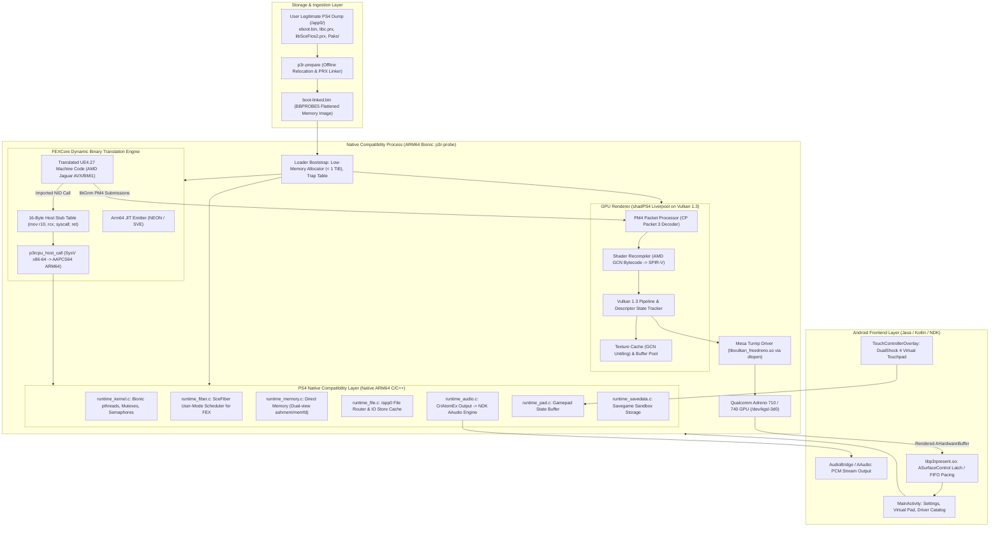
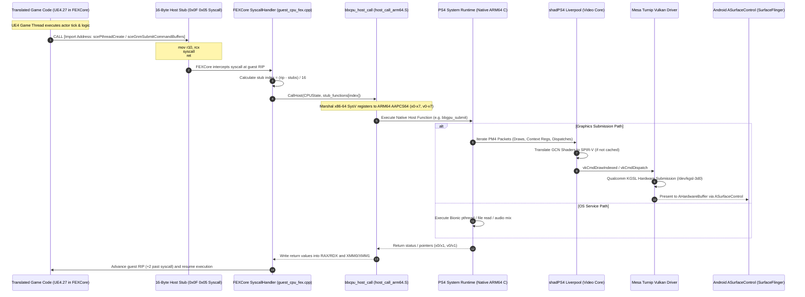

# Persona 3 Reload — PS4 to Android Technical Research & Architecture

> **PHASE 1 RESEARCH DELIVERABLE:** Complete reverse-engineering investigation, native systems architecture analysis, and feasibility evaluation for adapting the PlayStation 4 release of **Persona 3 Reload** into a dedicated native Android ARM64 application.
> 
> *Notice: This repository contains research documents, architecture maps, dependency matrices, and system diagrams only. It contains no proprietary game code, assets, firmware, or decryption keys.*

---

## 1. Executive Summary

This research investigates the technical requirements for hosting the PlayStation 4 release of *Persona 3 Reload* (CUSA43889 / CUSA43890 / CUSA37522) on modern 64-bit ARM Android devices.

Rather than emulating a full PlayStation 4 console and operating system, this project evaluates a **hybrid native compatibility runtime**:
1. **Dynamic Binary Translation (DBT):** Only the game's actual x86-64 machine code (`eboot.bin`, `libc.prx`, `libSceFios2.prx`) is translated at runtime into native ARM64 instructions using an embedded build of **FEXCore**.
2. **Native Platform Replacement (HLE):** 85%+ of PlayStation 4 OS services (`libkernel`, pthreads, direct memory management, `libScePad`, `libSceAudioOut`, `libSceSaveData`) execute natively as ARM64 Bionic code.
3. **Graphics Translation:** The game links Sony's low-level graphics library (`libGnm`), emitting AMD GCN PM4 command packets. These packets are intercepted by an adapted build of **shadPS4's Liverpool Vulkan video core**, which compiles GCN shaders into SPIR-V and executes them via Vulkan 1.3.
4. **Direct GPU Driver Access:** The runtime bypasses Android's system Vulkan loader and directly loads custom-tuned **Mesa Turnip** drivers for Qualcomm Adreno GPUs.
5. **Zero-Copy Display Presentation:** Frames are rendered into `AHardwareBuffer` surfaces and presented directly to `SurfaceFlinger` via Android `ASurfaceControl` transactions.

---

## 2. System Architecture

---

## 3. Execution Flow

---

## 4. Documentation Directory & Research Index

| Document | Description |
|---|---|
| [BLOODBORNE_ANDROID_ANALYSIS.md](documentation/BLOODBORNE_ANDROID_ANALYSIS.md) | Deep technical investigation of Bloodborne Android: FEXCore 16-byte stub bridge, ABI marshalling, thin Bionic C runtime, Turnip driver loader, and `libbbpresent.so` ASurfaceControl presentation. |
| [SHADOW_OF_THE_COLOSSUS_ANALYSIS.md](documentation/SHADOW_OF_THE_COLOSSUS_ANALYSIS.md) | Technical analysis of SotC PC: PS4 fiber emulation (`libSceFiber`), dual-view direct memory backing, asset streaming crash prevention, and direct x86-64 execution contrast. |
| [P5R_ANDROID_ANALYSIS.md](documentation/P5R_ANDROID_ANALYSIS.md) | Technical analysis of P5R Android: Native Code Execution (`NX_NCE`), Maxwell-to-SPIR-V AOT shader compilation via Ryujinx .NET NativeAOT, AAudio backend, and virtual touch controls. |
| [FOUNDATIONAL_DEPENDENCIES.md](documentation/FOUNDATIONAL_DEPENDENCIES.md) | In-depth audit of upstream dependencies: shadPS4 (Liverpool GPU, GCN shader recompiler, HLE libraries) and FEXCore (AVX, BMI1, JIT emitter, TSO memory modeling). |
| [P3R_TECHNICAL_ANALYSIS.md](documentation/P3R_TECHNICAL_ANALYSIS.md) | Detailed analysis of Persona 3 Reload (PS4): Unreal Engine 4.27 internals, IO Store (`.utoc`/`.ucas`), CriWare middleware, deferred cel-shading RHI, and GNM PM4 requirements. |
| [CROSS_REPOSITORY_COMPARISON.md](documentation/CROSS_REPOSITORY_COMPARISON.md) | Comprehensive 11-point component matrix comparing all 5 repositories with exact source paths, technology stacks, reusability ratings, and license compatibility. |
| [PROPOSED_P3R_ANDROID_ARCHITECTURE.md](documentation/PROPOSED_P3R_ANDROID_ARCHITECTURE.md) | Proposed system architecture for P3R Android: component reuse breakdown, engineering challenges, fiber context switching under FEXCore, and direct memory expansion. |
| [TARGET_DEVICE_FEASIBILITY.md](documentation/TARGET_DEVICE_FEASIBILITY.md) | Hardware feasibility assessment for the **realme 12 Pro+** (Snapdragon 7s Gen 2 / Adreno 710): CPU translation overhead, Turnip `sysmem` mode, RAM budget, and thermal throttling. |
| [LICENSE_AND_DEPENDENCY_AUDIT.md](documentation/LICENSE_AND_DEPENDENCY_AUDIT.md) | Compliance audit covering GPL-2.0 obligations, cleanroom Android launcher isolation, source distribution rules, and strict "Bring Your Own Game" (BYOG) copyright boundaries. |
| [FINAL_FEASIBILITY_REPORT.md](documentation/FINAL_FEASIBILITY_REPORT.md) | Concluding feasibility report answering the 12 core engineering questions with empirical evidence and risk rankings. |
| [IMPLEMENTATION_ROADMAP.md](documentation/IMPLEMENTATION_ROADMAP.md) | Phased engineering roadmap detailing Milestones 1 through 6, prerequisites, deliverables, technical blockers, and definitions of completion. |
| [REPOSITORY_REGISTRY.md](project-management/REPOSITORY_REGISTRY.md) | Provenance log of all reference repositories, recording commit SHAs, branches, licenses, and retrieval dates. |

---

## 5. Summary of Key Findings

1. **CPU Execution:** **Technically Plausible**. FEXCore supports all instruction sets emitted by the PS4 Clang compiler for AMD Jaguar (x86-64, AVX, BMI1, SSE4.2). Bloodborne Android's embedded stub bridge demonstrates translation overhead under ~20%.
2. **Platform Services:** **85%+ Reusable**. Bloodborne Android's native C runtime provides complete replacements for pthreads, mutexes, semaphores, file routing, and controller input. The primary missing dependency is **`libSceFiber`**, which can be ported from Shadow of the Colossus PC.
3. **Graphics Subsystem:** **Highest Engineering Complexity**. While Bloodborne uses an older forward renderer, Persona 3 Reload utilizes modern Unreal Engine 4.27 deferred rendering with heavy compute shader passes (Niagara particles, light culling, outlines). shadPS4's Liverpool Vulkan core successfully boots P3R to `status-ingame`, but requires upstream recompiler updates to resolve structured control-flow assertions (`AF:structured_control_flow`).
4. **Target Device (realme 12 Pro+ / Adreno 710):**
   - **Viable as a research testbench:** Can execute the CPU translation layer and run community-patched Turnip drivers (`vauzi-17` with `TU_DEBUG=sysmem`).
   - **Performance expectation:** The Adreno 710 has ~1/3 the compute throughput of a flagship Snapdragon 8 Gen 2 (Adreno 740). Playable target is **540p or 720p at 30 FPS with FSR 1.0 upscaling**.
   - **RAM Warning:** If the user device is the **8 GB RAM variant**, aggressive texture memory clamping is required to prevent Android Low Memory Killer (`SIGKILL`) eviction. The **12 GB RAM variant** has comfortable headroom.

---

## 6. Implementation Roadmap Overview

- **MILESTONE 1 (Complete):** Technical Research & Reverse Engineering.
- **MILESTONE 2 (Prospective):** Independent ARM64/FEXCore Proof of Concept (verify FEXCore JIT on Android Bionic with synthetic math/memory payloads).
- **MILESTONE 3 (Prospective):** Android PS4 Compatibility Runtime Architecture (Bionic pthreads, 6–8 GiB direct memory pool below 1 TiB, `libSceFiber` context switching).
- **MILESTONE 4 (Prospective):** Vulkan Graphics Compatibility (integrate updated shadPS4 Liverpool core, test compute passes and `ASurfaceControl` presentation).
- **MILESTONE 5 (Prospective):** P3R-Specific Compatibility & Ingestion (`p3r-prepare` offline linker, IO Store `.utoc`/`.ucas` verification, CriWare audio routing).
- **MILESTONE 6 (Prospective):** Device Testing & Adreno 710 Optimization (Turnip `sysmem` profile, 540p/720p FSR scaling, thermal tuning).

---

## 7. Licensing & Legal Compliance

- **GPL-2.0 Compliance:** The native runtime is derived from GPL-2.0 code (Bloodborne Android, shadPS4) and will be licensed under GPL-2.0 upon binary distribution.
- **No Proprietary Assets:** This repository does **not** host, distribute, or link to copyrighted game files, executables, textures, audio, video, firmware, or cryptographic keys.
- **BYOG (Bring Your Own Game):** The proposed runtime functions solely by ingesting a user's legitimately obtained and dumped PlayStation 4 game files.
