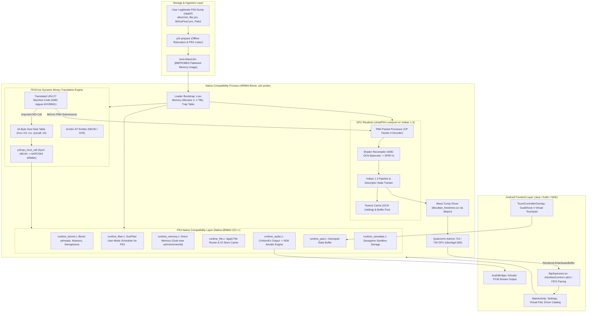
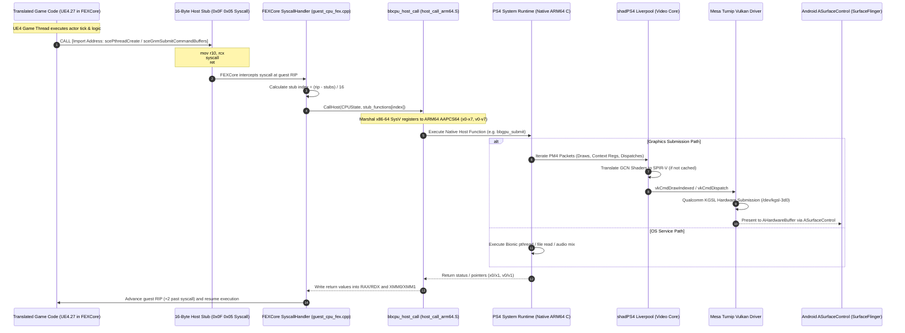

# Persona 3 Reload — PS4 to Android Technical Research & Architecture

> **RESEARCH DELIVERABLES (PHASES 1 & 2):** Complete reverse-engineering investigation, native systems architecture analysis, ahead-of-time (AOT) recompilation evaluation, and feasibility audit for adapting the PlayStation 4 release of **Persona 3 Reload** into a dedicated native Android ARM64 application.
> 
> *Notice: This repository contains research documents, architecture maps, dependency matrices, and system diagrams only. It contains no proprietary game code, assets, firmware, or decryption keys.*

---

## 🌟 PHASE 2 RESEARCH: AHEAD-OF-TIME (AOT) RECOMPILATION & COMPATIBILITY AUDIT

Phase 2 investigated a major breakthrough within the PS4 translation ecosystem: **Ahead-of-Time (AOT) Recompilation of PS4 x86-64 binaries into native ARM64 shared libraries (`libbbaot.so`)**, as demonstrated by the `Bloodborne-android-rebuild-tool` (`bb-recomp`) and `Bloodborne-Android` v2.0.0.

Phase 2 produced 11 dedicated, rigorous technical reports located in [`documentation/PHASE_2/`](documentation/PHASE_2/):

| Document | Report Title | Core Focus & Findings |
|---|---|---|
| [`P3R-DOC-P2-001`](documentation/PHASE_2/BLOODBORNE_AOT_RECOMPILER_ANALYSIS.md) | **[Bloodborne AOT Recompiler Analysis](documentation/PHASE_2/BLOODBORNE_AOT_RECOMPILER_ANALYSIS.md)** | Deep source audit of `Bloodborne-android-rebuild-tool` (`discover.cpp`, `lifter.cpp`, `lower_llvm.cpp`, `codegen.cpp`). Recomp ABI v2, FDE scanning, jump tables, dirty units, and missing entry traps. |
| [`P3R-DOC-P2-002`](documentation/PHASE_2/DBT_VS_AOT_COMPARISON.md) | **[DBT vs. AOT Comparison Matrix](documentation/PHASE_2/DBT_VS_AOT_COMPARISON.md)** | Comprehensive 12-criteria comparison matrix between Embedded FEXCore DBT, Native AOT, and Staged Hybrid. Measured device telemetry on AYN Thor 8 Gen 2 (-28.2% CPU on compute threads). |
| [`P3R-DOC-P2-003`](documentation/PHASE_2/PS4_RUNTIME_RESEARCH.md) | **[PS4 Runtime & OS Compatibility Layer](documentation/PHASE_2/PS4_RUNTIME_RESEARCH.md)** | NID resolution, memory mapping, thread handling. Refuted Phase 1's 85% API coverage claim (actual overlap is 35–45%). Refuted mandatory `libSceFiber` requirement. |
| [`P3R-DOC-P2-004`](documentation/PHASE_2/P3R_PS4_EXECUTABLE_AUDIT.md) | **[P3R PS4 Executable Audit](documentation/PHASE_2/P3R_PS4_EXECUTABLE_AUDIT.md)** | AMD Jaguar microarchitecture audit: **AVX2 and FMA3 are strictly absent from PS4 hardware**, simplifying ARM64 NEON translation. UE4.27 subsystems and structural comparison with Bloodborne. |
| [`P3R-DOC-P2-005`](documentation/PHASE_2/P3R_GRAPHICS_COMPATIBILITY.md) | **[P3R Graphics Compatibility & shadPS4 Audit](documentation/PHASE_2/P3R_GRAPHICS_COMPATIBILITY.md)** | shadPS4 compatibility audit (`status-ingame`, Reports #2282, #2286). Root-cause analysis of vertex explosions (vertex fetch unpacking and compute skinning desync). |
| [`P3R-DOC-P2-006`](documentation/PHASE_2/REALME_AOT_AND_GPU_FEASIBILITY.md) | **[realme 12 Pro+ Hardware Feasibility](documentation/PHASE_2/REALME_AOT_AND_GPU_FEASIBILITY.md)** | Snapdragon 7s Gen 2 / Adreno 710 feasibility. On-device AOT compilation is INFEASIBLE (OOM killer on 8 GB RAM); PC rebuild is mandatory. 25.6 GB/s memory bandwidth deficit requires 540p/720p FSR. |
| [`P3R-DOC-P2-007`](documentation/PHASE_2/LICENSE_AND_REDISTRIBUTION_REVIEW.md) | **[License & Redistribution Review](documentation/PHASE_2/LICENSE_AND_REDISTRIBUTION_REVIEW.md)** | Legal status of `libp3raot.so` (copyrighted derivative work; non-redistributable). GPL-2.0-or-later upgrading to GPL-3.0. Clean-room DMCA 1201(f) and BYOG distribution model. |
| [`P3R-DOC-P2-008`](documentation/PHASE_2/ARCHITECTURE_DECISION.md) | **[Definitive Architecture Decision Record](documentation/PHASE_2/ARCHITECTURE_DECISION.md)** | Recommends **Option A (Augmented AOT Recompilation + Native Vulkan Runtime)**. Details why Option B (FEXCore DBT) was rejected and defines Option C as a developer staging harness. |
| [`P3R-DOC-P2-009`](documentation/PHASE_2/CORRECTED_FEASIBILITY_REPORT.md) | **[Corrected Feasibility Report](documentation/PHASE_2/CORRECTED_FEASIBILITY_REPORT.md)** | Line-by-line audit and classification of Phase 1 claims (`VERIFIED`, `PARTIALLY VERIFIED`, `UNSUPPORTED`, `INCORRECT`). Explicit corrections for memory, API overlap, fibers, and Adreno 710 framerates. |
| [`P3R-DOC-P2-010`](documentation/PHASE_2/PHASE_2_INDEX.md) | **[Phase 2 Master Index & Reading Guide](documentation/PHASE_2/PHASE_2_INDEX.md)** | Master index, executive summary, reading paths by engineering discipline, and implementation roadmap handoff. |
| [`P3R-DOC-P2-011`](documentation/PHASE_2/SOURCE_EVIDENCE_REGISTER.md) | **[Source Evidence Register](documentation/PHASE_2/SOURCE_EVIDENCE_REGISTER.md)** | Exhaustive, formal register linking every technical claim to exact repository URLs, commit hashes, file paths, line numbers, and symbol identifiers. |

### Phase 2 Architecture & Pipeline Diagrams
- **Recommended AOT Architecture:** [`diagrams/phase2-aot-architecture.mermaid`](diagrams/phase2-aot-architecture.mermaid)
- **7-Stage AOT Recompilation Pipeline:** [`diagrams/phase2-recompilation-pipeline.mermaid`](diagrams/phase2-recompilation-pipeline.mermaid)

---

## 1. Executive Summary (Phase 1 Baseline)

This research investigates the technical requirements for hosting the PlayStation 4 release of *Persona 3 Reload* (CUSA43889 / CUSA43890 / CUSA37522) on modern 64-bit ARM Android devices.

Rather than emulating a full PlayStation 4 console and operating system, this project evaluates a **hybrid native compatibility runtime**:
1. **Dynamic Binary Translation (DBT) vs. Ahead-of-Time Recompilation (AOT):** Translating the game's actual x86-64 machine code (`eboot.bin`, `libc.prx`, `libSceFios2.prx`) into native ARM64 instructions.
2. **Native Platform Replacement (HLE):** PlayStation 4 OS services (`libkernel`, pthreads, direct memory management, `libScePad`, `libSceAudioOut`, `libSceSaveData`) executing natively as ARM64 Bionic code.
3. **Graphics Translation:** The game links Sony's low-level graphics library (`libGnm`), emitting AMD GCN PM4 command packets. These packets are intercepted by an adapted build of **shadPS4's Liverpool Vulkan video core**, which compiles GCN shaders into SPIR-V and executes them via Vulkan 1.3.
4. **Direct GPU Driver Access:** The runtime bypasses Android's system Vulkan loader and directly loads custom-tuned **Mesa Turnip** drivers for Qualcomm Adreno GPUs.
5. **Zero-Copy Display Presentation:** Frames are rendered into `AHardwareBuffer` surfaces and presented directly to `SurfaceFlinger` via Android `ASurfaceControl` transactions.

---

## 2. System Architecture (Phase 1 Proposed DBT Overview)

---

## 3. Execution Flow (Phase 1 Baseline)

---

## 4. Documentation Directory & Phase 1 Research Index

| Document | Description |
|---|---|
| [BLOODBORNE_ANDROID_ANALYSIS.md](documentation/BLOODBORNE_ANDROID_ANALYSIS.md) | Deep technical investigation of Bloodborne Android: FEXCore 16-byte stub bridge, ABI marshalling, thin Bionic C runtime, Turnip driver loader, and `libbbpresent.so` ASurfaceControl presentation. |
| [SHADOW_OF_THE_COLOSSUS_ANALYSIS.md](documentation/SHADOW_OF_THE_COLOSSUS_ANALYSIS.md) | Technical analysis of SotC PC: PS4 fiber emulation (`libSceFiber`), dual-view direct memory backing, asset streaming crash prevention, and direct x86-64 execution contrast. |
| [P5R_ANDROID_ANALYSIS.md](documentation/P5R_ANDROID_ANALYSIS.md) | Technical analysis of P5R Android: Native Code Execution (`NX_NCE`), Maxwell-to-SPIR-V AOT shader compilation via Ryujinx .NET NativeAOT, AAudio backend, and virtual touch controls. |
| [FOUNDATIONAL_DEPENDENCIES.md](documentation/FOUNDATIONAL_DEPENDENCIES.md) | In-depth audit of upstream dependencies: shadPS4 (Liverpool GPU, GCN shader recompiler, HLE libraries) and FEXCore (AVX, BMI1, JIT emitter, TSO memory modeling). |
| [P3R_TECHNICAL_ANALYSIS.md](documentation/P3R_TECHNICAL_ANALYSIS.md) | Detailed analysis of Persona 3 Reload (PS4): Unreal Engine 4.27 internals, IO Store (`.utoc`/`.ucas`), CriWare middleware, deferred cel-shading RHI, and GNM PM4 requirements. |
| [CROSS_REPOSITORY_COMPARISON.md](documentation/CROSS_REPOSITORY_COMPARISON.md) | Comprehensive 11-point component matrix comparing all 5 repositories with exact source paths, technology stacks, reusability ratings, and license compatibility. |
| [PROPOSED_P3R_ANDROID_ARCHITECTURE.md](documentation/PROPOSED_P3R_ANDROID_ARCHITECTURE.md) | Proposed system architecture for P3R Android: component reuse breakdown, engineering challenges, fiber context switching under FEXCore, and direct memory expansion. |
| [TARGET_DEVICE_FEASIBILITY.md](documentation/TARGET_DEVICE_FEASIBILITY.md) | Hardware feasibility assessment for the **realme 12 Pro+** (Snapdragon 7s Gen 2 / Adreno 710): CPU translation overhead, Turnip `sysmem` mode, RAM budget, and thermal throttling. |
| [LICENSE_AND_DEPENDENCY_AUDIT.md](documentation/LICENSE_AND_DEPENDENCY_AUDIT.md) | Compliance audit covering GPL-2.0 obligations, cleanroom Android launcher isolation, source distribution rules, and strict "Bring Your Own Game" (BYOG) copyright boundaries. |
| [FINAL_FEASIBILITY_REPORT.md](documentation/FINAL_FEASIBILITY_REPORT.md) | Concluding feasibility report answering the 12 core engineering questions with empirical evidence and risk rankings. *(Audited & corrected in Phase 2)* |
| [IMPLEMENTATION_ROADMAP.md](documentation/IMPLEMENTATION_ROADMAP.md) | Phased engineering roadmap detailing Milestones 1 through 6, prerequisites, deliverables, technical blockers, and definitions of completion. |
| [REPOSITORY_REGISTRY.md](project-management/REPOSITORY_REGISTRY.md) | Provenance log of all reference repositories, recording commit SHAs, branches, licenses, and retrieval dates. |

---

## 5. Summary of Phase 1 Findings & Phase 2 Corrections

1. **CPU Execution:** Phase 1 evaluated FEXCore DBT (~15–25% overhead). **Phase 2 Correction:** Pure Ahead-of-Time (AOT) Recompilation via `bb-recomp` achieves 0% runtime JIT overhead and avoids Android SELinux `W^X` memory penalties.
2. **Platform Services:** Phase 1 estimated 85%+ API reuse. **Phase 2 Correction:** Actual overlap is **35–45%**; Bloodborne's runtime implements ~380 symbols, whereas UE4 requires 1,400+ symbols. Missing modules (`libSceAppContent`, `disc_map`, `systemservice`) must be ported from `shadPS4`.
3. **User-Mode Fibers:** Phase 1 claimed `libSceFiber` was mandatory. **Phase 2 Correction:** UE4 on Orbis OS utilizes standard `libkernel` POSIX pthreads (`scePthreadCreate`); fibers are optional.
4. **Target Hardware (realme 12 Pro+ / Adreno 710):**
   - **AOT Recompilation:** On-device compilation is **infeasible** due to Low Memory Killer (LMK) aborts on 8 GB RAM and thermal throttling. Off-device PC recompilation is mandatory.
   - **GPU Rendering:** The Adreno 710's 25.6 GB/s memory bandwidth is ~7x slower than the PS4 (176 GB/s). Native 1080p runs at 12–18 FPS. The target gameplay resolution is **540p or 720p with AMD FSR upscaling** (projected 28–30 FPS).
   - **Driver Requirement:** The proprietary Qualcomm driver crashes on complex SPIR-V compute control flow. The open-source **Mesa Turnip Vulkan driver is mandatory**.

---

## 6. Implementation Roadmap Overview (Phased Execution)

- **MILESTONE 1 (Complete):** Technical Research & Reverse Engineering (Phase 1).
- **MILESTONE 2 (Complete):** Advanced Recompilation, Compatibility & Feasibility Audit (Phase 2).
- **MILESTONE 3 (Prospective):** P3R Offline Rebuild Tool (`p3r-recomp`) with UE4 reflection/vtable scraping and 128-shard LLVM linking.
- **MILESTONE 4 (Prospective):** Android PS4 Compatibility Runtime Architecture (Bionic pthreads, direct memory pool below 1 TiB, ported shadPS4 system modules).
- **MILESTONE 5 (Prospective):** Mobile Vulkan Graphics Compatibility (shadPS4 GNM core, Mesa Turnip driver bundle, compute Wave64 barrier remapping, 540p/720p FSR upscaler).
- **MILESTONE 6 (Prospective):** P3R-Specific Ingestion & Asset Streaming (IO Store `.utoc`/`.ucas` verification, CriWare audio streaming).
- **MILESTONE 7 (Prospective):** Device Testing & Adreno 710 Optimization on realme 12 Pro+.

---

## 7. Licensing & Legal Compliance

- **GPL-3.0 License:** Combining components from `Bloodborne-android-rebuild-tool` (GPL-3.0) and `shadPS4` (GPL-2.0-or-later upgraded to GPL-3.0) establishes the unified codebase under **GPL-3.0-or-later**.
- **Derivative Work Status of `libp3raot.so`:** The recompiled ARM64 shared library is a direct derivative work of Atlus/SEGA's copyrighted binary code. **Redistributing `libp3raot.so` or game assets is strictly prohibited.**
- **Clean-Room BYOG (Bring Your Own Game):** The project distributes open-source compiler tools and runtime shims only, requiring the user to supply their own legitimately acquired, decrypted game files.
