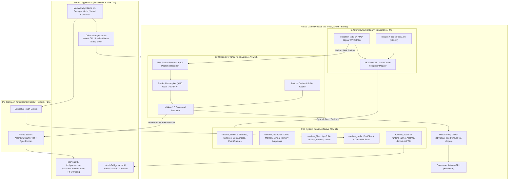
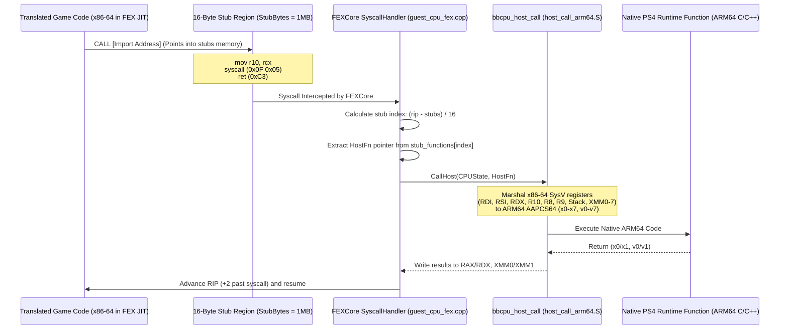

# Bloodborne Android Port Architecture & Technical Analysis

**Document:** `documentation/BLOODBORNE_ANDROID_ANALYSIS.md`  
**Reference Repository:** `references/bloodborne-android`  
**Source URL:** `https://github.com/StanTheMackiar/bloodborne-android-port`  
**Commit Hash:** `631b3f568bbf4d25abd5e05340c21becf2ca2a9b`  
**Branch:** `master`  
**License:** GNU General Public License v2.0 (`GPL-2.0`)  
**Investigation Date:** 2026-11-02  

---

## 1. Executive Architecture Summary

Bloodborne Android is an execution runtime that allows the PlayStation 4 retail release of *Bloodborne* (specifically update **v1.09**, across CUSA00900, CUSA00207, CUSA00208, CUSA00299, CUSA01363) to execute on Android ARM64 devices without running a full PS4 operating system emulator.

The system operates as a **hybrid native compatibility runtime**:
1. **Game CPU Code (x86-64):** Only the game's actual executable code (`eboot.bin`) and two shipped PS4 modules (`sce_module/libc.prx` and `libSceFios2.prx`) run through dynamic binary translation (DBT) via an embedded build of **FEXCore**.
2. **Platform & System Runtime (Native ARM64):** All PS4 operating system interfaces (`libkernel`, `libScePad`, `libSceAudioOut`, `libSceSaveData`, `libSceVideoOut`, `libc` replacements) execute natively on the ARM64 host processor compiled via the Android NDK.
3. **Graphics Pipeline (Native ARM64):** The game links Sony's low-level graphics library (`libGnm`) statically into `eboot.bin`, which emits AMD GCN Command Processor (PM4) packets. These PM4 packets are intercepted by a vendored, modified port of **shadPS4's Liverpool Vulkan renderer**, recompiled for ARM64 Android Bionic, which translates GCN bytecode to SPIR-V on the fly and dispatches Vulkan draw calls.
4. **Vulkan GPU Driver:** The native game process bypasses Android's standard system Vulkan loader (`libvulkan.so`) and directly `dlopen()`s bundled, pre-compiled Android builds of **Mesa Turnip** (open-source Qualcomm Adreno driver) with direct KGSL/DRM kernel device nodes.
5. **Display Presentation:** The game process renders into `AHardwareBuffer` surfaces and passes buffer file descriptors across a local UNIX domain socket to the Android Application frontend (`libbbpresent.so`), which presents them directly via `ASurfaceControl` transactions to `SurfaceFlinger`.



---

## 2. Upstream Lineage & Project Boundaries

Inspection of `gpu/VENDOR.txt` and the repository history establishes the precise boundaries between upstream code and the project's own contributions:

1. **Upstream shadPS4:**
   - **Commit:** `b4e7ae776071ceb1dd35004577a8719481e1d258` (2026-10-02).
   - **Vendored Directories in `gpu/`:** `src/video_core`, `src/shader_recompiler`, `src/common`, `src/core/libraries/{gnmdriver,videoout}`, `externals/gcn`, `externals/sirit`, `externals/half`.
   - **Kernel & Helpers:** `src/core/libraries/kernel/{orbis_error,posix_error,time,process,equeue}`, `src/core/libraries/avplayer`, `src/core/libraries/videodec/video_utils`.
   - **Selective Backports:** Specific shader recompiler patches (V_INTERP_MOV_F32, compute shader FP mode, S_SUBB_U32 SCC wrap, 32-bit float literals, V_BFM_B32, ADDC, V_CVT_PK_U8_F32, V_ALIGNBIT).
2. **Upstream FEX (FEXCore):**
   - Vendored / linked as a dynamic library via `cpu/fex_project.cmake` and `cpu/bbcpu.cmake`.
   - Configured specifically for ARM64 host JIT execution without Wine or generic Linux x86 root filesystem emulation.
3. **Upstream bloodborne_pc (DeadInside28 / Supermedo):**
   - Serves as the conceptual foundation for the C-based thin compatibility runtime (`probe.c`, `runtime.c`, `runtime_*.c`).
4. **Bloodborne Android's Original / Tailored Code:**
   - `cpu/guest_cpu_fex.cpp` and `cpu/host_call_arm64.S`: Custom high-performance ABI bridge between FEXCore guest state and ARM64 host runtime.
   - `tools/android/prepare/`: Standalone offline preparation toolchain (`bb-prepare`, `ps4.cpp`, `link.cpp`) that parses PS4 ELF/SELF binaries and merges them into a single relocatable image (`BBPROBE5`).
   - `tools/android/present/`: Low-latency zero-copy frame presentation pipeline using `AHardwareBuffer`, UNIX domain sockets, and `ASurfaceControl`.
   - `tools/android/frontend/`: Complete native Android launcher, Virtual Touchscreen overlay, dynamic GPU driver installer/selector, and APK packaging infrastructure.

---

## 3. Subsystem Breakdown

### 3.1. CPU Translation Layer (FEXCore Integration)

**Key Files:**
- `cpu/guest_cpu_fex.cpp` (547 lines)
- `cpu/host_call_arm64.S` (50 lines)
- `src/guest_cpu.h` (132 lines)

#### Architecture of the Guest-Host CPU Bridge
The game's x86-64 binary must execute on ARM64 hardware without paying the penalty of emulating system calls or runtime functions. `cpu/guest_cpu_fex.cpp` achieves this through a custom `FEXCore::HLE::SyscallHandler` and a memory region of 16-byte code stubs:



#### Detailed Execution Mechanism:
1. **Stub Allocation & Construction (`guest_cpu_fex.cpp#L77-L86`):**
   - Allocates a 1 MB executable memory region (`StubBytes = 1 << 20`) divided into 16-byte slots (`StubSize = 16`).
   - Each stub consists of the bytes:
     ```assembly
     mov r10, rcx    ; 49 89 ca (preserves 4th parameter before syscall overwrites rcx with rip)
     syscall         ; 0f 05
     ret             ; c3
     ```
2. **Import Resolution (`probe.c#L647-L670`):**
   - When the game's relocation table (`R_X86_64_JUMP_SLOT` or `R_X86_64_GLOB_DAT`) refers to an imported PS4 symbol, the runtime assigns an index in `stub_functions[]` and writes the stub's virtual address into the game's GOT/PLT.
3. **Syscall Interception (`guest_cpu_fex.cpp#L192-L236`):**
   - FEXCore invokes `Handler::HandleSyscall(FEXCore::Core::CpuStateFrame* frame)`.
   - The handler computes:
     ```cpp
     const uint64_t rip = s.rip;
     const uint64_t offset = rip - reinterpret_cast<uintptr_t>(stubs);
     if (offset < StubBytes && offset % StubSize == SyscallOffset) {
         void* fn = stub_functions[offset / StubSize];
         CallHost(s, fn);
         s.rip = rip + 2; // Advance past 0x0F 0x05 to RET
         return;
     }
     ```
4. **Register & ABI Marshalling (`cpu/host_call_arm64.S`):**
   - `CallHost` reads x86-64 System V AMD64 ABI argument registers (`RDI`, `RSI`, `RDX`, `R10`, `R8`, `R9`, stack arguments, and vector registers `XMM0`–`XMM7`).
   - Calls `bbcpu_host_call` in assembly:
     ```assembly
     bbcpu_host_call:
         // Loads arguments from struct HostArgs into ARM64 registers x0-x7, v0-v7
         // Calls native host function fn (x0..x7)
         // Stores return values x0, x1 and v0, v1 into HostResult
     ```
   - Sets guest `RAX`, `RDX`, `XMM0`, and `XMM1`.
5. **Memory Constraints & Low-Memory Mapping:**
   - The PS4 hardware (AMD Jaguar) and game executable pack pointers into 40 or 47 bits.
   - On 64-bit Android, Bionic's Scudo allocator may return addresses in the upper 48-bit address space.
   - `runtime_low_map` allocates memory strictly below the 1 TiB boundary using `mmap(..., MAP_PRIVATE | MAP_ANONYMOUS | MAP_FIXED_NOREPLACE, ...)` to ensure 40-bit pointer packing does not truncate high bits.
   - Tagged pointer support is explicitly disabled via:
     `mallopt(M_BIONIC_SET_HEAP_TAGGING_LEVEL, M_HEAP_TAGGING_LEVEL_NONE)`.

---

### 3.2. PS4 Compatibility Runtime

**Key Files:**
- `src/runtime.c` & `src/runtime.h`: Core runtime dispatcher, TLS management, lifecycle callbacks.
- `src/runtime_kernel.c`: Threads, mutexes, semaphores, event flags.
- `src/runtime_memory.c`: Direct memory (`sceKernelAllocateDirectMemory`), mmap, page protections.
- `src/runtime_file.c`: Virtual filesystem routing `/app0/` to host directories.
- `src/runtime_pad.c`: Controller input mapping (DualShock 4 -> Android MotionEvent/KeyEvent).
- `src/runtime_audio.c` & `src/runtime_ajm.c`: Sony AJM (Audio Job Manager) and ATRAC9 audio decoding.
- `src/runtime_savedata.c`: Save game mounting and directory sandboxing.
- `src/import_names.inc`: NID to symbol name translation table.
- `src/probe.c`: Image loading, relocations, patching, execution bootstrap.

#### PS4 Symbol Resolution by NID
PS4 dynamic linking identifies exported and imported functions by an 11-character hash called a **NID** (e.g. `4J2sUJmuHZQ#p#J` for `sceKernelGetProcessTime`).
- In `src/import_names.inc`, 750+ NIDs are cataloged.
- In `src/runtime.c`, `runtime_resolve(name, is_data)` maps these symbols directly to native C implementations.
- If a function is not implemented, the loader installs a diagnostic trap stub (`probe.c#L646-L655`) that logs the missing symbol name and its calling guest RIP before safely halting.

#### Threading & Synchronization
- PS4 `scePthread*` APIs are mapped directly to Android Bionic pthreads.
- Mutexes (`pthread_mutex_t`) and condition variables (`pthread_cond_t`) map 1:1 to host OS primitives.
- Kernel event queues (`SceKernelEqueue`) are implemented natively in `gpu/shadps4/src/core/libraries/kernel/equeue.cpp` using Linux `eventfd` and `epoll`.

#### Memory Subsystem
- The PS4 provides direct physical memory allocation (`sceKernelAllocateDirectMemory`, `sceKernelMapDirectMemory`) alongside standard POSIX virtual memory.
- `runtime_memory.c` implements these via anonymous shared memory mappings (`ashmem` / `memfd_create` / `mmap`), ensuring that the game's custom heap managers can map the same physical range into both CPU-cached and GPU-uncached virtual address spaces simultaneously (aliased virtual mappings).

---

### 3.3. Graphics Subsystem (shadPS4 Liverpool & Mesa Turnip)

**Key Files:**
- `gpu/bbgpu.h` & `gpu/bbgpu.cpp`: GPU subsystem lifecycle and configuration.
- `gpu/shadps4/src/video_core/amdgpu/liverpool.cpp`: Liverpool GPU emulation and PM4 processing.
- `gpu/shadps4/src/video_core/renderer_vulkan/`: Vulkan 1.3 implementation of GCN states.
- `gpu/shadps4/src/shader_recompiler/`: Translation of GCN ISA assembly to SPIR-V.
- `tools/android/build_turnip_android.sh`: Mesa Turnip custom build recipe.

#### GNM / PM4 Packet Translation
*Bloodborne* statically links `libGnm`, meaning that GNM function calls do not go through dynamic linking. Instead, `libGnm` writes PM4 command packets into command buffers allocated in guest memory.
- The runtime hooks the PM4 submission entry point (`sceGnmSubmitCommandBuffers`).
- The Liverpool GPU processor iterates through PM4 packets:
  - `PACKET3_DRAW_INDEX_AUTO`, `PACKET3_DRAW_INDEX_2`: Mapped to `vkCmdDraw` / `vkCmdDrawIndexed`.
  - `PACKET3_SET_CONTEXT_REG`: Configures rasterizer state, depth/stencil tests, blend modes.
  - `PACKET3_SET_SH_REG`: Binds shader register constants, resource descriptors, sampler descriptors.
  - `PACKET3_DISPATCH_DIRECT`: Mapped to `vkCmdDispatch` for compute shaders.

#### Shader Recompilation (GCN to SPIR-V)
1. **GCN Binary Parsing:** Shaders compiled for PS4's Liverpool GPU are in AMD GCN bytecode.
2. **Intermediate Representation:** The recompiler parses GCN Scalar ALU (SALU) and Vector ALU (VALU) instructions into an SSA IR (Sirit-backed).
3. **SPIR-V Generation:** The IR is emitted as SPIR-V binary code targeting Vulkan 1.3.
4. **Vulkan Pipeline Creation:** Pipelines are created using `vkCreateGraphicsPipelines` / `vkCreateComputePipelines` and cached to disk in the user directory (`user/cache/`).

#### Driver Architecture (Direct Mesa Turnip Loading)
Standard Android devices use Qualcomm's proprietary driver (`libvulkan.so`), which has strict memory limits, buggy descriptor indexing, and lack of certain Vulkan extensions critical for GCN translation (such as `VK_EXT_custom_border_color`, `VK_KHR_shader_float16_int8`, `VK_EXT_scalar_block_layout`, `VK_EXT_robustness2`).
- Bloodborne Android bundles pre-compiled Mesa Turnip shared libraries (`libvulkan_freedreno.so`).
- The game process bypasses the Android system loader and directly `dlopen()`s the Turnip driver library, talking directly to the Qualcomm KGSL kernel driver (`/dev/kgsl-3d0`).

---

### 3.4. Android Application Architecture

**Key Files:**
- `tools/android/frontend/AndroidManifest.xml`
- `tools/android/frontend/src/ro/cobrabm/fexdroid/MainActivity.java`
- `tools/android/frontend/src/ro/cobrabm/fexdroid/AutoDriver.java`
- `tools/android/frontend/src/ro/cobrabm/fexdroid/TouchControllerOverlay.java`
- `tools/android/frontend/jni/bbpresent/bbpresent.c`
- `tools/android/prepare/bb_prepare.cpp`

#### Presentation Architecture (`bbpresent.c`)
- Uses Android NDK `ASurfaceControl` (API 29+) and `ASurfaceTransaction`.
- The native game process renders into `AHardwareBuffer` instances.
- Passes the buffer file descriptor and sync fence via a local UNIX domain socket to `libbbpresent.so`.
- `libbbpresent.so` executes transaction commits to `SurfaceFlinger`.
- Implements two pacing modes:
  - **Newest-wins ("VSync off"):** Applies transactions immediately; SurfaceFlinger latches the newest buffer per refresh cycle. Minimum latency.
  - **FIFO ("VSync on"):** Restricts to one in-flight transaction; queues subsequent frames and gates on `ASurfaceTransaction_setOnCommit` (API 31+) to ensure smooth frame pacing.

#### Offline Game Preparation (`bb_prepare.cpp`)
To avoid complex ELF parsing, dynamic relocation processing, and module binding on every app launch:
- The user points the app to an extracted Bloodborne v1.09 directory.
- `bb_prepare` parses `eboot.bin`, `libc.prx`, and `libSceFios2.prx`.
- Resolves all internal relocations (`R_X86_64_RELATIVE`, `R_X86_64_GLOB_DAT`, `R_X86_64_JUMP_SLOT`).
- Combines the code and data segments into a pre-linked binary blob (`boot-linked.bin` with `BBPROBE5` header).
- At runtime, `probe.c` loads `boot-linked.bin` in a single `fread()` and applies page protections in milliseconds.

---

## 4. Key Limitations & Reusability Assessment

| Component | Implementation in Bloodborne Android | Reusability for Persona 3 Reload | Necessary Modifications |
|---|---|---|---|
| **FEXCore CPU Bridge** | `guest_cpu_fex.cpp`, `host_call_arm64.S` | **HIGH** | Must expand stub table and verify instruction set support for Unreal Engine 4 JIT / tasks. |
| **Loader & Relocation** | `bb_prepare.cpp`, `probe.c` | **HIGH** | Generic ELF/PRX linker can link UE4 `eboot.bin` and dependencies into a `BOOT` image. |
| **Kernel / Synchronization** | `runtime_kernel.c`, `runtime_mutex.c` | **MEDIUM-HIGH** | UE4 makes extensive use of worker threads, fibers (`libSceFiber`), and semaphores. |
| **Direct Memory** | `runtime_memory.c` | **MEDIUM** | UE4 uses massive page allocations; must verify 40-bit address packing and Scudo limits. |
| **Graphics (PM4 -> Vulkan)** | `gpu/shadps4/` | **MEDIUM** | Bloodborne uses a customized forward renderer; P3R uses Unreal Engine 4's Deferred/Forward renderer with extensive compute shaders, cascaded shadow maps, and cel-shading post-processing. |
| **Turnip Driver Bundling** | `AutoDriver.java`, `tools/android/build_turnip_android.sh` | **HIGH** | The dynamic driver loading pattern is reusable for Qualcomm Adreno devices. |
| **Presentation Pipeline** | `libbbpresent.so` (ASurfaceControl) | **VERY HIGH** | 100% reusable zero-copy frame presentation pipeline. |
| **Virtual Touchscreen** | `TouchControllerOverlay.java` | **HIGH** | Reusable for standard DualShock 4 on-screen controls. |
| **Game Speed / FPS Hooks** | `bbport_frame_rate.cpp` | **NONE** | Specific to FromSoftware's engine (Bloodborne 30 FPS fixed timestep); UE4 uses delta time (`Tick(DeltaTime)`). |

