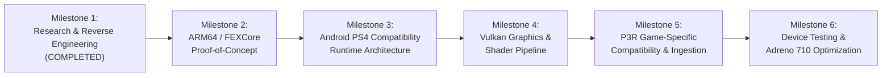

# Implementation Roadmap: Persona 3 Reload (PS4 to Android)

**Document:** `documentation/IMPLEMENTATION_ROADMAP.md`  
**Project Phase:** Prospective Engineering Roadmap (Phases 2 through 6)  
**Investigation Date:** 2026-11-02  
**Status:** Planning Only — Implementation is NOT started during Phase 1.  

---

## 1. Roadmap Overview & Phased Progression

---

## 2. Detailed Milestone Specifications

### MILESTONE 1: Research & Reverse Engineering (CURRENT PHASE)
- **Status:** **COMPLETE**.
- **Prerequisites:** Access to reference repositories (`bloodborne-android`, `shadow-of-the-colossus-pc`, `p5r-android`, `shadps4`, `fexcore`), REA tooling, and target device specifications.
- **Expected Deliverables:**
  - Complete technical documentation suite (Analyses, Comparisons, Proposed Architecture, Device Feasibility, Licensing Audit, Final Feasibility Report).
  - Preserved reference repositories with recorded Git metadata and licenses.
- **Technical Blockers:** None (Research phase).
- **Definition of Completion:** All 12 feasibility questions answered with empirical evidence; architectural plan approved by user.

---

### MILESTONE 2: Independent ARM64 / FEXCore Proof of Concept
- **Objective:** Establish an isolated command-line ARM64 test executable running under Android Bionic that embeds FEXCore and executes a minimal x86-64 ELF test payload via the 16-byte `syscall` stub bridge.
- **Prerequisites:** Android NDK (r26b or r28), CMake 3.22+, Clang ARM64 toolchain.
- **Expected Deliverables:**
  - `p3r-fex-poc`: A standalone native Bionic executable for ARM64 Android.
  - Verification of `guest_cpu_fex.cpp` and `host_call_arm64.S` compiling cleanly against the latest FEXCore library.
  - Synthetic x86-64 test payload demonstrating AVX vector math, BMI1 instructions, and host function calling across the ABI boundary.
- **Technical Blockers:**
  - Bionic C library symbol mismatches or Scudo allocator heap pointer tagging.
- **Required Dependencies:** `references/fexcore`, Android NDK.
- **Testing Criteria:**
  - Test binary pushes SysV arguments into guest registers, jumps to stub, catches syscall in FEXCore, marshals to ARM64 host function, and returns verified calculated result.
- **Definition of Completion:** 100% pass rate on x86-64 math, memory, and ABI round-trip test suites running on physical ARM64 Android hardware via `adb shell`.

---

### MILESTONE 3: Android PS4 Compatibility Runtime Architecture
- **Objective:** Build the core native C compatibility runtime (`p3r-runtime`) providing PS4 kernel, memory, thread, and fiber replacements.
- **Prerequisites:** Milestone 2 completion.
- **Expected Deliverables:**
  - `p3r-runtime`: Native ARM64 shared library.
  - Implemented `runtime_kernel.c` (threads, mutexes, semaphores, event queues).
  - Implemented `runtime_memory.c` with expanded 6–8 GiB direct physical memory mapping below 1 TiB.
  - Integrated `runtime_fiber.c` adapted from Shadow of the Colossus PC with guest-aware FEXCore context switching.
  - Implemented `runtime_file.c` supporting virtual filesystem mounting of `/app0/`.
- **Technical Blockers:**
  - Ensuring fiber context swaps do not desynchronize FEXCore's internal call-return tracking stack.
- **Required Dependencies:** Android Bionic pthreads, Linux `eventfd`, `ashmem`/`memfd`.
- **Testing Criteria:**
  - A mock x86-64 executable creates 8 guest worker threads, switches between 16 fibers, allocates 4 GiB of direct memory, and reads files from `/app0/`.
- **Definition of Completion:** All thread, memory, and fiber unit tests execute without crashes, deadlocks, or memory leaks.

---

### MILESTONE 4: Vulkan Graphics Compatibility & Shader Pipeline
- **Objective:** Integrate shadPS4's Liverpool GPU video core and shader recompiler into the native runtime; connect the presentation pipeline to Android `ASurfaceControl`.
- **Prerequisites:** Milestone 3 completion, Vulkan 1.3 Android NDK headers.
- **Expected Deliverables:**
  - `p3r-gpu`: Native GPU translation library compiling AMD GCN PM4 command buffers to Vulkan 1.3.
  - Updated shader recompiler pulling latest upstream fixes for structured control flow and vertex attribute fetching.
  - `libp3rpresent.so`: `ASurfaceControl` + `AHardwareBuffer` presentation client.
  - Mesa Turnip direct dynamic loader (`dlopen("libvulkan_freedreno.so")`).
- **Technical Blockers:**
  - GCN-to-SPIR-V recompiler crashes on complex Unreal Engine 4 Niagara compute shaders.
  - Adreno 710 driver register crashes in tiled GMEM mode (requires forcing `sysmem` mode).
- **Required Dependencies:** Upstream `shadps4/src/video_core/`, Mesa Turnip drivers.
- **Testing Criteria:**
  - A synthetic test submits GNM PM4 packets executing depth prepass, MRT color passes, and compute dispatches; rendered output is verified on the Android device screen.
- **Definition of Completion:** Stable 60 FPS presentation loop rendering complex Vulkan pipelines directly to Android `SurfaceFlinger`.

---

### MILESTONE 5: P3R-Specific Compatibility Research & Integration Planning
- **Objective:** Build the offline game preparation tool (`p3r-prepare`) and verify full bootstrap of legitimate Persona 3 Reload game files.
- **Prerequisites:** Milestones 3 and 4 completion; user-supplied decrypted PS4 P3R files.
- **Expected Deliverables:**
  - `p3r-prepare`: Offline tool that parses P3R's `eboot.bin`, `libc.prx`, and `libSceFios2.prx`, applies base relocations, and outputs `boot-linked.bin`.
  - Stubbing or implementation of all P3R-specific NIDs discovered during boot attempts.
  - Verification of CriWare audio routing from `libSceAudioOut` to Android NDK AAudio.
- **Technical Blockers:**
  - Missing or unhandled PS4 SDK 10.x / 11.x system library imports.
  - IO Store container decompression bottlenecks.
- **Required Dependencies:** Persona 3 Reload legitimate game files (user-owned).
- **Testing Criteria:**
  - The runtime boots `eboot.bin`, executes module initializers, mounts IO Store `.utoc`/`.ucas` containers, initializes CriAtomEx, and loads the title screen.
- **Definition of Completion:** Game reaches the main menu and transitions into Tartarus 3D gameplay.

---

### MILESTONE 6: Device Testing & Adreno 710 Optimization
- **Objective:** Deploy the complete application to the realme 12 Pro+ (Snapdragon 7s Gen 2 / Adreno 710) and tune performance.
- **Prerequisites:** Milestone 5 completion; physical target device.
- **Expected Deliverables:**
  - Production Android APK (`P3R-Android.apk`) containing launcher, touch overlay, and native runtime.
  - Custom-tuned Mesa Turnip profile (`TU_DEBUG=sysmem`) optimized for Adreno 710.
  - In-game graphics presets: 540p/720p resolution scale, FSR 1.0 upscaling, disabled motion blur/depth-of-field, clamped shadow resolution.
- **Technical Blockers:**
  - Thermal throttling after 10+ minutes of continuous gameplay.
  - Android Low Memory Killer (LMK) eviction on 8 GB RAM variants.
- **Required Dependencies:** realme 12 Pro+ hardware, `adb` diagnostic tools.
- **Testing Criteria:**
  - Continuous 30-minute stress test navigating Tartarus and battles without crashes, thermal collapse, or memory exhaustion.
- **Definition of Completion:** Stable, playable target framerate (~30 FPS @ 540p/720p FSR) achieved on the target device.

