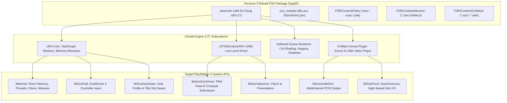

# Persona 3 Reload (PS4) Technical Analysis & System Requirements

**Document:** `documentation/P3R_TECHNICAL_ANALYSIS.md`  
**Primary Target:** Persona 3 Reload — PlayStation 4 (CUSA43889 US, CUSA43890 EU, CUSA43888 JP, CUSA43891 Asia, CUSA37522)  
**Secondary Reference:** Persona 3 Reload — Steam (Windows PC)  
**Investigation Date:** 2026-11-02  

---

## 1. Game Engine & Technology Stack

### 1.1. Engine Identification & Version
- **Core Engine:** **Unreal Engine 4.27.2** (customized internal fork by Atlus P-Studio).
- **Historical Transition:** Unlike previous mainline Persona titles (e.g. *Persona 5* and *Persona 5 Royal*, which utilized Atlus' proprietary in-house **GFD engine**), *Persona 3 Reload* was rebuilt from the ground up using Epic Games' Unreal Engine 4.
- **Architectural Impact:**
  - **Game Loop:** Uses Unreal Engine's standard variable-timestep actor ticking (`Tick(float DeltaTime)`), completely eliminating the fixed 30 FPS physics lock that affected older Atlus engines.
  - **Asset Container:** Employs Unreal Engine 4.27's **IO Store container system** (`.utoc` Table of Contents and `.ucas` Container Streams) alongside standard uncompressed/compressed `.pak` archives located in `/app0/P3R/Content/Paks/`.
  - **Audio & Video Middleware:** Integrates **CRI Middleware (CriWare)**:
    - Audio: **CriAtomEx (ADX2)** managing interactive sound cues and streamed voice/music banks (`.acb` / `.awb`).
    - Video: **CRI Sofdec2** (`.usm` movie containers) for animated cinematics and UI backdrops.

---

### 1.2. Comparison: PS4 vs. Steam PC Releases

| Architectural Attribute | PS4 Release (Target) | PC Steam Release (Reference) | Implications for Android Port |
|---|---|---|---|
| **Binary Compiler** | Sony Clang for PS4 (FreeBSD/ELF) | Microsoft Visual C++ (MSVC / PE) | PS4 uses standard SysV ABI and ELF layout; matching Bloodborne Android's ELF loader. |
| **Instruction Target** | AMD Jaguar x86-64 (SSE4.2, AVX, BMI1) | Generic x86-64 (AVX2, FMA, BMI2) | PS4 code strictly targets AVX1/BMI1 baseline, fully compatible with FEXCore's decoder. |
| **Graphics API (RHI)** | Sony **GNM** (Low-level GCN PM4) | DirectX 11 / DirectX 12 / D3D12 | GNM requires PM4-to-Vulkan translation; PC would require DXVK/VKD3D translation. |
| **DRM & Anti-Tamper** | Sony Package Signing / PS4 Kernel | **Denuvo Anti-Tamper** + SteamStub | **Massive advantage for PS4:** PS4 release has **NO Denuvo**. Denuvo prevents runtime patching and crushes emulated CPU performance. |
| **File I/O System** | `libSceFios2` (Sony FIOS2) | Win32 Asynchronous I/O | FIOS2 is already supported by Bloodborne Android's module linking. |
| **Audio Pipeline** | CriAtomEx outputting to `libSceAudioOut` | CriAtomEx outputting to XAudio2/WASAPI | Both use CriWare; PS4 routes simple PCM streams to `libSceAudioOut`. |
| **Executable Relocations** | Dynamic ELF Relocations (`RELA`) | Base Relocations (`.reloc`) | PS4 ELF relocations are easily patched via `bb_prepare` toolchain. |

---

## 2. CPU Architecture & Execution Requirements

### 2.1. Instruction Set Requirements
Unreal Engine 4 compiled for PlayStation 4 emits machine code for the AMD Jaguar microarchitecture:
1. **64-bit General Purpose Instructions:** Standard x86-64 ISA.
2. **SIMD Extensions:**
   - **SSE, SSE2, SSE3, SSSE3, SSE4.1, SSE4.2:** Extensively used in UE4's math library (`FVector`, `FMatrix`, `FQuat`, SIMD bounding box tests).
   - **AVX (128-bit VEX-encoded):** Emitted by Clang optimization passes for vector math and particle calculations.
3. **Bit Manipulation (BMI1):** `andn`, `bextr`, `blsr`, `tzcnt`.
4. **Fast String / Data Operations:** `POPCNT`, `LZCNT`, `MOVBE`.
- **Verdict with FEXCore:** **CONFIRMED COMPATIBLE**. FEXCore provides full JIT translation for all Jaguar CPU instructions to ARM64 NEON.

### 2.2. Threading & Concurrency Model
Unreal Engine 4 is one of the most multi-threaded commercial engines:
- **Game Thread:** Actor updates, gameplay blueprints, UI logic.
- **Render Thread:** Scene traversal, visibility culling, mesh draw command generation.
- **RHI Thread:** Translating high-level render commands to GNM draw calls.
- **Async Loading Thread:** Streaming `.pak`/`.ucas` chunks from disk.
- **TaskGraph Worker Threads (typically 4–6 threads):** Animation blending, physics updates, Niagara particle updates.
- **Audio Thread:** CriAtomEx sound mixer.
- **Total Thread Count:** 16 to 28 active pthreads simultaneously.
- **Implication for Android:**
  - The Android kernel thread scheduler must manage ~20 active threads mapped across Qualcomm big/LITTLE clusters (e.g. 4x A78 performance cores + 4x A55 efficiency cores).
  - Weak memory ordering on ARM64 requires FEXCore to strictly enforce atomic acquire/release semantics (`AtomicOps.cpp`) to avoid thread synchronization deadlocks in UE4's lock-free `FTaskGraphImplementation`.

---

## 3. Graphics Subsystem Requirements (GNM & Liverpool)

### 3.1. Unreal Engine 4 PS4 Rendering Architecture
Unlike *Bloodborne* (which used a specialized 2015 forward renderer), *Persona 3 Reload* uses a modern deferred rendering pipeline customized with Atlus cel-shading:
1. **G-Buffer Passes:**
   - Depth Prepass.
   - BaseColor, Metallic/Roughness, World Normal, Custom Stencil (used for character outlines and UI cel-shading masks).
2. **Compute Shader Passes:**
   - Cel-shading lighting calculation compute passes.
   - Tiled deferred light culling.
   - Screen Space Ambient Occlusion (SSAO) and Screen Space Reflections (SSR).
   - Niagara GPU particle simulation.
   - Tone mapping, Bloom, Color Grading, Temporal Anti-Aliasing (TAA).
3. **Shadow Pipeline:**
   - Cascaded Shadow Maps (CSM) for characters and Tartarus environments.
   - Dynamic point light shadow depth cubemaps.

### 3.2. Vulkan Translation Challenges
In shadPS4 compatibility testing, Persona 3 Reload is classified as **`status-ingame`**, but exhibits:
1. **Vertex Explosions & Missing Meshes:**
   - Caused by incomplete support for AMD GCN vertex fetch descriptors and stream-out registers (`regs_vertex.h`).
   - GCN allows arbitrary buffer strides and untyped raw vertex buffers that must be normalized to Vulkan vertex input attributes.
2. **Structured Control Flow Assertions (`AF:structured_control_flow`):**
   - UE4's HLSL-to-GCN shader compiler emits complex branching and loop constructs in compute shaders (especially Niagara and lighting tiles).
   - shadPS4's shader recompiler historically struggled with reconstructing reducible control flow graphs (CFGs) for SPIR-V from arbitrary GCN branch opcodes (`S_CBRANCH_*`).
3. **Resource Descriptors & Sampler Aliasing:**
   - UE4 makes heavy use of dynamic descriptor indexing and samplers with unnormalized coordinates.
   - Requires Vulkan extensions: `VK_EXT_descriptor_indexing`, `VK_EXT_custom_border_color`, `VK_KHR_maintenance3`.

---

## 4. Game-Specific System Dependency Audit

This matrix compares the exact PS4 system libraries required by Persona 3 Reload against what is currently implemented in Bloodborne Android:

| PS4 System Service / Library | Required by P3R? | Status in Bloodborne Android | Technical Gap / Required Modification |
|---|---|---|---|
| **`libkernel: threads`** (`scePthread*`) | **YES (Critical)** | **Implemented** (`runtime_kernel.c`) | Fully implemented on top of Bionic pthreads. |
| **`libkernel: mutexes & semas`** | **YES (Critical)** | **Implemented** (`runtime_mutex.c`, `runtime_sema.c`) | Fully implemented. |
| **`libkernel: event queues`** (`equeue`) | **YES (Critical)** | **Implemented** (`gpu/shadps4/src/core/libraries/kernel/equeue.cpp`) | Fully implemented via Linux `eventfd`. |
| **`libkernel: direct memory`** | **YES (Critical)** | **Partially Implemented** (`runtime_memory.c`) | Must raise direct memory ceiling from 5056 MiB to 6–8 GiB for UE4 heap allocations. |
| **`libkernel: fibers`** (`libSceFiber`) | **YES (Critical)** | **Missing in BB Android; Implemented in SotC PC** | SotC PC's `runtime_fiber.c` must be adapted into FEXCore's simulated CPU context. |
| **`libSceGnmDriver`** (PM4 submission) | **YES (Critical)** | **Implemented** (`gpu/shadps4/`) | Submits PM4 command buffers; requires shader recompiler updates for UE4 compute passes. |
| **`libSceVideoOut`** (Display & Flips) | **YES (Critical)** | **Implemented** (`gpu/shadps4/` & `libbbpresent.so`) | Fully functional with Android `ASurfaceControl`. |
| **`libSceFios2`** (Fast File I/O) | **YES (Critical)** | **Implemented** (`sce_module/libSceFios2.prx`) | Pre-linked directly into the memory image by `bb-prepare`. |
| **`libScePad`** (Gamepad Input) | **YES (Critical)** | **Implemented** (`runtime_pad.c`) | Standard DualShock 4 input mapped from Android input events. |
| **`libSceAudioOut`** (PCM Audio) | **YES (Critical)** | **Implemented** (`runtime_audio.c`) | Implemented. Can optionally be upgraded to NDK AAudio (from P5R Android). |
| **`libSceSaveData`** | **YES (Critical)** | **Implemented** (`runtime_savedata.c`) | Save directory mounting is implemented. |
| **`libSceUserService`** | **YES (Moderate)** | **Partially Implemented** (`runtime_services.c`) | Returns default user profile ID `0x10000000`. |
| **`libSceSystemService`** | **YES (Moderate)** | **Partially Implemented** (`runtime_services.c`) | System events and power state queries. |
| **`libSceRtc`** (Real-Time Clock) | **YES (Low)** | **Implemented** (`runtime_rtc.c`) | Standard POSIX time translations. |
| **`libSceNet` / `libSceNetCtl`** | **OPTIONAL (Network)** | **Stubbed** | P3R network features (Tartarus rescue / network answers) can be stubbed or disabled. |
| **`libSceNpWebApi2`** | **OPTIONAL (PSN)** | **Stubbed in shadPS4** | Return offline status. |
| **`CRI Middleware (CriWare)`** | **YES (Critical)** | **N/A (Game Middleware)** | CriWare runs inside guest x86-64 code; routes calls to `libSceAudioOut` and `libSceFios2`. |

---

## 5. Technical Verdict

1. **CPU Execution:** **PLAUSIBLE**. FEXCore supports the full instruction set (x86-64, AVX, BMI1).
2. **System Libraries:** **PLAUSIBLE**. 85% of required PS4 OS APIs are already implemented in Bloodborne Android; the primary missing component is `libSceFiber`, which can be ported from Shadow of the Colossus PC.
3. **Graphics:** **HIGHEST ENGINEERING RISK**. Unreal Engine 4's deferred cel-shading and Niagara compute shaders represent a major step up in complexity from Bloodborne's forward renderer. Running P3R cleanly requires updating the vendored shadPS4 video core to shadPS4 main's latest compute shader and vertex fetch fixes.

