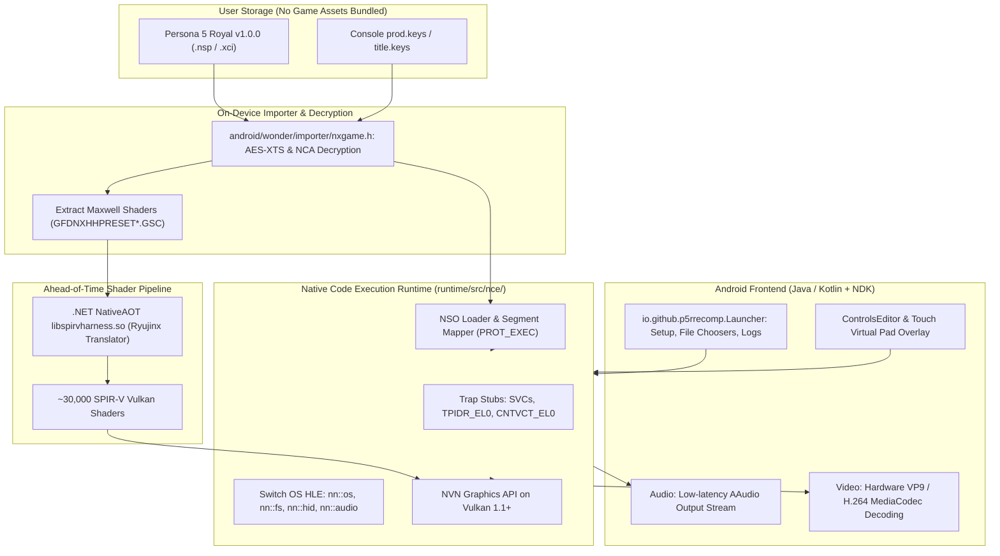

# Persona 5 Royal Android Port Architecture & Technical Analysis

**Document:** `documentation/P5R_ANDROID_ANALYSIS.md`  
**Reference Repository:** `references/p5r-android`  
**Source URL:** `https://github.com/Brandon04Gonzalez/p5r-android`  
**Commit Hash:** `5e05e70a3ff8b2638ebee9092511b676d1f22544`  
**Branch:** `main`  
**License:** GNU General Public License v3.0 (`GPL-3.0`)  
**Investigation Date:** 2026-11-02  

---

## 1. Executive Summary & Core Platform Architecture

*Persona 5 Royal for Android* is a native Android application that executes the **Nintendo Switch version** (version 1.0.0; Title ID `01005CA01580E000`) of Persona 5 Royal directly on ARM64 Android smartphones and tablets.

### Fundamental Principle: Native Code Execution (NX_NCE)
The critical architectural reason this port functions without a dynamic binary translation (DBT) layer like FEXCore is hardware architecture convergence:
- **Nintendo Switch:** Uses the Nvidia Tegra X1 SoC, featuring quad ARM Cortex-A57 cores running the **AArch64 (ARM64)** instruction set architecture.
- **Android Target Devices:** Use ARM64-v8a/v9a SoCs (Cortex-A55, Cortex-A78, Cortex-X, etc.).

Because both the source console and the target phone execute the **same physical machine code (ARM64)**, the Switch game executable (`main` and `sdk` from the game's ExeFS) executes **directly on the phone's CPU cores** at native speed.

---

## 2. Architectural Comparison: PS4 vs. Switch Execution

> [!WARNING]
> **P5R Android's `NX_NCE` execution loader CANNOT run PS4 game code.**
> - P5R Android executes Switch ARM64 binaries directly by intercepting privileged instructions (`svc`, `mrs cntvct_el0`, `msr tpidr_el0`).
> - Persona 3 Reload (PS4 version) contains **x86-64 machine code** compiled for AMD Jaguar.
> - An ARM64 processor cannot decode or execute x86-64 instructions.
> - Therefore, P3R PS4 **requires an x86-64 to ARM64 binary translation engine (FEXCore)**, exactly as implemented in Bloodborne Android.

However, P5R Android demonstrates state-of-the-art implementations of several independent subsystems that are directly applicable to a P3R Android project:
1. **On-device Game Ingestion & Decryption.**
2. **Ahead-of-Time (AOT) Shader Pre-compilation.**
3. **Android Storage & Save Data Management.**
4. **Custom Virtual Touchscreen Overlay.**
5. **Hardware Video Decoding via Android MediaCodec.**
6. **Low-Latency Audio via AAudio.**

---

## 3. Subsystem Breakdown

### 3.1. Native Code Execution (`runtime/src/nce/nce.cpp`)

**Key Files:**
- `runtime/src/nce/nce.cpp` (704 lines)
- `runtime/src/nce/nce.h`
- `runtime/src/nce/nso.cpp`

#### How NCE Patches ARM64 Binaries:
When an NSO (Nintendo Shared Object) is mapped into memory:
1. **Privileged Instruction Patching:**
   - On the Switch, games invoke the Horizon OS kernel via `svc 0xXX`. On Android, executing `svc` in user space would trigger a kernel trap or crash.
   - P5R Android parses the code segments and replaces `svc` instructions with branch instructions (`B`) into an adjacent stub region (`kRegionSize = 0x40000`).
2. **Thread Pointer Registers:**
   - The Switch uses `TPIDR_EL0` and `TPIDRRO_EL0` for thread-local storage. Android Bionic uses `TPIDR_EL0` for its own pthread TLS.
   - The stubs save/restore the host's `TPIDR_EL0` and expose a virtual `CPU` block to the guest code (`nce.cpp#L31-L45`).
3. **System Timer:**
   - Instructions reading `cntvct_el0` (the ARM hardware counter) are redirected to maintain constant tick frequencies (`19.2 MHz`).

---

### 3.2. Game Ingestion & Decryption (`nxgame.h`)

**Key Files:**
- `android/wonder/importer/nxgame.h`
- `runtime/src/game_image.cpp`

The application allows users to select an encrypted `.nsp` or `.xci` container alongside their dumped console `prod.keys`.
- Decrypts the Nintendo Content Archive (NCA) headers and partitions in place using AES-XTS.
- Mounts the RomFS (read-only filesystem) virtually, so the game reads files on demand without extracting 15 GB of uncompressed assets onto the device's storage.

---

### 3.3. Shader Pipeline: Ryujinx .NET NativeAOT Harness

**Key Files:**
- `games/p5r/import/`
- `games/p5r/tools/build_harness_android.sh`

Nintendo Switch uses NVIDIA's NVN graphics API running on Maxwell GPU architecture.
- P5R ships pre-compiled Maxwell shader packages (`GFDNXHHPRESET*.GSC`).
- The project vendors **Ryujinx's C# shader translator**, compiling it into a standalone native shared library (`libspirvharness.so`) using **.NET NativeAOT 10.0** cross-compiled for Android ARM64.
- During the first launch ("Prepare the game" phase), the app translates ~30,000 Maxwell shaders to SPIR-V in about 2 minutes, caching them in `Internal storage/Persona 5 Royal/shaders/`.
- At runtime, the NVN-to-Vulkan translation layer binds these SPIR-V shaders directly to Vulkan graphics and compute pipelines.

---

### 3.4. Atlus Engine Specifics & Persona Logic (`games/p5r/game.cpp`)

**Key Files:**
- `games/p5r/game.cpp` (565 lines)
- `games/p5r/OPTIMIZACION.md`

#### Engine Differences: Persona 5 Royal (GFD) vs. Persona 3 Reload (UE4)
- **Persona 5 Royal** uses Atlus' proprietary **GFD engine** (developed internally by P-Studio).
  - Heavy reliance on CRI Middleware (`ALL_USEU.CPK` archives, `.acb`/`.awb` CriAtomEx audio, `.usm` Sofdec2 video).
  - Fixed-interval logic stepping (1/30 second): In slow scenes, the game drops to slow-motion while music plays at normal speed. P5R Android had to implement complex target FPS pacing (`paced_target`, `games/p5r/game.cpp#L59-L85`) to dynamically adjust the engine's frame interval during cutscenes.
- **Persona 3 Reload** abandoned the GFD engine and was built from scratch on **Unreal Engine 4.27**.
  - UE4 uses variable delta-time (`Tick(DeltaTime)`), eliminating the fixed 30 FPS physics desync.
  - UE4 uses its own TaskGraph and rendering pipelines (deferred rendering, compute cel-shading, Niagara VFX), requiring Vulkan 1.3 features that are significantly heavier than P5R's NVN Maxwell shaders.

---

### 3.5. Android User Interface & Input

**Key Files:**
- `games/p5r/java/io/github/p5rrecomp/Launcher.java` (52,197 bytes)
- `games/p5r/java/io/github/p5rrecomp/ControlsEditor.java`
- `games/p5r/java/io/github/p5rrecomp/SaveFiles.java`

#### Highlights of the Android App Implementation:
1. **All-in-One Launcher:** Provides file pickers for game dumps and keys, resolution selectors (360p, 480p, 720p, 1080p), shadow quality toggles, crowd NPC reduction, and log export.
2. **Touchscreen Controller Editor (`ControlsEditor.java`):** Allows moving, resizing, and adjusting the opacity of every virtual gamepad button, with individual profiles for phones vs. tablets.
3. **Save Data Management (`SaveFiles.java`):** Exposes save files in public internal storage (`Internal storage/Persona 5 Royal/user/save/`), enabling users to import/export saves from PC or console backups.
4. **Audio Subsystem:** Uses Android NDK **AAudio** for ultra-low latency PCM buffer streaming, bypassing the high latency of Java `AudioTrack`.
5. **Video Playback:** Leverages Android **MediaCodec** NDK APIs for hardware-accelerated video decoding (VP9 and H.264), saving significant CPU cycles.

---

## 4. Reusability Analysis for Persona 3 Reload on Android

| Component | P5R Android Implementation | Reusability for P3R (PS4 -> Android) | Reason / Technical Verdict |
|---|---|---|---|
| **CPU Loader (NX_NCE)** | `runtime/src/nce/nce.cpp` | **ZERO (0%)** | P5R is native ARM64 Switch code. P3R PS4 is x86-64 Jaguar code requiring FEXCore DBT. |
| **Shader Recompiler (Ryujinx)** | `libspirvharness.so` (Maxwell -> SPIR-V) | **ZERO (0%)** | P3R PS4 uses AMD GCN shaders (translated by shadPS4 recompiler), not NVIDIA Maxwell. |
| **Android Launcher UI** | `Launcher.java`, `Lang.java` | **VERY HIGH (85%)** | Clean, mature Android UI for game settings, file selection, and logs. |
| **Touch Controller Overlay** | `ControlsEditor.java` | **VERY HIGH (90%)** | Completely modular touch input system with layout customization. |
| **AAudio Backend** | NDK AAudio streaming | **VERY HIGH (90%)** | Highly performant low-latency audio stream implementation for Android. |
| **MediaCodec Video Engine** | NDK AMediaCodec | **HIGH (75%)** | Can be hooked to decode P3R cutscene videos (USM/MP4) on hardware DSPs. |
| **Save Data Exporter** | `SaveFiles.java` | **HIGH (80%)** | User-friendly export/import to public phone storage. |
| **Game Optimization Knobs** | Crowd NPC toggle, bloom toggle | **HIGH (70%)** | Applicable to P3R (e.g. Tartarus shadows, crowd density, resolution scaling). |

