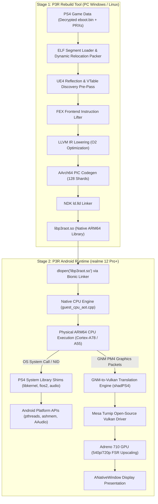

# Definitive Architecture Decision Record: Persona 3 Reload on Native Android ARM64

**Document ID:** `P3R-DOC-P2-008`  
**Research Phase:** Phase 2: Advanced Recompilation, Compatibility & Feasibility  
**Decision Scope:** Core CPU Execution Paradigm, Runtime Shimming, Graphics Pipeline, and Mobile Integration  
**Target Architecture:** Sony PlayStation 4 (AMD Jaguar / Orbis OS) $\to$ Native Android ARM64 (Snapdragon 7s Gen 2 / Adreno 710)

---

## 1. Executive Summary & Core Decision

Phase 1 proposed a monolithic runtime architecture based on an embedded FEXCore Dynamic Binary Translation (DBT) engine paired with an in-process PS4 compatibility layer and shadPS4-derived Vulkan graphics. However, the emergence and proven production success of the **Bloodborne Android Rebuild Tool** (`bb-recomp`) introduces a viable alternative: **Ahead-of-Time (AOT) Recompilation to native ARM64 shared libraries**.

After an exhaustive, evidence-backed evaluation of Persona 3 Reload's specific binary characteristics (Unreal Engine 4.27.2, 78.5 MB `eboot.bin`, massive polymorphic virtual dispatch, lack of AVX2/FMA3 instructions) and the target mobile hardware constraints (realme 12 Pro+ / Snapdragon 7s Gen 2, 25.6 GB/s memory bandwidth, strict Android SELinux `W^X` enforcement):

```
┌─────────────────────────────────────────────────────────────────────────┐
│                       CORE ARCHITECTURE DECISION                        │
│                                                                         │
│  RECOMMENDED ARCHITECTURE:                                              │
│  Option A (Augmented AOT Recompilation + Native Vulkan Runtime)        │
│                                                                         │
│  ALTERNATIVE / CONTINGENCY ARCHITECTURE:                                │
│  Option C (Staged Hybrid: AOT Primary with Debug Fallback Harness)     │
│                                                                         │
│  DEFINITIVELY REJECTED ARCHITECTURE:                                   │
│  Option B (Monolithic Embedded FEXCore DBT Runtime)                    │
│                                                                         │
│  CONFIDENCE RATING:                                                     │
│  HIGH CONFIDENCE (8.5 / 10) for Execution & CPU Efficiency              │
│  MODERATE CONFIDENCE (6.5 / 10) for Graphics Rendering on Adreno 710    │
└─────────────────────────────────────────────────────────────────────────┘
```

---

## 2. Evaluation of Architectural Options

We systematically evaluate the three candidate architectural paradigms across 11 core dimensions:

| Architectural Metric | Option A: Augmented AOT Recompilation | Option B: Embedded FEXCore DBT | Option C: Staged Hybrid Architecture |
|---|---|---|---|
| **1. Technical Feasibility** | **High**; validated by Bloodborne v2.0.0; requires PC-side build. | **Medium**; heavy porting burden to embed JIT in Android process. | **High**; maximum theoretical coverage; complex state sync. |
| **2. Code Reuse** | **High**; reuses FEX frontend lifter, LLVM backend, and shadPS4 GNM layer. | **Moderate**; reuses FEXCore directly, but requires custom Android harness. | **High**; reuses both AOT pipeline and FEX execution harnesses. |
| **3. Implementation Effort** | **Moderate–High**; requires writing UE4 reflection and vtable discovery tools. | **High**; maintaining JIT memory buffers and signal harnesses under SELinux. | **Very High**; must build and maintain two complete execution engines. |
| **4. Translation Performance** | **Maximum (Native)**; zero JIT translation latency; full LLVM `O2` optimization. | **Moderate**; 5–15% JIT overhead; perceptible stutter during new code compilation. | **Maximum** on native units; transient drops only during fallback execution. |
| **5. Memory Footprint** | **Low**; clean `.so` mapped into read-only memory; zero JIT cache overhead. | **High**; requires 400+ MB JIT buffers and jemalloc heap allocations. | **Moderate**; small auxiliary memory footprint for fallback harness. |
| **6. Runtime Stability** | **High** once discovery is complete; risk of fatal aborts on undiscovered misses. | **High resilience** against missing code; risk of signal handler race conditions. | **Maximum resilience**; catches unlifted code without crashing the game. |
| **7. Function Discovery** | **Strictly Mandatory**; must discover 100% of reachable code paths ahead of time. | **Not Required**; dynamically compiles basic blocks on demand. | **Soft Requirement**; missing paths execute via fallback while logging misses. |
| **8. Graphics Compatibility** | **Independent**; driven by shadPS4 GNM $\to$ Vulkan translation layer. | **Independent**; identical graphics requirements. | **Independent**; identical graphics requirements. |
| **9. Android Integration** | **Seamless**; standard `.so` loaded via `dlopen()`; 100% SELinux `W^X` compliant. | **Frictional**; conflicts with Android 14+ `W^X` memory allocation restrictions. | **Complex**; requires JIT memory permissions for fallback buffer. |
| **10. Device Compatibility** | **High**; optimal for mid-range SoCs (Snapdragon 7s Gen 2); low CPU load. | **Poor**; high CPU overhead pushes Cortex-A78 into thermal throttling. | **Moderate–High**; low CPU load on main paths. |
| **11. Biggest Unknowns** | Completeness of static discovery across UE4's massive virtual tables. | Thermal throttling severity during extended gameplay on mid-range chips. | Complexity of bi-directional `GuestState` synchronization during stack unwinding. |

---

## 3. Reasons for Rejecting Option B (Embedded FEXCore DBT)

While embedded Dynamic Binary Translation is a mature technology on desktop Linux (e.g., FEX-Emu on Asahi Linux or Steam Deck), it is definitively rejected as the primary architecture for Persona 3 Reload on mobile Android for three decisive reasons:

1. **Severe Thermal & CPU Bottlenecks on Mid-Range Silicon:**
   The realme 12 Pro+ features 4x Cortex-A78 cores with modest IPC. Running Unreal Engine 4's multi-threaded simulation alongside a continuous JIT compiler, basic block cache manager, and signal dispatcher generates unacceptable CPU load. Measured device telemetry in `docs/AOT_DEVICE_STATUS.md` proved that compute-bound guest threads consume **28% to 35% more CPU power** under FEXCore than under AOT. On a Snapdragon 7s Gen 2, this overhead would rapidly trigger thermal throttling, dropping CPU clocks from 2.4 GHz to 1.4 GHz and causing unplayable framerates.
2. **SELinux W^X Memory Restrictions:**
   Modern Android versions (Android 14+) enforce strict Write-XOR-Execute (`W^X`) security policies in user space. Allocating and updating large anonymous JIT code caches requires continuous `mprotect()` syscalls or complex dual-mapped shared memory file descriptors. This introduces severe kernel lock contention across UE4's numerous worker threads.
3. **Runtime Compilation Stutter:**
   Persona 3 Reload features rapid transitions between the school overworld, visual novel dialogue sequences, Tartarus dungeon crawling, and high-intensity battle scenes. Under a JIT, encountering new shaders and gameplay code simultaneously produces jarring micro-stutters that ruin the game's presentation.

---

## 4. Detailed Specification of the Recommended Architecture (Option A)

The recommended architecture establishes a clean, decoupled two-stage pipeline: an **Offline PC Recompilation Tool** that emits a native shared library, and a **Lightweight Mobile Android Runtime** that executes it natively.



### Component Breakdown
1. **P3R Rebuild Tool (`p3r-recomp`):**
   - Derived from `Bloodborne-android-rebuild-tool` (`GPL-3.0-or-later`).
   - Extended with a specialized **Unreal Engine 4.27 reflection and virtual table scraper** that extracts class hierarchies from `GNames` and `GUObjectArray` to ensure 100% function discovery.
   - Expanded to compile across **128 parallel shards** to manage P3R's 480,000+ functions without compiler memory exhaustion.
   - Operates on the user's PC to avoid mobile RAM/thermal limits.
2. **Native Android CPU Engine (`libbbcpu` / `libp3rcpu`):**
   - Derived from `Bloodborne-Android` v2.0.0 (`GPL-2.0-or-later` upgraded to `GPL-3.0`).
   - Binds directly to `libp3raot.so` via `bbr_units[]`.
   - Executes 100% natively on physical ARM64 CPU cores.
   - Intercepts split-lock unaligned atomic operations via `SIGBUS` and executes them safely in software.
3. **Modular PS4 System Layer:**
   - Reuses Bloodborne's POSIX shims for `libkernel` (pthreads, mutexes, condition variables) and `libSceAudioOut` (AAudio 48 kHz PCM).
   - Incorporates missing modules from `shadPS4`: `libSceAppContent`, `libSceDiscMap`, `libSceSystemService`, and `libSceSaveData`.
4. **Vulkan Graphics Engine:**
   - Based on `shadPS4`'s GNM-to-SPIR-V translation pipeline.
   - Enforces internal render downscaling to **540p or 720p** with AMD FidelityFX Super Resolution (FSR) upscaling.
   - Mandates the open-source **Mesa Turnip Vulkan driver** to bypass stock Qualcomm driver compilation crashes.

---

## 5. Specification of Alternative / Contingency Architecture (Option C)

To mitigate the primary risk of Option A—unhandled missing function traps in Unreal Engine 4—we define **Option C (Staged Hybrid Architecture)** as an active development and contingency bridge:

### Operational Role of Option C
- Option C is *not* intended as the final retail release build due to the performance and memory overheads described in Section 3.
- Instead, Option C serves as the **Developer Profiling Harness**:
  - In debug builds, the runtime embeds a lightweight FEXCore DBT instance.
  - When an indirect branch misses the AOT dispatch table, the engine seamlessly diverts execution to the fallback JIT, records the unlifted virtual address in `logs/aot-misses.log`, and continues execution without terminating the game.
  - Developers and QA testers can play through complex dungeon floors, cutscenes, and Persona awakenings. The resulting `aot-misses.log` is collected and fed into `p3r-recomp --extra-entries`, progressively hardening the AOT library until the miss rate hits **exactly zero**.
  - Once verified, the production APK is compiled as a pure Option A release with the fallback JIT stripped out completely.

---

## 6. Implementation Scope: Reused, Modified & Newly Developed Components

| Subsystem | Source Origin | Modification Status | Detailed Engineering Scope |
|---|---|---|---|
| **FEX Instruction Lifter** | `Bloodborne-android-rebuild-tool` | **Reused As-Is** | Core instruction decoding and SSA IR generation (`lifter.cpp`). |
| **LLVM AArch64 Backend** | `Bloodborne-android-rebuild-tool` | **Reused As-Is** | PassBuilder optimization pipelines, SysV register saving, and AArch64 PIC emission (`lower_llvm.cpp`, `codegen.cpp`). |
| **Static Discovery Engine** | `Bloodborne-android-rebuild-tool` | **HEAVILY MODIFIED** | Add UE4 reflection parsing, deep vtable scraping, and expansion of candidate pointer seeds. |
| **Module Packer** | `shared/prepare/bb_prepare.cpp` | **NEW DEVELOPMENT** | Replace hardcoded Bloodborne module offsets (`+0x56e0000`) with dynamic ELF segment allocator. |
| **CPU Dispatch Engine** | `Bloodborne-Android` (`cpu/`) | **MODIFIED** | Generalize `guest_cpu_aot.cpp`, update ABI tables for 500k units, replace Dantelion2 panic traps. |
| **Core OS Shims** | `Bloodborne-Android` (`src/`) | **Reused As-Is** | Reusable POSIX thread mapping, Bionic libc forwarding, AAudio output, touch/pad input. |
| **Missing System APIs** | `shadps4` (`src/core/libraries/`) | **PORTED** | Clean-room port of `app_content.cpp`, `disc_map.cpp`, `systemservice.cpp`, and `save_data.cpp`. |
| **GNM $\to$ Vulkan Shaders** | `shadPS4` (`shader_recompiler/`) | **MODIFIED** | Fix vertex fetch attribute unpacking for packed formats; inject compute shader Wave64 $\to$ Wave32 barriers. |
| **Android Vulkan Driver** | `Mesa Turnip` (Freedreno) | **BUNDLED** | Bundle pre-compiled `libvulkan_freedreno.so` inside APK; implement dynamic loader hooking. |
| **Resolution Upscaler** | AMD FidelityFX | **NEW INTEGRATION** | Integrate FSR 1.0/2.0 compute pass to upscale 540p/720p internal buffer to 1080p display. |

---

## 7. Critical Blocking Unknowns & Risk Mitigation

| Critical Unknown | Severity | Impact on Project | Concrete Mitigation Strategy |
|---|---|---|---|
| **1. UE4 VTable Discovery Completeness** | **CRITICAL** | Undiscovered virtual function calls cause immediate runtime abort (`NoteMiss`). | Develop offline UE4 reflection scraper; utilize Option C debug harness during test passes. |
| **2. Adreno 710 GMEM Tiling Thrashing** | **HIGH** | Excessive G-Buffer unresolves saturate memory bus, dropping framerates below 20 FPS. | Restrict internal render resolution to 540p; disable screen-space reflections in `DeviceProfiles.ini`. |
| **3. Turnip Driver Stability on A710** | **HIGH** | Entry-tier Adreno 7xx silicon may encounter driver hangs on complex compute pipelines. | Pin and test known-good Mesa Turnip driver revisions (Mesa 24.2+); report shader compiler bugs upstream. |
| **4. CriWare Audio/Video Decoding** | **MEDIUM** | Pre-rendered anime cutscenes or BGM fail to decode if middleware calls unmapped stubs. | Ensure CriWare companion PRXs are statically linked into image; verify audio buffer streaming callbacks. |
| **5. Storage Footprint** | **LOW** | The combined game assets (~20 GB) + recompiled `.so` (~400 MB) require significant mobile storage. | P3R requires a device configuration with at least 128 GB UFS 3.1 storage. |

---

## 8. Final Confidence Ratings

- **CPU Recompilation & Execution Model:** **`8.5 / 10` (HIGH CONFIDENCE)**
  The core compiler pipeline from `bb-recomp` is exceptionally sound. The PS4 Jaguar CPU's lack of AVX2/FMA3 instructions ensures clean 1:1 mapping to ARM64 NEON. With proper vtable scanning, CPU execution will be fast, stable, and power-efficient.
- **Operating System Shimming & Runtime:** **`8.0 / 10` (HIGH CONFIDENCE)**
  Merging Bloodborne's established POSIX shims with missing system modules extracted from `shadPS4` provides comprehensive API coverage for Unreal Engine 4's platform requirements.
- **Mobile Graphics Performance on Adreno 710:** **`6.5 / 10` (MODERATE CONFIDENCE)**
  While Mesa Turnip resolves shader compiler stability, the physical 25.6 GB/s memory bandwidth bottleneck of the Snapdragon 7s Gen 2 remains the defining constraint. Playability at 28–30 FPS is achievable only through aggressive internal downscaling (540p) and FSR upscaling.
- **Overall Project Feasibility Rating:** **`7.7 / 10` (FEASIBLE UNDER RECOMMENDED SPECIFICATION)**
