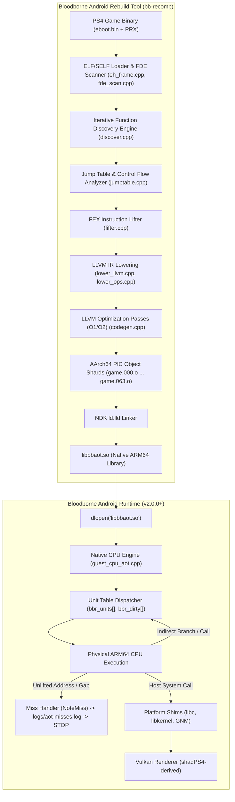

# Deep Technical Analysis: Bloodborne Android Ahead-of-Time (AOT) Recompiler Architecture

**Document ID:** `P3R-DOC-P2-001`  
**Research Phase:** Phase 2: Advanced Recompilation, Compatibility & Feasibility  
**Target Systems:** Sony PlayStation 4 (Orbis OS / x86-64) $\to$ Google Android (Linux Kernel / AArch64)  
**Primary Investigated Repositories:**
- `ducvd89/Bloodborne-android-rebuild-tool` (`commit 6ebb33b0c729a3942fddaa03965360c699d7d900`, branch `main`)
- `ducvd89/Bloodborne-Android` (`commit f241353e36f46bf183806acd7b79222afff2fd2f`, branch `master`)
- `deadinside28/bloodborne_pc` (`commit 0fc2921c45f8ff3900f6bfa43a299e9a4f532af4`, branch `master`)
- `StanTheMackiar/bloodborne-android-port` (`commit 631b3f568bbf4d25abd5e05340c21becf2ca2a9b`, branch `master`)

---

## 1. Executive Summary & Architectural Overview

The emergence of the **Bloodborne Android Rebuild Tool** (`bb-recomp`) represents a fundamental paradigm shift in mobile game preservation and platform translation. In earlier development phases (Bloodborne Android v1.x), execution relied on an embedded **Dynamic Binary Translation (DBT)** runtime powered by `FEXCore`. While functional, the DBT model suffered from JIT translation overhead, micro-stutters during dynamic compilation of newly encountered code blocks, significant memory footprint (an embedded LLVM JIT / code cache consuming 400+ MB), and strict Android platform constraints (W^X / SELinux restrictions on JIT code execution).

In Bloodborne Android v2.0.0 (versionCode 35), the runtime was completely re-architected around **Ahead-of-Time (AOT) Recompilation**:
1. The game's original decrypted x86-64 executable (`eboot.bin`) and companion PRX modules (`libc.prx`, `libSceFios2.prx`) are parsed and lifted offline (or on-device) into a high-level Static Single Assignment (SSA) intermediate representation using FEXCore's instruction decoding frontend.
2. The lifted IR is translated into **LLVM IR** (`src/lower_llvm.cpp`).
3. LLVM applies target-independent and AArch64-specific optimization passes (`O1`/`O2`).
4. An AArch64 code generator emits Position Independent Code (`Reloc::PIC_`) into 64 parallel ELF object shards.
5. The shards are linked using Android NDK's `ld.lld` into a single native Android shared library (`libbbaot.so`).
6. At runtime on Android, `libbbaot.so` is loaded directly via `dlopen()`. The game executes 100% natively on the physical ARM64 CPU. **The FEXCore JIT engine is completely absent from the runtime APK.**



---

## 2. Source-Code Implementation Map

Every module within `Bloodborne-android-rebuild-tool` performs a distinct, decoupled task in the compilation pipeline:

| Source File | Exact Path | Core Responsibility & Architectural Function |
|---|---|---|
| `discover.cpp` | `src/discover.cpp` | Multi-round static discovery engine. Scrapes `.eh_frame` FDEs, relocations, LEA pointers, and branch targets to resolve functions and sub-unit entries. |
| `discover.h` | `src/discover.h` | Data structures for discovered functions (`Func`, `DiscoverResult`, `LiftOptions`). |
| `fde_scan.cpp` | `src/fde_scan.cpp` | High-speed binary scanner for DWARF Frame Description Entries (FDEs) in `.eh_frame`. Identifies initial function boundaries without full disassembly. |
| `eh_frame.cpp` | `src/eh_frame.cpp` | Parses DWARF call frame information, unwind tables, personality routines, and landing pads for exception handling. |
| `jumptable.cpp` | `src/jumptable.cpp` | Disassembles indirect jump sequences (`jmp [rip + reg*8 + disp]`), parses switch tables in `.rodata`, and emits target addresses. |
| `lifter.cpp` | `src/lifter.cpp` | Integrates FEXCore's `OpcodeDispatcher`. Decodes x86-64 machine instructions into FEX SSA Intermediate Representation (IR). |
| `lower_llvm.cpp` | `src/lower_llvm.cpp` | Lowers FEX SSA IR blocks into LLVM IR functions. Manages guest register mapping, stack alignment, flag calculations, and unit emission. |
| `lower_ops.cpp` | `src/lower_ops.cpp` | Implementation of individual integer, ALU, bitwise, memory load/store, and branching operations in LLVM IR. |
| `lower_vector.cpp`| `src/lower_vector.cpp` | Implementation of SSE, SSE2, SSE3, SSSE3, SSE4.1, SSE4.2, and AVX vector instructions mapped to LLVM vector intrinsics and NEON. |
| `codegen.cpp` | `src/codegen.cpp` | Configures LLVM `TargetMachine` for `aarch64-unknown-linux-android30`, runs PassBuilder optimization pipelines (`O1`/`O2`), and emits ELF object code. |
| `compile.cpp` | `src/compile.cpp` | Orchestrates multi-threaded compilation. Divides functions into 64 shards, manages symbol tables (`bbr_units`), and tracks compilation statistics. |
| `elf_image.cpp` | `src/elf_image.cpp` | Loads and maps PS4 ELF segments into a unified guest address space (`0x3a7700000000`), processes dynamic relocations, and builds boot images. |
| `variant_compile.cpp`| `src/variant_compile.cpp`| Compiles alternative function variants (patches, 60 FPS detours, mod hooks) directly into native slots. |
| `player.cpp` | `src/player.cpp` | Standalone execution runner and test harness for validating recompiled units on desktop x86-64 / ARM64. |
| `bb_prepare.cpp` | `shared/prepare/bb_prepare.cpp`| Bloodborne-specific game preparation logic: unpkg, layout validation, patching `fs:` to `gs:`, and static module placement. |
| `android-fex-shim.h`| `arm64/android-fex-shim.h`| Bionic libc compatibility shim. Implements `valloc()` via `memalign(getpagesize(), size)` to compile FEX headers under Android NDK. |

---

## 3. The Ahead-of-Time Recompilation Pipeline

The translation from x86-64 machine code to native ARM64 ELF objects proceeds through seven distinct, sequential stages:

```
[x86-64 Machine Code]
       │
       ▼ (Stage 1: Binary Layout & Segment Mapping)
[Flat Guest Image @ 0x3a7700000000]
       │
       ▼ (Stage 2: Discovery & Boundary Analysis)
[Function & Sub-Unit Manifest (FDE + Relocs + JumpTables)]
       │
       ▼ (Stage 3: Frontend Instruction Lifting)
[FEXCore SSA Intermediate Representation]
       │
       ▼ (Stage 4: LLVM IR Lowering & Guest State Mapping)
[LLVM IR Modules (64 Shards)]
       │
       ▼ (Stage 5: Optimization Passes)
[Optimized LLVM IR (SROA, GVN, DSE, InstCombine)]
       │
       ▼ (Stage 6: AArch64 Machine Code Generation)
[64 Sharded ELF Object Files (game.000.o ... game.063.o)]
       │
       ▼ (Stage 7: Native Library Construction)
[libbbaot.so (Native Android Dynamic Library)]
```

### Stage 1: Binary Layout & Address Space Virtualization
PS4 ELFs expect to execute within a 64-bit virtual address space. However, on Android ARM64, user-space virtual addresses are typically restricted to 39 bits (512 GB) or 48 bits (256 TB). In early builds, `bb-recomp` used a base of `0x200000000`, which catastrophically collided with 64-bit integer constants embedded in game code (e.g., `movabs rax, 0x200000002` was mistakenly relocated as an image pointer, leading to 1 GB invalid allocations and crashes).
- In commit `c58a088`, the virtual image base was relocated to `0x3a7700000000`. This address is completely safe within 39-bit Android address spaces and sits far above immediate integer ranges.
- Modules are flattened into this image: `eboot.bin` at base, with dynamic libraries statically placed at predetermined offsets (`libc.prx` at `+0x56e0000`, `libSceFios2.prx` at `+0x57c0000`).

### Stage 2: Function Discovery & Boundary Resolution
Unlike high-level source languages, stripped machine code lacks explicit symbol headers. To compile code ahead of time, the tool must identify every valid instruction that can ever be reached:
1. **FDE Scanning (`fde_scan.cpp`):** The tool parses the `.eh_frame` section. Every function registered with the C++ exception handling runtime has an entry (FDE) specifying its exact start virtual address and size. In Bloodborne, this identifies ~184,000 baseline functions (kind 0).
2. **Relocation & Pointer Scraping (`discover.cpp`):** Relocation tables (`.rela.dyn`, `.rela.plt`) contain absolute addresses pointing into code. Any relocation target within an executable segment is queued as a candidate function.
3. **Control Flow Analysis (`jumptable.cpp`):** Indirect jump patterns (`jmp [rip + reg*8]`) are analyzed. The switch jump table stored in `.rodata` is inspected, and every target label is registered.
4. **Iterative Lifting Loop (`discover.cpp` lines 96–177):** The tool executes up to 16 iterative discovery passes. In each round, every known function is decoded. Any direct `CALL`, `JMP`, `Jcc`, or `LEA` (Load Effective Address) pointing outside the current function boundary is extracted:
   - If the target lands in an unmapped region between functions (a "gap"), a new **pseudo-function** (kind 3) is synthesized.
   - If the target lands inside an existing function, it is recorded as a **secondary entry unit** (`entryUnits`).
   - If a target fails to decode into valid x86-64 instructions, it is flagged as data/rodata and dropped (`bad.insert()`).

### Stage 3: Instruction Lifting to FEX SSA IR
Decoding is executed via FEXCore's `OpcodeDispatcher` (`lifter.cpp`). Rather than interpreting or emitting assembly directly, FEX translates each x86 instruction into a stream of Static Single Assignment (SSA) RISC-like intermediate instructions (`FEXCore::IR::IROp_Header`).
- Complex x86 instructions with side effects (e.g., `push`, `pop`, `leave`, `rep movsb`) are decomposed into atomic primitives (`LoadContext`, `StoreContext`, `Add`, `StoreMem`).
- Segment registers (`fs:`, `gs:`) are mapped cleanly. Bloodborne uses `gs:` for thread-local storage (`tcb`), so `bb_prepare` normalizes TLS accesses.

### Stage 4: LLVM IR Lowering & Guest State Model
The FEX SSA IR is converted into LLVM IR by `UnitLowerer` (`lower_llvm.cpp`).
- Every translated unit is emitted as a standalone C-compatible function with the exact signature:
  ```c
  void bbr_<vaddr>(GuestState* s);
  ```
- **`GuestState` Structure:** A continuous struct representing the x86-64 CPU registers. Its binary layout matches FEXCore's `CPUState`:
  - 16 General Purpose Registers (GPRs): `s->gregs[0..15]` (RAX, RCX, RDX, RBX, RSP, RBP, RSI, RDI, R8..R15).
  - Flags: `s->rip`, `pf_raw`, `af_raw`, NZCV words.
  - 16 XMM / YMM SIMD Registers: `s->xmm.sse.data[0..15]` (128-bit low halves) and `s->avx_high[0..15]` (128-bit high halves).
- **Static Register Allocation via `alloca`:**
  Within each unit function, registers are allocated as local stack variables via LLVM `alloca`.
  At unit entry, touched registers are loaded from `s->gregs[...]`.
  During the unit's execution, values remain in SSA registers.
  Before any exit, direct jump, or call, modified registers are stored back to `s->gregs[...]`.
  LLVM's `SROA` (Scalar Replacement of Aggregates) and `mem2reg` passes lift these `alloca` variables directly into physical ARM64 hardware registers (`x0`–`x30`, `v0`–`v31`).
- **Callee-Saved Register Optimization:**
  Following the System V AMD64 ABI, registers `rbx`, `rbp`, and `r12`–`r15` are callee-saved. When a unit performs a direct call to another unit, it does *not* reload `rbx`, `rbp`, and `r12`–`r15` upon return. They remain pinned in host ARM64 registers across the call, dramatically reducing memory traffic.

### Stage 5: Target-Independent & Target-Specific LLVM Optimization
`codegen.cpp` constructs a custom LLVM `PassBuilder` pipeline optimized specifically for lifted code:
- **Optimization Level 1 (`O1`):**
  `function(sroa<modify-cfg>, early-cse<memssa>, simplifycfg, instcombine<no-verify-fixpoint>, dse, adce, simplifycfg)`
  Eliminates redundant flag evaluations, removes dead stores to guest registers that are overwritten before exit, and merges redundant memory loads.
- **Optimization Level 2 (`O2`):**
  Adds Global Value Numbering (`gvn`), correlated propagation, reassociation, and a secondary `instcombine` loop.
- **Volatile Load Enforcement for Spin-Waits (Commit `ef1a331`):**
  A critical compiler bug discovered on physical devices: spin-wait loops of the form:
  ```x86asm
  L: cmp eax, [r13 + 0x18]
     jg L
  ```
  had no stores inside the loop body. LLVM's `early-cse` and `gvn` assumed the memory location `[r13 + 0x18]` was invariant, hoisted the load outside the loop, and transformed the loop into an infinite spin on a stale register value! This deterministically deadlocked the main thread waiting on worker threads (`GXWorker`).
  - **The Fix:** In `lower_ops.cpp`, memory loads in loops lacking internal stores, atomics, or function calls are explicitly tagged with `volatile`, forcing physical loads from memory on every iteration.

### Stage 6: Multi-Threaded Sharding & AArch64 Machine Code Generation
Compiling 184,000 functions into a single LLVM module would cause memory usage to explode past 32 GB RAM, crashing both desktop and mobile compilers.
- `compile.cpp` shards the unit list across **64 independent modules** (`game.000.o` through `game.063.o`).
- LLVM's AArch64 backend is configured with:
  - Target Triple: `aarch64-unknown-linux-android30`
  - Target Features: `+v8.2a, +lse, +crc, +fp-armv8, +neon`
  - Relocation Model: `Reloc::PIC_` (Position Independent Code)
- Object files are generated completely in-memory using `legacy::PassManager` and `raw_svector_ostream`.

### Stage 7: Linking & Shared Library Construction
The 64 shards are written to disk and linked using the Android NDK LLVM linker:
```bash
ld.lld -shared -O2 --gc-sections -soname libbbaot.so \
  game.000.o game.001.o ... game.063.o -o libbbaot.so
```
The resulting `libbbaot.so` is ~150–200 MB in size and exports the master dispatch metadata required by the Android runtime.

---

## 4. Recompilation ABI & Output Library Structure (ABI v2)

The generated `libbbaot.so` is not a collection of arbitrary symbols. To maximize dispatch performance and ensure position independence, the library conforms to **Recomp ABI Version 2** (`docs/RECOMP_ABI.md`):

### Exported Symbols
| Symbol Name | Type | Description |
|---|---|---|
| `bbr_abi_version` | `uint32_t` | ABI version check. Must equal `2`. Mismatches cause runtime rejection. |
| `bbr_abi_flags` | `uint64_t` | Bitmask: bit 0 = resume entries present; bit 1 = dirty check present; bit 2 = variants; bit 3 = hook slots. |
| `bbr_image_hash` | `uint64_t` | FNV-1a 64-bit hash of the original flat PS4 binary. Prevents loading an AOT library built from a mismatched game version. |
| `bbr_image_base` | `uintptr_t` (writable) | Initialized by the runtime at load to the actual virtual address where the game's data segments are mapped. |
| `bbr_unit_count` | `uint64_t` | Total number of compiled units in the library (~184,000 in Bloodborne). |
| `bbr_units` | Array of `UnitEntry` | Sorted array of `{ uint64_t vaddr; void (*fn)(GuestState*); }`. The master entry table. |
| `bbr_unit_end` | `uint64_t[]` | Array of end virtual addresses for each unit's code range `[vaddr, end)`. |
| `bbr_unit_extra` | `uint8_t[]` | 1 = secondary entry (switch case, landing pad, setjmp site); 0 = function start. |
| `bbr_dirty` | `uint8_t[]` (writable) | Per-unit dirty byte. Initialized to 0. Set to 1 by runtime when code is patched or unlifted. |
| `bbr_funcs` | `GranRec[]` | Function bounds table `{ uint32_t start, end, first, count; }` for granular resume dispatch. |

### Unit Structure and Dirty Checks
Every unit function begins with an inlined dirty check:
```cpp
void bbr_0x123456(GuestState* s) {
    if (__builtin_expect(bbr_dirty[INDEX], 0)) {
        bbr_dirty_entry(s, 0x123456);
        return;
    }
    // ... translated unit body ...
}
```
If a unit was patched at runtime (e.g., a frame-rate patch or mod detour), the runtime sets `bbr_dirty[INDEX] = 1`. When execution hits that unit, it immediately diverts to `bbr_dirty_entry()` without requiring any modification to executable `.text` memory pages. This completely eliminates the need for `mprotect(PROT_WRITE)` or `execmod`, ensuring full compliance with Android SELinux security policies.

---

## 5. Function Discovery Limitations & The Missing Function Problem

Static ahead-of-time binary translation faces an intractable computer science challenge: **the undecidability of indirect control flow**.

### Causes of AOT Misses
1. **Computed Gotos & Indirect Function Pointers:** When code jumps via a register whose value was computed dynamically through pointer arithmetic (e.g., `jmp *rax`), static analysis cannot determine the destination set at compile time.
2. **C++ Dynamic Virtual Dispatch (vtables):** Virtual tables loaded at runtime or resolved through complex base classes may contain code pointers not scraped from static relocations.
3. **C++ Exception Landing Pads & `setjmp`/`longjmp`:** Unwinding mechanisms jump directly into the middle of stack frames rather than to function prologues.
4. **Code Gaps & Data Mixed in Code:** In x86 binaries, jump tables and string literals are frequently interleaved directly inside executable `.text` sections.

### The Missing Entry Trap & Strict Mode Execution
In Bloodborne Android v2.0.0, **there is NO JIT or interpreter fallback**. If execution branches to an unlifted address:
1. `Lookup(offset)` in `guest_cpu_aot.cpp` returns `nullptr`.
2. It attempts `GranularEntry()`. If that fails:
3. The engine invokes `NoteMiss()` (`guest_cpu_aot.cpp` line 454).
4. `NoteMiss()` logs the exact image-relative offset, thread name, and guest backtrace to `logs/aot-misses.log`:
   ```
   # bb aot misses (image offsets; feed this file to bb-recomp --extra-entries), pid 12345, image base 0x3a7700000000
   miss +0x210ebc0
   miss +0x23a9c9c
   ```
5. The application immediately terminates with a fatal error:
   ```
   STOP: AOT: native code is missing an entry at +0x210ebc0
   ```

### The `--extra-entries` Iterative Feedback Loop
To resolve gaps, developers and testers use an iterative feedback mechanism:
1. Run the game until an AOT miss occurs.
2. Retrieve `logs/aot-misses.log` from the device.
3. Feed the log directly into the rebuild tool:
   ```bash
   bb-recomp --game <game_dir> --extra-entries aot-misses.log --out aot/
   ```
4. `readEntryList()` (`discover.cpp` line 26) parses each `miss +0x...` line, adds the addresses to the candidate seed list, lifts them as new unit entries or splits existing units, and re-emits `libbbaot.so`.
5. Repeat until the game runs end-to-end without misses.

---

## 6. Android Platform & Hardware Integration

### Memory Management & 39-Bit Address Constraints
Android on 64-bit ARM operates in a virtual memory sandbox. The runtime manages guest memory using direct anonymous mappings (`mmap` with `MAP_FIXED` or `MAP_SHARED`):
- `E.base` is mapped to `0x3a7700000000`.
- Guest memory allocations (`sceKernelAllocateDirectMemory`, `sceKernelMapDirectMemory`) map physical pages into this virtual address space.
- Thread stacks: Each guest thread is allocated a dedicated 4 MB stack (`DefaultStack = 4u << 20`) aligned to 64 bytes.

### Unaligned Atomic Operations on ARM64 (`guest_cpu_atomics.h`)
The x86-64 architecture natively permits atomic operations (`lock cmpxchg`, `lock xadd`, `lock bts`) on unaligned memory addresses, including addresses that span two separate 64-byte cache lines ("split locks").
On ARM64, the hardware Large System Extensions (LSE) atomics (`CAS`, `LDADD`, `SWP`) strictly require natural alignment. An unaligned atomic instruction executing on ARM64 immediately triggers an unaligned access fault (`SIGBUS`).
- **The Solution:** The Android runtime registers a `SIGBUS` signal handler.
- When `SIGBUS` fires at an atomic instruction address, `guest_cpu_atomics.h` decodes the faulting ARM64 instruction, extracts the operands, acquires a **global host fallback mutex**, executes the atomic operation byte-wise in software, advances the program counter (`ucontext->uc_mcontext.pc += 4`), and resumes execution.

### CPUID & TSC Clock Emulation
Games rely on `cpuid` for hardware capability detection and `rdtsc` for high-resolution timing:
- **CPUID (`guest_cpu_cpuid.h`):** The runtime provides a static emulation model ported from FEX-Emu. It presents an Intel Skylake profile with AVX/AVX2 enabled, cache sizes populated, and core 0's MIDR brand string.
- **TSC Timing (`Ticks()`):** Mapped directly to the ARM64 virtual timer counter register:
  ```cpp
  __asm__ volatile("mrs %0, cntvct_el0" : "=r"(v));
  ```
  Scaled using `cntfrq_el0` to deliver nanosecond-accurate monotonicity.

---

## 7. Reusable vs. Bloodborne-Specific Architecture Audit

A central question for this research is: **Can `Bloodborne-android-rebuild-tool` be reused as a generic PS4-to-Android compiler?**

An exhaustive audit of the source code reveals that while the core compiler infrastructure is generic, the tool is heavily coupled to Bloodborne's binary layout:

### Reusable Core Components (Generic PS4 Recompiler Engine)
1. **FEXCore SSA Lifter Frontend (`lifter.cpp`):** Completely independent of the game. Correctly decodes any standard x86-64 user-mode instruction stream.
2. **LLVM IR Lowering & Code Generation (`lower_llvm.cpp`, `lower_ops.cpp`, `lower_vector.cpp`, `codegen.cpp`):** Generic compiler backend. Emits highly optimized AArch64 PIC units with SysV ABI callee-saved preservation.
3. **ELF / DWARF FDE Scanner (`fde_scan.cpp`, `eh_frame.cpp`):** Standard DWARF parsing applicable to any PS4 ELF compiled with Clang/GCC.
4. **Iterative Discovery & Jump Table Analyzer (`discover.cpp`, `jumptable.cpp`):** Generic control flow reconstruction algorithms.
5. **AArch64 Atomic Fault Handler (`guest_cpu_atomics.h`):** Universal solution for x86 split-lock emulation on ARM64.

### Bloodborne-Specific Hardcoded Elements (Must Be Refactored for P3R)
1. **Hardcoded Module Base Addresses (`shared/prepare/bb_prepare.cpp`, `docs/RECOMP_ABI.md` line 68):**
   - The tool hardcodes `libc.prx` at `+0x56e0000` and `libSceFios2.prx` at `+0x57c0000`.
   - Any game with a different executable size or differing companion PRX modules will collide with these offsets.
2. **Engine Panic Pattern Recognition (`guest_cpu_aot.cpp` line 428):**
   - The runtime explicitly looks for FromSoftware's **Dantelion2** engine panic trap:
     ```cpp
     // Dantelion2's DL_PANIC prints its message and then stores to address 0 (movl $0xdeadba, 0x0)
     bool StoresToAddressZero(const uint8_t* p);
     ```
3. **Hardcoded Variant and Hook Patches (`variants/`, `guest_cpu_aot_hooks.inc`):**
   - Contains 45 specific Bloodborne patch variants (60 FPS detours, Havok physics timestep adjustments, FMOD audio redirects).
4. **Hand-Coded Start Routines:**
   - The startup entry point at `image + 0x20` is explicitly tailored to FromSoftware's CRT initialization sequence.

---

## 8. Specific Implications for Persona 3 Reload (PS4) Adaptation

Adapting this AOT recompilation technology to Persona 3 Reload introduces several major challenges stemming from the difference between FromSoftware's custom engine (Dantelion2) and Epic Games' **Unreal Engine 4.27**:

1. **Massive Executable Footprint:**
   - Bloodborne's `eboot.bin` is ~35 MB containing ~184,000 units.
   - Persona 3 Reload's PS4 executable (`eboot.bin` + UE4 runtime + CriWare middleware) exceeds 75–90 MB of x86-64 machine code.
   - The unit count will likely exceed **450,000–550,000 units**, expanding compilation time, memory usage during linking, and the final `.so` size (estimated at 350–500 MB).
2. **Extensive Virtual Dispatch in Unreal Engine 4:**
   - UE4 relies intensely on C++ virtual function tables (`UObject`, `AActor`, `UActorComponent`, `FRHICommandList`).
   - Virtual calls resolved through runtime object pointers are much more difficult for static discovery to resolve than Bloodborne's predominantly static C++ architecture.
   - A pure AOT approach on P3R without an extensive discovery database would trigger frequent `STOP: AOT: native code is missing an entry` crashes during gameplay.
3. **Dynamic TaskGraph Scheduling:**
   - UE4's TaskGraph multiplexes asynchronous worker jobs across threads using lock-free work-stealing queues and function delegates.
   - Ensuring that all worker thread dispatch targets are discovered ahead of time is critical.
4. **Module Layout Generalization:**
   - A P3R recompilation tool must replace `bb_prepare.cpp` with a dynamic ELF linker that dynamically assigns module virtual base addresses based on actual segment sizes rather than hardcoded offsets.

---

## 9. Conclusion

The Bloodborne AOT Rebuilder demonstrates that ahead-of-time recompilation of x86-64 PS4 games into native ARM64 Android libraries is not merely theoretically possible—it is an established, highly performant reality that eliminates JIT emulation overhead entirely. However, the existing implementation is heavily coupled to Bloodborne. To serve as the foundation for Persona 3 Reload, the tool must be generalized into a modular PS4 AOT compiler framework capable of handling Unreal Engine 4's massive code size and polymorphic dispatch patterns.
