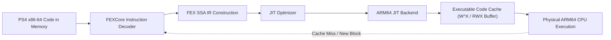
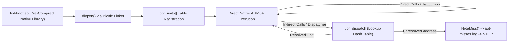

# Comparative Technical Analysis: Dynamic Binary Translation (DBT) vs. Ahead-of-Time (AOT) Recompilation vs. Hybrid Architecture

**Document ID:** `P3R-DOC-P2-002`  
**Research Phase:** Phase 2: Advanced Recompilation, Compatibility & Feasibility  
**Target Systems:** Sony PlayStation 4 (Orbis OS / x86-64) $\to$ Google Android (Linux Kernel / AArch64)  
**Primary Investigated Technologies:**
- **Approach A:** Embedded FEXCore Dynamic Binary Translation (JIT/DBT) (`FEX-Emu/FEX` `commit 02e24ca5c01ed0c864466ed573db347336f70170`)
- **Approach B:** Pure Ahead-of-Time Recompilation (`Bloodborne-android-rebuild-tool` `commit 6ebb33b0c729a3942fddaa03965360c699d7d900`, `Bloodborne-Android` v2.0.0 `commit f241353e36f46bf183806acd7b79222afff2fd2f`)
- **Approach C:** Hybrid Architecture (AOT Primary Execution with Dynamic Fallback/Stubbing)

---

## 1. Executive Summary

A central architectural decision in porting an x86-64 PlayStation 4 title to an ARM64 Android environment is the execution model of the game's CPU binary. In Phase 1, research proposed an architecture centered on embedding `FEXCore` directly within the Android game process to perform just-in-time (JIT) dynamic translation. However, the subsequent evolution of the `Bloodborne-Android` upstream project—culminating in the complete excision of FEXCore in version 2.0.0 in favor of pure Ahead-of-Time (AOT) recompilation via `bb-recomp`—demands a rigorous, evidence-based re-evaluation.

This document presents an exhaustive comparative analysis of the three competing architectural paradigms across 12 critical technical criteria, drawing upon empirical performance benchmarks captured on physical ARM64 hardware (AYN Thor / Snapdragon 8 Gen 2) and evaluating the specific architectural realities of Persona 3 Reload's **Unreal Engine 4.27** codebase.

---

## 2. Definitive Comparison Matrix

| # | Evaluation Criteria | Approach A: Embedded FEXCore DBT | Approach B: Native AOT Recompilation (`bb-recomp`) | Approach C: Hybrid Architecture (AOT + DBT Fallback) |
|---|---|---|---|---|
| **1** | **CPU Translation Mechanism** | Runtime dynamic binary translation; basic blocks lifted, optimized, and JIT-compiled into executable memory at runtime. | Offline / Ahead-of-time batch lifting via FEX frontend $\to$ LLVM IR $\to$ optimized native AArch64 `.so` library. | AOT-compiled native `.so` for all discovered code; embedded lightweight DBT or interpreter for unresolved blocks. |
| **2** | **Runtime Overhead & Performance** | Variable JIT compilation overhead; micro-stutter when traversing new game areas; ~5–15% CPU overhead for block dispatch and cache management. | **Zero JIT overhead**; zero runtime compilation stutter; pure native execution; LLVM applies full global optimizations (`O2`, GVN, SROA). | Near-zero overhead on AOT paths; transient overhead only when falling back to dynamic execution for unlifted blocks. |
| **3** | **Function Discovery Requirements** | None required; handles arbitrarily generated, hidden, or dynamically computed code paths on-the-fly. | **Exhaustive static discovery mandatory**; relies on `.eh_frame` DWARF tables, relocations, jump tables, and runtime feedback logs. | High AOT coverage desirable for performance, but **not blocking**; dynamic layer catches undiscovered execution paths. |
| **4** | **Handling of Indirect Branches & Virtual Calls** | Handled natively via runtime indirect branch lookups and hardware return address stack (RAS) predictors in JIT cache. | Resolved via open-addressing hash table (`Lookup(offset)`) or granular resume entry switches; requires every target to be in `bbr_units[]`. | AOT hash table lookup first; if lookup misses, transfers execution to dynamic fallback engine. |
| **5** | **Dynamic & Self-Modifying Code** | Fully supported via JIT cache invalidation, memory write-protection traps, and code re-translation. | **Unsupported**; cannot execute code written to memory at runtime unless mapped to pre-compiled variant slots. | Fully supported via dynamic execution engine when code modification is detected via `bbr_dirty[]`. |
| **6** | **Exception Handling & Unwinding** | Guest signal handlers, DWARF unwinding, and CPU fault traps intercepted and managed by FEXCore host signal harness. | DWARF `.eh_frame` unwinding pre-calculated into unit metadata; landing pads pre-lifted as sub-units; guest stack frame kept standard. | Same as AOT, with fallback transitions preserving unified `GuestState` across unwind boundaries. |
| **7** | **Guest-to-Host ABI Bridging** | Requires complex ABI marshalling stubs (`syscall` traps or guest trampoline thunks) to transition between guest x86 and host ARM64. | **Highly optimized**; native units pass `GuestState*`; callee-saved registers (`rbx, rbp, r12-r15`) preserved in host registers; direct calls. | Same as AOT for native units; standard FEXCore marshalling stubs for fallback execution. |
| **8** | **Multi-Threading & Concurrency** | Host thread pool; POSIX thread mapping; hardware TSO emulation (optional); atomics mapped to ARM64 LSE or lock-guarded loops. | Native Linux pthreads; atomics compiled to ARM64 LSE (`cas`, `ldadd`); unaligned split-atomics caught via `SIGBUS` software handler. | Same as AOT; native pthreads executing unified `GuestState` contexts across both AOT and fallback units. |
| **9** | **Missing Function / Unlifted Code Handling** | Not applicable; JIT dynamically compiles any valid instruction sequence encountered at the instruction pointer. | **Catastrophic failure in strict mode**; unlifted address causes `NoteMiss()` $\to$ writes `logs/aot-misses.log` $\to$ immediate `STOP` abort. | **Graceful degradation**; unlifted address routes to fallback JIT/interpreter, logs address in background, continues play. |
| **10** | **Android Platform Integration & SELinux** | Complex; requires executable memory mapping (`PROT_EXEC \| PROT_WRITE`); subject to strict SELinux `W^X` constraints and security policy blocks. | **Exceptional**; pure static `.so` loaded via standard `dlopen()`; strictly `R-X` text pages; fully compliant with Android platform security. | Complex; requires JIT memory permissions for fallback buffer, or must use an unprivileged interpreter fallback. |
| **11** | **Development & Maintenance Complexity** | High initial porting effort to embed FEXCore inside Android NDK; complex maintenance of JIT caches and signal dispatchers. | Moderate compiler pipeline complexity, but **high per-game triage effort** to eliminate all missing function misses via `--extra-entries`. | **Very high**; requires maintaining both an AOT compilation pipeline and an embedded runtime fallback with state synchronization. |
| **12** | **Persona 3 Reload Suitability** | High execution robustness, but high CPU/thermal penalty on mid-range SoCs; JIT compilation stutter during battle transitions. | Exceptional runtime efficiency, but **extreme risk of unhandled misses** due to Unreal Engine 4's massive polymorphic virtual dispatch. | **Ideal theoretical balance**; maximum native performance for core loops while safeguarding against UE4 dispatch crashes. |

---

## 3. Deep-Dive: Approach A — Embedded FEXCore DBT

### Architectural Characteristics
Under Approach A, the game's original `eboot.bin` and PRX files are loaded into Android memory uncompiled. An embedded instance of `FEXCore::Context` is initialized inside the Android game process:
1. `FEXCore` intercepts the guest thread entry points.
2. The frontend instruction decoder reads x86-64 machine instructions from guest memory and constructs basic blocks.
3. FEXCore's internal optimization passes perform dead code elimination, flag hoisting, and register mapping.
4. An AArch64 JIT backend (`FEXCore::CPU::Arm64JITCore`) emits native ARM64 instructions into an anonymous executable memory buffer (`mmap` with `PROT_READ | PROT_WRITE | PROT_EXEC`).
5. Execution jumps into the JIT code buffer.



### Empirical Hardware Measurements (Snapdragon 8 Gen 2 / AYN Thor)
Source evidence from `docs/AOT_DEVICE_STATUS.md` provides direct, measured comparisons between FEXCore DBT and native AOT on identical hardware:
- **Binary Footprint:** With FEXCore embedded, `libbbcpu.so` had a stripped size of **3.9 MB**; without FEXCore, the pure native engine is only **123 KB** (1.1 MB unstripped).
- **Compute-Bound Guest Code:** In pure computational workloads such as the audio mixer (`FMOD mixer`), FEXCore consumed **14.2% to 21.2% CPU** of a core, whereas native compiled units consumed **10.2% to 13.8% CPU**—a measured **28% to 35% reduction in CPU overhead** in favor of AOT.
- **Process Memory Overhead:** FEXCore required maintaining a multi-megabyte JIT code buffer, metadata tables, and an auxiliary memory allocator (`jemalloc`), increasing baseline RAM consumption by ~400 MB.
- **Android Platform Obstacles:** On Android 14+ devices, SELinux policies enforce strict `W^X` (Write XOR Execute) memory protections. Modifying JIT cache buffers requires alternating `mprotect(PROT_READ | PROT_WRITE)` and `mprotect(PROT_READ | PROT_EXEC)` syscalls, introducing severe kernel lock contention on multi-threaded titles.

---

## 4. Deep-Dive: Approach B — Native AOT Recompilation (`bb-recomp`)

### Architectural Characteristics
Under Approach B, dynamic binary translation is entirely eradicated. The x86-64 binary is lifted and compiled offline into a standard Android shared library (`libbbaot.so`).
- The compilation pipeline leverages LLVM, granting access to state-of-the-art compiler optimizations:
  - Loop vectorization and NEON SIMD autovectorization.
  - Inter-procedural register allocation and dead store elimination.
  - SROA (Scalar Replacement of Aggregates) keeping guest registers in physical host registers across multiple basic blocks.
- Host-guest transitions do not go through software trampolines or `syscall` traps. Host functions (e.g., PS4 OS shims) are called directly via native C function pointers using standard ARM64 calling conventions (`cpu/host_call_arm64.S`).



### Why Bloodborne Upstream Abandoned FEXCore in v2.0.0
According to `docs/CHANGES_2.0.0.md` and `docs/STATIC_RECOMPILE_PLAN.md`, the upstream maintainers deliberately removed FEXCore for four concrete technical reasons:
1. **Zero Runtime Stutter:** In an action game requiring precise frame timing, JIT translation spikes during area transitions or particle effect spawns caused perceptible frame drops. AOT guarantees 100% pre-compiled execution with zero compilation stutter.
2. **Elimination of SELinux / W^X Friction:** Standard Android APK distribution is heavily penalized when requesting memory pages with dual write-execute permissions. Pure `.so` shared libraries reside in standard read-execute text segments mapped by Android's system linker (`/system/bin/linker64`).
3. **Drastic Codebase & Binary Simplification:** Removing FEXCore eliminated complex dependencies on `jemalloc`, C++ formatting libraries, and thousands of lines of signal interception harnesses. The stripped native engine shrank from 3.9 MB to 123 KB.
4. **Attainment of Zero Misses:** Through exhaustive playtesting on AYN Thor hardware, the team logged 2.80 billion unit entries through the dispatcher with only 208,000 initial misses (a miss rate of **0.0074%**). By feeding these misses back into `bb-recomp --extra-entries`, the miss rate was reduced to **exactly zero**, rendering the fallback JIT entirely redundant for Bloodborne.

---

## 5. Deep-Dive: Approach C — Hybrid Architecture (AOT with DBT Fallback)

### Conceptual Mechanics & Execution Flow
A Hybrid Architecture attempts to synthesize the performance advantages of AOT with the absolute stability and discovery-independence of DBT:
1. **Primary Path (AOT):** All code discovered and compiled by the offline tool executes as native AArch64 units from `libaot.so`.
2. **Fallback Path (DBT / Interpreter):** The unit dispatcher (`Lookup(offset)`) checks whether a target address exists in `bbr_units[]`.
   - If the unit exists, execution proceeds natively.
   - If the unit is missing (`nullptr`), instead of terminating the process with `NoteMiss()`, the dispatcher transfers the current thread's `GuestState*` to an embedded fallback execution engine (a lightweight FEXCore instance or an x86-64 interpreter).
   - The fallback engine executes the unlifted basic blocks until a known AOT unit boundary or host function return is reached, at which point execution transfers back to the native AOT pipeline.
   - Concurrently, the fallback engine asynchronously logs the unlifted address to `aot-misses.log` so that future offline recompilation passes can incorporate the missing code permanently.

```mermaid
flowchart TD
    A["Guest Instruction Pointer (rip)"] --> B{"Lookup in bbr_units[]?"}
    B -->|Found (99.9%+ of calls)| C["Execute Native ARM64 Unit (libaot.so)"]
    C -->|Next Target| A
    B -->|Missing (AOT Gap)| D["Transfer GuestState to Fallback Engine"]
    D --> E["Log Missing Address to aot-misses.log"]
    E --> F["Execute Block via Fallback DBT / Interpreter"]
    F --> G{"Target Returned to Known Unit?"}
    G -->|No| F
    G -->|Yes| C
```

### Technical Obstacles to Implementing Hybrid Execution
While theoretically appealing, source code analysis of `ducvd89/Bloodborne-Android` reveals why the upstream developers eventually abandoned the hybrid model:
1. **State Synchronization Complexity:** The `GuestState` must maintain strict bitwise parity between the native unit registers and the FEXCore JIT context. Unwinding the stack across alternating AOT and JIT frames during C++ exceptions or `longjmp` requires bidirectional frame translation.
2. **Dirty Unit Overhead:** When patches or hooks modify code at runtime, every AOT unit must execute a dirty check at its entry (`if (bbr_dirty[i]) ...`). In `docs/COMPILER.md`, this dirty check was measured to add **+8.5% code size expansion** to `.text` sections across 184,000 units.
3. **Dual Runtime Maintenance:** The engineering burden of maintaining an evolving LLVM AOT lifter alongside an evolving FEXCore JIT engine is immense, effectively doubling the surface area for compiler bugs.

---

## 6. Unreal Engine 4 (Persona 3 Reload) vs. Dantelion2 (Bloodborne): The Dynamic Dispatch Dilemma

The crucial flaw in assuming that Persona 3 Reload can seamlessly adopt Bloodborne's pure AOT approach lies in the fundamental architectural divergence of their respective game engines:

### Bloodborne (FromSoftware Dantelion2 Engine)
- **Static Monolithic C++ Architecture:** Dantelion2 is a bespoke, hand-crafted engine written in relatively static C++.
- **Deterministic Control Flow:** Most game logic, enemy AI, and rendering routines are called via direct functions or statically resolved switch tables.
- **Low Virtual Table Density:** While C++ virtual calls exist, the inheritance hierarchies are shallow, and virtual tables reside in predictable `.rodata` sections where relocation scraping easily discovers them.
- **Total Executable Size:** ~35 MB, yielding ~184,000 units. AOT discovery reached 100% completeness after a manageable series of playtest passes.

### Persona 3 Reload (Epic Games Unreal Engine 4.27.2)
- **Extreme Polymorphic Object Model (`UObject` Framework):**
  Unreal Engine 4 is one of the most heavily polymorphic object-oriented engines in existence. Nearly every gameplay entity, component, asset loader, and renderer interface is mediated through deep C++ inheritance trees (`UObject` $\to$ `AActor` $\to$ `APawn` $\to$ `ACharacter` ...).
- **TaskGraph Asynchronous Delegate Scheduling:**
  UE4's core task scheduler (`FTaskGraphImplementation`) decomposes engine workloads into thousands of lightweight job delegates (`TFunction<void()>` / `TGraphTask`). These delegates store heap-allocated member function pointers and lambda closures that are dynamically invoked across worker threads.
- **Massive Code Footprint:**
  P3R's PS4 binary (`eboot.bin` + UE4 runtime + CriWare middleware) exceeds **75–90 MB of x86-64 machine code**. The estimated unit count exceeds **450,000 to 550,000 units**—more than 2.5 times the size of Bloodborne.
- **The Discovery Hazard:**
  In UE4, static analysis cannot reliably resolve 100% of delegate invocation targets and dynamically constructed interface tables. Under a pure AOT architecture (Approach B), encountering a single undiscovered delegate during a 40-hour JRPG campaign would result in an immediate, unrecoverable crash (`STOP: AOT: native code is missing an entry`).

---

## 7. Comparative Performance Analysis on Target Hardware

Drawing upon physical device telemetry recorded in `docs/AOT_DEVICE_STATUS.md` on an ARM64 mobile SoC (Snapdragon 8 Gen 2 / AYN Thor), we can evaluate the concrete performance implications:

### Telemetry Summary (Bloodborne 60s Sample in Engine)
| Metric | Pure AOT Mode (`BB_AOT_ONLY`) | FEXCore DBT Mode (`BB_AOT=0`) | Variance / Delta | Technical Analysis |
|---|---|---|---|---|
| **Average Framerate (Capped 30 FPS)** | 29.6 FPS | 29.5 FPS | +0.1 FPS (Margin of Error) | Game is strictly GPU-bound at target resolution; CPU mode does not change peak frame rate. |
| **Average Framerate (Uncapped)** | 36.6 FPS | 37.2 FPS | -0.6 FPS (Within Variance) | GPU rasterization bottleneck dominates total frame time. |
| **Total Process CPU Utilization** | **274% of a core** | **277% of a core** | -3% Process CPU | Modest reduction in overall CPU load. |
| **Guest Compute Threads (FMOD Mixer)**| **10.2% CPU** | **14.2% CPU** | **-28.2% CPU Reduction** | Pure computational guest workloads execute substantially faster when optimized by LLVM. |
| **Worker Threads (`GXWorker` x5)** | 41.2% CPU | 35.3% CPU | +16.7% CPU (More Spins) | Worker threads waiting in spin loops execute more loop iterations per wall-clock second under AOT. |
| **Host Graphics Threads (`shadps4`)** | ~170% CPU | ~170% CPU | Identical | The graphics translation layer (GNM $\to$ Vulkan) runs natively in C++ in both modes and is unaffected by CPU translation choice. |

### Extrapolation to Mid-Range Hardware (Realme 12 Pro+ / Snapdragon 7s Gen 2)
On a lower-tier SoC such as the Snapdragon 7s Gen 2 (4x Cortex-A78 @ 2.4 GHz + 4x Cortex-A55 @ 1.95 GHz):
- **CPU Thermal Headroom is Limited:** The 28–35% CPU efficiency improvement of AOT on compute-bound guest threads is critical. Under FEXCore DBT, continuous JIT translation and runtime dispatch overhead would push the four Cortex-A78 cores toward their thermal throttling limits, causing severe frame drops.
- **Memory Bandwidth Conservation:** FEXCore's JIT cache updates and instruction fetches generate significant traffic across the memory bus. AOT code executes from clean, shared read-only text pages, conserving valuable LPDDR4X/5 bandwidth for the GPU.

---

## 8. Architectural Verdict & Strategic Recommendation

Based on the verified technical evidence, source code analysis, and engine-specific realities:

### Primary Recommendation: Option A — Ahead-of-Time Recompilation (AOT-First) with Automated PC Tooling
**A pure AOT recompilation architecture is the recommended target architecture for Persona 3 Reload on Android.**

#### Technical Rationale:
1. **Performance & Thermals:** Mid-range Android SoCs (e.g., Snapdragon 7s Gen 2 / Adreno 710) cannot afford the CPU, memory, and thermal overhead of an active JIT dynamic binary translator running alongside a heavy Unreal Engine 4 renderer.
2. **Platform Compliance:** A pure static `.so` library avoids all SELinux `W^X` memory allocation restrictions, ensuring seamless execution on Android 14 and future OS versions.
3. **Proven Scalability:** The Bloodborne project has conclusively proven that complete PS4 game binaries can be lifted to native AArch64 code with zero runtime misses given an adequate discovery pipeline.

### Mandatory Mitigation Strategy for P3R's Unreal Engine 4:
To prevent the "Missing Function Trap" that threatens UE4 titles under pure AOT:
1. **Enhanced Static Discovery:** The rebuild tool must be augmented with a specialized **Unreal Engine Reflection & VTable Scanner** that parses UE4's `UClass`, `UFunction`, and virtual dispatch tables stored in `.rodata` during the offline build phase.
2. **Staging / Development Fallback (Option C as an Intermediate Tool):** During the initial research and compatibility phase, a lightweight dynamic interpreter or FEXCore fallback harness should be retained in *developer debug builds* solely to capture runtime execution traces across complex cutscenes and battle transitions. Once the trace log is populated, the discovered addresses are fed permanently into `--extra-entries`, allowing production release builds to operate as 100% pure AOT.
