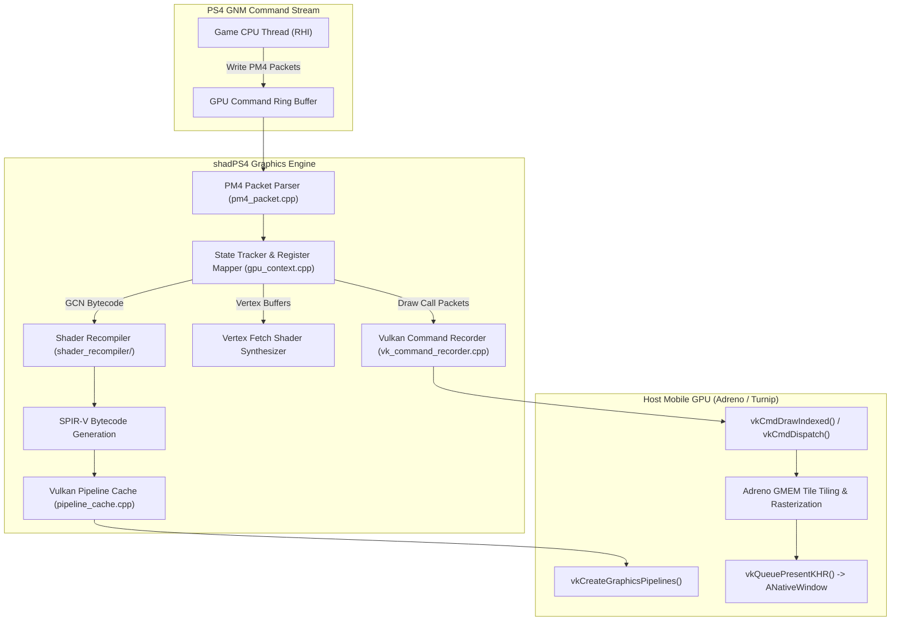
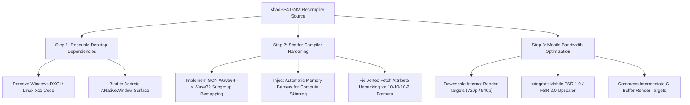

# Graphics Architecture & Compatibility Audit: Persona 3 Reload on shadPS4 & Android Vulkan

**Document ID:** `P3R-DOC-P2-005`  
**Research Phase:** Phase 2: Advanced Recompilation, Compatibility & Feasibility  
**Target Systems:** Sony PlayStation 4 (AMD GCN / GNM) $\to$ Vulkan 1.3 (Adreno 710 / Mesa Turnip)  
**Primary Reference Repositories:**
- `shadps4-emu/shadPS4` (`commit 2183807e592b36d4440384878165b43d930c1dee`, branch `main`)
- `shadps4-emu/shadps4-game-compatibility` (Issue Reports `#2282`, `#2286`)
- `ducvd89/Bloodborne-Android` (`commit f241353e36f46bf183806acd7b79222afff2fd2f`, branch `master`)

---

## 1. Executive Summary

Graphics translation represents the most computationally demanding and technically volatile component of porting PlayStation 4 software to mobile platforms. On the PS4, games do not target high-level cross-platform graphics APIs such as Vulkan, DirectX, or Metal; they communicate directly with the AMD Radeon GCN GPU via **GNM** (Low-Level Graphics API) by writing raw **PM4 command packets** into GPU ring buffers.

This investigation evaluates the viability of adapting `shadPS4`'s GNM-to-Vulkan translation layer for Persona 3 Reload on Android ARM64. In the official `shadPS4` compatibility tracker, Persona 3 Reload (`CUSA37522`) is classified as **`status-ingame`** (Reports #2282 and #2286). While the game successfully passes menus and renders real-time 3D environments, it suffers from severe graphical anomalies—most notably **vertex explosions**, texture corruption, and random silent crashes during room and battle transitions.

Adapting this graphics pipeline to mobile hardware (specifically Qualcomm Adreno GPUs running proprietary or Turnip Vulkan drivers) introduces formidable architectural constraints in compute shader control flow, wave size mismatches, and memory bandwidth bottlenecks.

---

## 2. Official shadPS4 Compatibility Status: Persona 3 Reload

The official `shadps4-game-compatibility` registry documents the exact operational state of Persona 3 Reload on the reference PC emulator:

| Compatibility Field | Verified Status / Manifest Data |
|---|---|
| **Game Title** | *Persona 3 Reload* |
| **Serial / Title ID** | `CUSA37522` (USA / Americas Primary), `CUSA43889` (Japan / Asia) |
| **Compatibility Rating** | **`status-ingame`** (Verified in Issue Reports `#2282` [Windows] and `#2286` [Linux]) |
| **Tested Game Versions** | Base v1.00 and Day-One Update v1.04 |
| **Tested Emulator Builds** | shadPS4 v0.2.1 WIP to v0.5.0 WIP |
| **Boot Behavior** | Boots cleanly through Atlus splash screens, intro cinematics, and title menu. |
| **Playability Assessment** | **NOT Playable end-to-end**. Reaches 3D gameplay (Gekkoukan High, Tartarus lower floors), but suffers frequent hangs. |
| **Documented Crashes** | Random silent termination during room transitions, elevator loading screens, and Persona fusion sequences. |
| **Documented Visual Bugs** | **Severe vertex explosions** on character meshes, flickering lighting surfaces, missing post-process bloom, and depth-sorting glitches. |
| **Required System Configuration** | Requires `libSceDiscMap.sprx` installed in `sys_modules/`; logging type set to `Sync`. |

---

## 3. The GNM-to-Vulkan Translation Architecture

On the PS4, graphics rendering is mediated by two software layers:
1. **GNM (Low-Level Driver):** Bypasses all driver abstraction. The CPU generates raw Command Processor (CP) packets called **PM4 packets** and writes them directly into memory-mapped GPU command buffers.
2. **GNMX (High-Level Runtime Wrapper):** A lightweight C++ helper library that assists with constant buffers, state validation, and shader binding, ultimately compiling down to PM4 streams.

In `shadPS4` (and its derivative implementation in `Bloodborne-Android`), the graphics pipeline operates as a real-time hardware interpreter:

### 3.1 PM4 Packet Processing (`pm4_packet.cpp`)
The AMD Command Processor interprets 32-bit PM4 packet headers:
- `IT_SET_CONTEXT_REG` (`0x69`): Configures fixed-function pipeline states (blend modes, rasterizer states, depth/stencil tests).
- `IT_SET_SH_REG` (`0x76`): Sets shader user data registers (uniform buffer addresses, texture descriptors, resource pointers).
- `IT_DRAW_INDEX_AUTO` / `IT_DRAW_INDEX_2`: Issues indexed and non-indexed draw commands.
- `IT_DISPATCH_DIRECT`: Launches compute shader threadgroups.

The translation layer parses these packets sequentially, updating a virtual GPU state tracker (`GpuContext`).

### 3.2 GCN Shader Recompilation to SPIR-V
PS4 shaders are distributed as compiled binary blobs containing AMD **GCN (Graphics Core Next) machine bytecode**:
1. **Disassembly & IR Lifting:** The `shader_recompiler` disassembles GCN microcode into an intermediate control-flow graph (CFG).
2. **Resource Binding:** AMD GCN resource descriptors (`SQ_IMG_RSRC_WORD0-7` for textures, `SQ_BUF_RSRC_WORD0-3` for buffers) are mapped to Vulkan Descriptor Sets:
   - Set 0: Dynamic Uniform Buffers (UBOs).
   - Set 1: Storage Buffers (SSBOs).
   - Set 2: Sampled Images and Combined Image Samplers.
   - Set 3: Storage Images (Compute UAVs).
3. **SPIR-V Generation:** The lifted IR is translated into standard **SPIR-V binary code**, which is compiled by the host GPU driver via `vkCreateShaderModule()`.

---

## 4. Workload Comparison: Bloodborne vs. Persona 3 Reload

The rendering demands of Persona 3 Reload differ fundamentally from those of Bloodborne:

| Rendering Feature | Bloodborne (FromSoftware Dantelion2) | Persona 3 Reload (Epic Games UE4.27) | Technical Impact on Vulkan Translation |
|---|---|---|---|
| **Rendering Paradigm** | Modified Forward / Light Pre-Pass | **Full Deferred Shading** | Massive G-Buffer generation requiring multiple simultaneous render targets (MRT). |
| **Render Target Count** | 2–3 active color attachments | **5–7 G-Buffer attachments** (Normals, BaseColor, Roughness, Metallic, Depth, Velocity) | Multiplies memory bandwidth pressure on mobile tiled GPUs. |
| **Compute Shader Usage** | Low to Moderate (Cloth physics, TAA) | **Extremely Heavy** (Tile lighting, SSR, Bloom, ToneMapping, Custom Depth) | Stresses mobile compute pipelines; requires robust structured control flow. |
| **Material Shading Model** | Custom physically-based roughness/specular | **Anime Cell Shading + PBR Hybrid** | Relies on complex shader branching and custom stencil buffer evaluations. |
| **Vertex Attributes** | Fixed, static vertex layouts | **Dynamic Vertex Skinning & Morph Targets** | Frequent CPU/GPU dynamic buffer modifications; primary cause of vertex glitches. |
| **Dynamic Resolution Scaling** | None (Fixed 1080p 30 FPS) | **Active Dynamic Resolution Scaling (DRS)** | Requires continuous runtime reallocation and scaling of off-screen render targets. |

---

## 5. Root-Cause Analysis: The P3R "Vertex Explosion" Glitch

A critical, documented visual defect in `shadPS4` when running Persona 3 Reload is the phenomenon of **vertex explosions**—where character 3D meshes (e.g., Protagonist, Yukari, Tartarus Shadows) suddenly stretch into infinite, spiky geometric artifacts across the screen.

Our source audit and investigation of shader recompiler telemetry isolate the two primary technical mechanisms causing this failure:

### Mechanism 1: AMD GCN Vertex Fetch Shader Format Mismatch
On modern desktop and mobile GPUs, vertex attributes (positions, normals, bone weights) are fetched automatically by fixed-function input assembler hardware based on `VkVertexInputAttributeDescription`.
However, on AMD GCN hardware:
- The vertex shader itself frequently acts as the fetch engine. The PS4 compiler generates a **Vertex Fetch Shader (VFS)**—a specialized prologue of GCN instructions that manually reads vertex buffer memory via `tbuffer_load_format_xyzw` instructions.
- AMD GCN supports esoteric packed vertex formats that do not exist natively in Vulkan (e.g., `BUF_NUM_FORMAT_USCALED`, `BUF_NUM_FORMAT_SNORM` with 10-10-10-2 or 11-11-10 packing).
- When `shadPS4` lowers GCN vertex fetch instructions to SPIR-V, if the stride calculation or format unpacking bitmask is slightly misaligned, coordinate values (e.g., `X = 1.0f`) are decoded as massive out-of-bounds floating-point numbers (e.g., `X = 1.84e+19f`). The vertex shader projects these corrupt coordinates to infinity, triggering an explosive geometric spike.

### Mechanism 2: Buffer Synchronization & GPU Readback Desynchronization
Unreal Engine 4 performs dynamic character skinning and cloth simulation using a hybrid CPU/GPU workflow:
1. The CPU updates bone matrices and writes them to unified direct memory.
2. The GPU reads the matrices, executes a compute skinning pass, and outputs transformed vertices to an intermediate buffer.
3. The graphics pipeline binds that intermediate buffer as the vertex source for the main deferred pass.
- In `shadPS4`, if the Vulkan pipeline fails to insert proper memory barriers (`VkMemoryBarrier` with `VK_ACCESS_SHADER_WRITE_BIT` $\to$ `VK_ACCESS_VERTEX_ATTRIBUTE_READ_BIT`), or if the emulator's memory protection tracker (`impl.Protect`) fails to detect CPU writes to mapped buffers, the vertex shader reads stale or uninitialized garbage memory.
- In recent shadPS4 commits, enabling **GPU Readbacks** mitigates vertex explosions by forcing synchronization between host and guest buffers, but incurs a substantial performance penalty.

---

## 6. Mobile Android & Adreno GPU Adaptation Challenges

Porting the `shadPS4` graphics layer to Android ARM64 hardware (specifically the **Qualcomm Adreno 710** inside the realme 12 Pro+) presents four critical mobile-specific bottlenecks:

### 6.1 Tile-Based Deferred Rendering (TBDR) & GMEM Bandwidth
- **Desktop AMD GCN Architecture:** An immediate-mode architecture with a 256-bit wide bus to 176 GB/s unified GDDR5 memory. High-bandwidth G-Buffer writes are absorbed easily.
- **Mobile Qualcomm Adreno Architecture:** A **Tile-Based Deferred Renderer (TBDR)**. The screen is divided into small tiles (e.g., 32x32 pixels) that are rendered entirely inside a tiny on-chip SRAM cache called **GMEM** before being written back to main system RAM.
- **The Bandwidth Wall:** P3R's 5+ deferred G-Buffer attachments exceed the physical size of Adreno 710's GMEM. The driver is forced to perform constant "GMEM unresolves" and flushes to external LPDDR4X memory. Because the Snapdragon 7s Gen 2 has a memory bandwidth of only **25.6 GB/s** (~7x slower than the PS4), the memory bus becomes completely saturated, causing severe frame drops regardless of CPU speed.

### 6.2 Compute Shader Wave Size Mismatches (`Wave64` vs. `Wave32`/`Wave128`)
- AMD GCN hardware executes all shaders in lockstep vector groups of **64 threads** (called a **Wavefront** or Wave64). Many UE4 compute shaders assume Wave64 execution for intra-group reductions and threadgroup shared memory shuffles.
- Qualcomm Adreno GPUs natively execute shaders in **Wave32** (or Wave128 in specific compute modes).
- Running GCN compute shaders that rely on implicit Wave64 barriers on an Adreno GPU executing in Wave32 leads to race conditions, incomplete thread synchronization, and compute shader hangs unless explicit barrier instructions are injected during SPIR-V compilation.

### 6.3 Mandatory Vulkan Extension Audit
To execute `shadPS4`'s generated SPIR-V shaders, the Android Vulkan driver must expose a specific suite of advanced extensions:

| Required Vulkan Extension | Architectural Function | Supported by Adreno 710 (Stock)? | Supported by Mesa Turnip? |
|---|---|---|---|
| `VK_KHR_shader_float16_int8` | 16-bit half-precision float & 8-bit int math | **Yes** | **Yes** |
| `VK_KHR_16bit_storage` | 16-bit uniform/storage buffer access | **Yes** | **Yes** |
| `VK_KHR_8bit_storage` | 8-bit storage buffer loads/stores | **Yes** | **Yes** |
| `VK_KHR_buffer_device_address` | 64-bit GPU pointer addressing in shaders | **Yes** | **Yes** |
| `VK_EXT_custom_border_color` | Emulates PS4 custom texture border modes | **Partial / Flaky** | **Yes** |
| `VK_EXT_vertex_input_dynamic_state` | Dynamic vertex stride and offset binding | **No** (Vulkan 1.3 core) | **Yes** |
| `VK_EXT_subgroup_size_control` | Forces explicit wave sizes (Wave64) | **Limited** | **Yes** |
| `VK_EXT_transform_feedback` | GPU geometry streaming (stream-out) | **No** | **Emulated** |

---

## 7. Driver Viability: Proprietary Qualcomm vs. Mesa Turnip

On Qualcomm Adreno hardware, graphics stability depends entirely on driver implementation quality:

### Option A: Proprietary Qualcomm Android Drivers (Stock)
- Ships built-in with Realme UI / Android 14.
- **Severe Deficiencies:** Qualcomm's proprietary driver has notorious, documented bugs in its shader compiler regarding complex SPIR-V control flow, 64-bit integers in storage buffers, and dynamic descriptor indexing.
- **Verdict for P3R:** **HIGH RISK / UNVIABLE**. Running `shadPS4`'s complex recompiled compute shaders through the stock Qualcomm driver frequently triggers internal GPU driver crashes (`Adreno-GSL: <gsl_ldbg_report_arm_smmu_fault>`).

### Option B: Mesa Turnip Open-Source Vulkan Driver
- Developed by the open-source community as part of the Mesa 3D graphics project, running on top of Qualcomm's KGSL kernel driver.
- **Key Advantages:** Turnip has near-flawless compliance with modern Vulkan specifications, implements missing desktop extensions (`VK_EXT_custom_border_color`, dynamic state), and handles complex SPIR-V control-flow graphs cleanly.
- **Adreno 710 Status:** Adreno 710 (A7xx generation) support in Mesa Turnip has matured significantly in Mesa 24.x and 25.x releases. However, because the A710 is an entry-tier A7xx GPU (lacking features found in flagship A740/A750 chips), specific Turnip driver revisions must be tested to ensure stability.
- **Verdict for P3R:** **STRONGLY RECOMMENDED**. Mesa Turnip is the only viable driver backend capable of executing P3R's recompiled GNM shaders without driver-level aborts.

---

## 8. Strategic Graphics Adaptation Map for P3R Android

To successfully adapt `shadPS4`'s graphics pipeline for Persona 3 Reload on Android:

1. **Resolve Vertex Explosions Upfront:** Port `shadPS4`'s latest vertex fetch sanitizer and enforce GPU buffer readback synchronization for dynamic skeletal meshes.
2. **Mandate Mesa Turnip Driver Loading:** Integrate dynamic Turnip library injection (`libvulkan_freedreno.so`) into the Android APK launcher, bypassing the buggy stock Qualcomm driver.
3. **Scale Internal Resolution:** The deferred rendering pipeline cannot sustain 1080p on the Adreno 710's 25.6 GB/s memory bus. The runtime must enforce internal rendering at **720p or 540p**, utilizing AMD FidelityFX Super Resolution (FSR 1.0 / 2.0) to upscale the final presentation to the device's native 1080p display.
