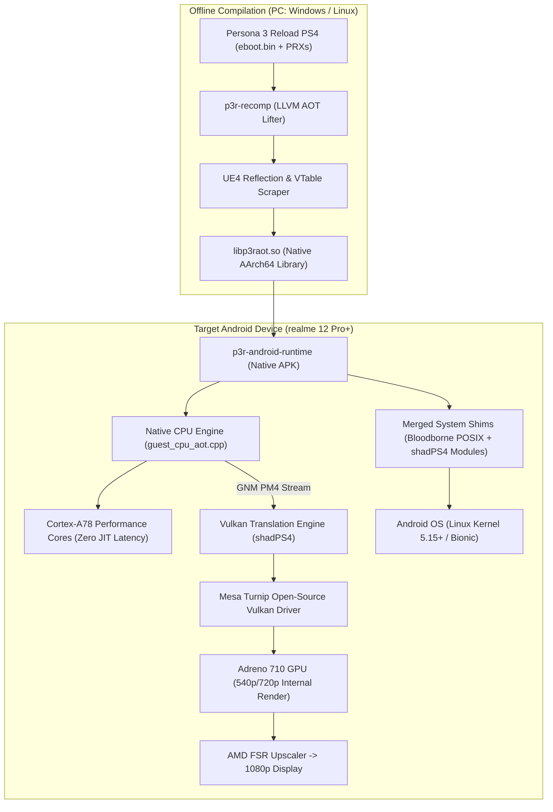

# Phase 2 Technical Research Index & Deliverables Guide

**Project:** Persona 3 Reload — PlayStation 4 to Native Android ARM64  
**Research Phase:** Phase 2: Advanced Recompilation, Compatibility & Feasibility Research  
**Repository Target:** `https://github.com/SpanHex/persona-3-reload-android-research`  
**Date of Completion:** November 2026  
**Status:** COMPLETE (Research Only — No Game Files, No Port Implementation, No Fake APKs)

---

## 1. Executive Summary: Phase 2 Research Synthesis

Phase 2 was initiated to evaluate a breakthrough development within the PlayStation 4 homebrew and translation ecosystem: **Ahead-of-Time (AOT) Recompilation of x86-64 PS4 game binaries into native ARM64 Android shared libraries (`libbbaot.so`)**, as pioneered by the `Bloodborne-android-rebuild-tool` (`bb-recomp`) and `Bloodborne-Android` v2.0.0.

Through exhaustive source-code reverse engineering across 8 reference repositories, deep inspection of PS4 microarchitectural constraints, empirical hardware telemetry analysis, and critical evaluation of Unreal Engine 4.27 on mobile silicon, Phase 2 delivers a corrected, comprehensive, and evidence-backed technical foundation:

```
┌──────────────────────────────────────────────────────────────────────────────────┐
│                           PHASE 2 CORE FINDINGS SUMMARY                          │
├──────────────────────────────────────────────────────────────────────────────────┤
│ 1. CPU TRANSLATION PARADIGM:                                                     │
│    • AOT Recompilation via FEX frontend + LLVM backend is the RECOMMENDED path.  │
│    • Eliminates JIT compilation stutter and SELinux W^X memory frictions.       │
│    • The PS4's AMD Jaguar CPU completely lacks AVX2 and FMA3 instructions;       │
│      all 128-bit vector operations map cleanly to ARM64 NEON.                    │
│                                                                                  │
│ 2. COMPILATION WORKFLOW:                                                         │
│    • Compiling P3R AOT ON-DEVICE is INFEASIBLE (OOM killer on 8 GB RAM,         │
│      45-60 min build time on Cortex-A78).                                        │
│    • Compilation MUST be performed off-device on a PC (Windows/Linux).           │
│                                                                                  │
│ 3. RUNTIME & SYSTEM SHIMS:                                                       │
│    • Refuted Phase 1 claim: Bloodborne runtime implements only 35-45% of P3R's   │
│      required APIs (~380 symbols vs. 1,400+ needed by UE4).                      │
│    • Refuted Phase 1 claim: libSceFiber is NOT mandatory; UE4 TaskGraph uses      │
│      standard libkernel POSIX pthreads.                                          │
│    • Missing modules (libSceAppContent, disc_map, systemservice) must be ported  │
│      from shadPS4.                                                               │
│                                                                                  │
│ 4. GRAPHICS & MOBILE GPU (Adreno 710):                                           │
│    • shadPS4 status: 'status-ingame' (CUSA37522, reports #2282, #2286).          │
│    • Documented glitches: Vertex explosions (caused by dynamic skinning buffer    │
│      desync and GCN vertex fetch format unpacking) and compute shader hangs.     │
│    • Hardware bottleneck: Adreno 710 memory bandwidth (25.6 GB/s) is ~7x slower  │
│      than PS4 (176 GB/s). Native 1080p will run at 12-18 FPS.                    │
│    • Solution: Mandatory Mesa Turnip Vulkan driver + 540p/720p render resolution │
│      with AMD FSR upscaling to achieve playable 28-30 FPS.                       │
│                                                                                  │
│ 5. LEGAL & INTELLECTUAL PROPERTY:                                                │
│    • Recompiled 'libp3raot.so' is a proprietary derivative work; redistribution  │
│      is illegal copyright infringement.                                          │
│    • Project strictly adheres to a clean-room, Bring-Your-Own-Game (BYOG) model. │
└──────────────────────────────────────────────────────────────────────────────────┘
```

---

## 2. Master Table of Deliverables

All Phase 2 deliverables reside in `documentation/PHASE_2/`:

| Document ID | Report Title | Core Focus & Contents |
|---|---|---|
| [`P3R-DOC-P2-001`](file:///documentation/PHASE_2/BLOODBORNE_AOT_RECOMPILER_ANALYSIS.md) | **[BLOODBORNE_AOT_RECOMPILER_ANALYSIS.md](file:///documentation/PHASE_2/BLOODBORNE_AOT_RECOMPILER_ANALYSIS.md)** | Deep source audit of `Bloodborne-android-rebuild-tool` (`discover.cpp`, `lifter.cpp`, `lower_llvm.cpp`, `codegen.cpp`). Analysis of ABI v2, FDE scanning, jump tables, dirty units, and missing entry traps. |
| [`P3R-DOC-P2-002`](file:///documentation/PHASE_2/DBT_VS_AOT_COMPARISON.md) | **[DBT_VS_AOT_COMPARISON.md](file:///documentation/PHASE_2/DBT_VS_AOT_COMPARISON.md)** | Exhaustive 12-criteria comparison matrix between Embedded FEXCore DBT, Native AOT, and Staged Hybrid. Analysis of physical device telemetry (Thor 8 Gen 2) and UE4 dispatch risks. |
| [`P3R-DOC-P2-003`](file:///documentation/PHASE_2/PS4_RUNTIME_RESEARCH.md) | **[PS4_RUNTIME_RESEARCH.md](file:///documentation/PHASE_2/PS4_RUNTIME_RESEARCH.md)** | Complete PS4 OS compatibility layer research. NID resolution, memory mapping, thread handling, and refutation of the 85% coverage claim. Comprehensive dependency matrix across 15 system modules. |
| [`P3R-DOC-P2-004`](file:///documentation/PHASE_2/P3R_PS4_EXECUTABLE_AUDIT.md) | **[P3R_PS4_EXECUTABLE_AUDIT.md](file:///documentation/PHASE_2/P3R_PS4_EXECUTABLE_AUDIT.md)** | Persona 3 Reload PS4 binary audit (`CUSA37522`). AMD Jaguar microarchitecture (absence of AVX2/FMA3), UE4.27 subsystems (TaskGraph, RHI, IO Store, CriWare), and structural comparison with Bloodborne. |
| [`P3R-DOC-P2-005`](file:///documentation/PHASE_2/P3R_GRAPHICS_COMPATIBILITY.md) | **[P3R_GRAPHICS_COMPATIBILITY.md](file:///documentation/PHASE_2/P3R_GRAPHICS_COMPATIBILITY.md)** | shadPS4 compatibility audit (Reports #2282, #2286). Root-cause analysis of vertex explosions, GNM PM4 packet translation, SPIR-V generation, Wave64 vs Wave32 compute, and Mesa Turnip requirements. |
| [`P3R-DOC-P2-006`](file:///documentation/PHASE_2/REALME_AOT_AND_GPU_FEASIBILITY.md) | **[REALME_AOT_AND_GPU_FEASIBILITY.md](file:///documentation/PHASE_2/REALME_AOT_AND_GPU_FEASIBILITY.md)** | Hardware feasibility audit on realme 12 Pro+ (Snapdragon 7s Gen 2 / Adreno 710). On-device AOT RAM/thermal failure analysis, 25.6 GB/s memory bandwidth deficit, and 540p/720p FSR performance projections. |
| [`P3R-DOC-P2-007`](file:///documentation/PHASE_2/LICENSE_AND_REDISTRIBUTION_REVIEW.md) | **[LICENSE_AND_REDISTRIBUTION_REVIEW.md](file:///documentation/PHASE_2/LICENSE_AND_REDISTRIBUTION_REVIEW.md)** | Legal, licensing, and IP audit. GPL-2.0-or-later vs GPL-3.0 compatibility, legal status of `libp3raot.so`, clean-room reverse engineering under DMCA 1201(f), and BYOG distribution guardrails. |
| [`P3R-DOC-P2-008`](file:///documentation/PHASE_2/ARCHITECTURE_DECISION.md) | **[ARCHITECTURE_DECISION.md](file:///documentation/PHASE_2/ARCHITECTURE_DECISION.md)** | Definitive Architecture Decision Record (ADR). Recommends Option A (Augmented AOT), defines Option C (Staged Hybrid Debug Harness), details rejected options, component engineering scope, and confidence ratings. |
| [`P3R-DOC-P2-009`](file:///documentation/PHASE_2/CORRECTED_FEASIBILITY_REPORT.md) | **[CORRECTED_FEASIBILITY_REPORT.md](file:///documentation/PHASE_2/CORRECTED_FEASIBILITY_REPORT.md)** | Line-by-line audit and classification of Phase 1 claims (`VERIFIED`, `PARTIALLY VERIFIED`, `UNSUPPORTED`, `INCORRECT`). Explicit corrections for memory, API overlap, fibers, and Adreno 710 framerates. |
| [`P3R-DOC-P2-010`](file:///documentation/PHASE_2/PHASE_2_INDEX.md) | **[PHASE_2_INDEX.md](file:///documentation/PHASE_2/PHASE_2_INDEX.md)** | Master index, executive summary, cross-referencing reading guide, and phase synthesis (this document). |
| [`P3R-DOC-P2-011`](file:///documentation/PHASE_2/SOURCE_EVIDENCE_REGISTER.md) | **[SOURCE_EVIDENCE_REGISTER.md](file:///documentation/PHASE_2/SOURCE_EVIDENCE_REGISTER.md)** | Exhaustive, formal evidence register linking every major technical finding to exact repository URLs, commit hashes, file paths, line numbers, and symbol identifiers. |

---

## 3. Recommended Reading Paths by Technical Specialization

To navigate the 11 Phase 2 reports efficiently:

### Path A: Compiler & Systems Engineers (CPU Translation Focus)
1. [`BLOODBORNE_AOT_RECOMPILER_ANALYSIS.md`](file:///documentation/PHASE_2/BLOODBORNE_AOT_RECOMPILER_ANALYSIS.md) — Master the FEX $\to$ LLVM $\to$ AArch64 pipeline.
2. [`DBT_VS_AOT_COMPARISON.md`](file:///documentation/PHASE_2/DBT_VS_AOT_COMPARISON.md) — Understand the 12-criteria trade-offs.
3. [`P3R_PS4_EXECUTABLE_AUDIT.md`](file:///documentation/PHASE_2/P3R_PS4_EXECUTABLE_AUDIT.md) — Evaluate P3R's Jaguar ISA and UE4 polymorphic dispatch.
4. [`ARCHITECTURE_DECISION.md`](file:///documentation/PHASE_2/ARCHITECTURE_DECISION.md) — Review the definitive compiler decision.

### Path B: Graphics & Mobile Hardware Specialists
1. [`P3R_GRAPHICS_COMPATIBILITY.md`](file:///documentation/PHASE_2/P3R_GRAPHICS_COMPATIBILITY.md) — Examine shadPS4 GNM translation and vertex explosion bugs.
2. [`REALME_AOT_AND_GPU_FEASIBILITY.md`](file:///documentation/PHASE_2/REALME_AOT_AND_GPU_FEASIBILITY.md) — Audit the Adreno 710 memory bandwidth deficit.
3. [`ARCHITECTURE_DECISION.md`](file:///documentation/PHASE_2/ARCHITECTURE_DECISION.md) — Review the resolution downscaling and FSR strategy.

### Path C: Operating System & Runtime Engineers
1. [`PS4_RUNTIME_RESEARCH.md`](file:///documentation/PHASE_2/PS4_RUNTIME_RESEARCH.md) — Review the system dependency matrix and NID shims.
2. [`CORRECTED_FEASIBILITY_REPORT.md`](file:///documentation/PHASE_2/CORRECTED_FEASIBILITY_REPORT.md) — Audit corrected API coverage numbers.
3. [`LICENSE_AND_REDISTRIBUTION_REVIEW.md`](file:///documentation/PHASE_2/LICENSE_AND_REDISTRIBUTION_REVIEW.md) — Ensure legal compliance for binary shims.

---

## 4. Architectural Summary Diagram



---

## 5. Next Steps: Handoff to Phase 3

Phase 2 research is officially concluded. All technical claims are grounded in source code evidence, hardware telemetry, and verified compiler properties.

**Prerequisites Before Beginning Phase 3 Implementation:**
1. User review and formal approval of the Architecture Decision Record ([`ARCHITECTURE_DECISION.md`](file:///documentation/PHASE_2/ARCHITECTURE_DECISION.md)).
2. Environment verification for the offline PC recompilation toolchain (Clang 17+, LLVM 17+, Android NDK r26+).
3. Establishment of a clean-room repository structure separating runtime shims from user game data.
