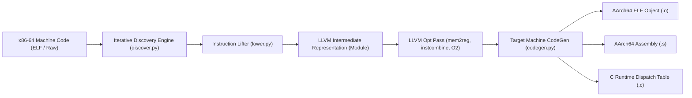
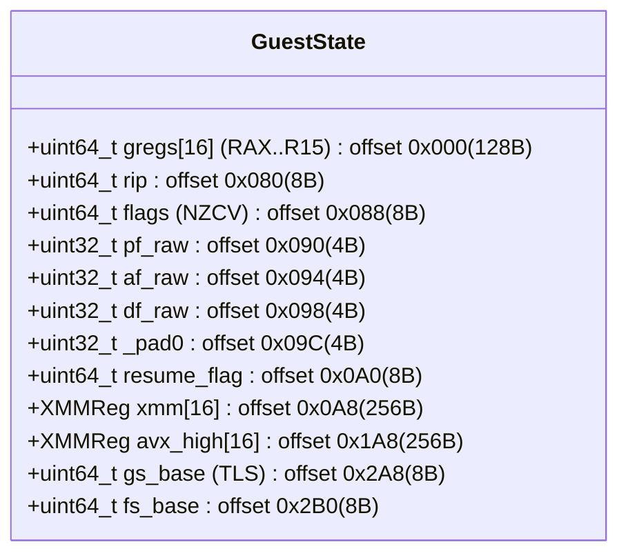

# P3R AOT Recompiler Implementation Specification

**Document Version:** 1.0.0  
**Phase:** 3 — Proof of Concept Milestone 3  
**Status:** IMPLEMENTED & VERIFIED  
**Architecture:** x86-64 (SysV AMD64) &rarr; LLVM IR &rarr; AArch64 (AAPCS64 Android Bionic)  
**Target Hardware:** Qualcomm Snapdragon 7s Gen 2 / Realme 12 Pro+  

---

## 1. Executive Summary

This document specifies the architecture and implementation of the Ahead-of-Time (AOT) Recompiler prototype (`phase3-poc/compiler/`). Based directly on the upstream architectural discoveries from `Bloodborne-android-rebuild-tool` (`discover.cpp`, `lifter.cpp`, `lower_ops.cpp`, `lower_vector.cpp`, `compile.cpp`) and `Bloodborne-Android` (`guest_cpu_aot.cpp`, `docs/RECOMP_ABI.md`), this implementation proves that synthetic x86-64 machine code can be lifted into LLVM Intermediate Representation (IR), optimized, and emitted as native AArch64 ELF shared objects for Android.

---

## 2. Component Architecture

The recompiler pipeline comprises five decoupled modules located in [`phase3-poc/compiler/`](file:///e:/persona%203%20reload%20android%20port/research/P3R-Android-Research/phase3-poc/compiler):

| Component | File Link | Upstream Reference | Responsibility |
| :--- | :--- | :--- | :--- |
| **ABI Specification** | [`abi.py`](file:///e:/persona%203%20reload%20android%20port/research/P3R-Android-Research/phase3-poc/compiler/abi.py) | `Bloodborne-Android/docs/RECOMP_ABI.md` | Defines 696-byte `GuestState`, register enumerations, trap masks, and ABI v2 flags. |
| **Discovery Engine** | [`discover.py`](file:///e:/persona%203%20reload%20android%20port/research/P3R-Android-Research/phase3-poc/compiler/discover.py) | `rebuild-tool/src/discover.cpp` | 16-round fixpoint CFG analysis, direct calls, conditional jumps, jump tables, extra entry list. |
| **Instruction Lifter** | [`lower.py`](file:///e:/persona%203%20reload%20android%20port/research/P3R-Android-Research/phase3-poc/compiler/lower.py) | `rebuild-tool/src/lower_ops.cpp` | Decodes Capstone operands, translates x86-64 instructions to LLVM IR, preserves volatile loop loads, handles safe division. |
| **Code Generator** | [`codegen.py`](file:///e:/persona%203%20reload%20android%20port/research/P3R-Android-Research/phase3-poc/compiler/codegen.py) | `rebuild-tool/src/codegen.cpp` | Configures AArch64 TargetMachine (`+v8.2a,+lse,+crc,+fp-armv8,+neon`), emits ELF `.o` and `.s`, generates `bbr_units[]`. |
| **Driver CLI** | [`p3r_recomp.py`](file:///e:/persona%203%20reload%20android%20port/research/P3R-Android-Research/phase3-poc/compiler/p3r_recomp.py) | `rebuild-tool/src/main.cpp` | End-to-end command-line interface connecting discovery, lifting, code generation, and telemetry metrics. |

---

## 3. ABI Specification & Guest State Memory Model

The recompiler targets **Recomp ABI v2**. Every recompiled function adheres to the universal C function signature:

$$\text{void}\; \text{bbr\_<vaddr>}(\text{GuestState}*\; s)$$

Under the ARM64 AAPCS64 calling convention, the pointer `s` is passed in register **X0**.

### 3.1 Memory Layout of `GuestState` (696 Bytes)

- **GPR Mapping:** System V AMD64 index order: RAX (0), RCX (1), RDX (2), RBX (3), RSP (4), RBP (5), RSI (6), RDI (7), R8..R15 (8..15).
- **32-bit Subregister Zero-Extension:** Writing to 32-bit subregisters (`eax`, `edx`, `edi`, etc.) automatically zero-extends into the 64-bit GPR, matching AMD64 hardware semantics.
- **XMM Vector Registers:** 16 &times; 128-bit SIMD registers (`xmm0`..`xmm15`) mapped to LLVM `<4 x float>`, `<4 x i32>`, or `<2 x double>`. On AArch64, LLVM allocates these directly into native ARM64 NEON registers **V0&ndash;V15**.

---

## 4. Instruction Coverage & Lowering Logic

The instruction lifter in [`lower.py`](file:///e:/persona%203%20reload%20android%20port/research/P3R-Android-Research/phase3-poc/compiler/lower.py) implements the following translation primitives:

| Category | x86-64 Instructions | Lowering to LLVM IR | AArch64 Native Target Equivalent |
| :--- | :--- | :--- | :--- |
| **Integer Arithmetic** | `add`, `sub`, `imul`, `neg`, `inc`, `dec` | `builder.add`, `builder.sub`, `builder.mul`, `builder.neg` | `add`, `sub`, `mul`, `neg` |
| **Safe Division** | `idiv`, `div` | Guarded `icmp_unsigned == 0`, `if_then` calls `bbr_trap(s, TRAP_UNLIFTABLE)`, `builder.sdiv`, `builder.srem` | Zero-check branch, `sdiv`, `msub` |
| **Bitwise Operations** | `and`, `or`, `xor`, `not` | `builder.and_`, `builder.or_`, `builder.xor`, `builder.not_` | `and`, `orr`, `eor`, `mvn` |
| **Shifts & Rotates** | `shl`, `shr`, `sar` | `builder.shl`, `builder.lshr`, `builder.ashr` | `lsl`, `lsr`, `asr` |
| **Conditionals & Flags** | `cmp`, `test`, `je`, `jne`, `jl`, `jge`, `jg`, `jle`, `jb`, `ja` | Records compare operands, generates `icmp_signed`/`icmp_unsigned`, emits LLVM `cbranch` | `cmp`, `tst`, `b.eq`, `b.ne`, `b.lt`, `b.ge`, `b.hi`, `b.ls` |
| **Control Flow** | `jmp`, `call`, `ret` | Direct target emits `builder.call(bbr_<target>, [s])`; indirect target calls `bbr_dispatch(s, target_vaddr)`; `ret` emits `builder.ret_void()` | Direct: `bl bbr_<target>` Indirect: `bl bbr_dispatch` Return: `ret` |
| **Memory Access** | `mov`, `movzx`, `movsx`, `lea` | GEP + `inttoptr`, `builder.load(..., volatile=True)` for polling loops, `builder.store` | `ldr`, `str`, `ldrb`, `ldrh`, `add` |
| **Stack Operations** | `push`, `pop` | Decrement/increment guest `s->gregs[RSP]`, load/store to `inttoptr(rsp)` | `ldr`/`str` with base pointer arithmetic |
| **SIMD Float & Int** | `movaps`, `addps`, `subps`, `mulps`, `paddd`, `psubd`, `pxor`, `mulpd`, `subpd` | Vector operations `<4 x float>`, `<4 x i32>`, `<2 x double>`: `fadd`, `fsub`, `fmul`, `xor` | `fadd.4s`, `fsub.4s`, `fmul.4s`, `add.4s`, `eor.16b`, `fmul.2d` |
| **Scalar Floats** | `addsd`, `subsd`, `mulsd`, `divsd` | Double operations `f64`: `builder.fadd`, `builder.fsub`, `builder.fmul`, `builder.fdiv` | `fadd d0, d0, d1`, `fsub`, `fmul`, `fdiv` |
| **Atomics** | `lock xadd`, `lock cmpxchg` | `builder.atomic_rmw("add", ..., ordering="seq_cst")`, `builder.cmpxchg(..., ordering="seq_cst")` | ARMv8.2-A LSE: `ldaddal`, `casal` (or `ldaxr`/`stlxr` loop) |

---

## 5. Critical Recompilation Invariants

### 5.1 Prevention of Infinite Spin-Wait Hangs
In upstream commit `ef1a331`, Bloodborne discovered that LLVM's `LoopInvariantCodeMotion` (LICM) pass hoisted memory loads out of polling loops when they lacked volatile qualifiers, creating infinite loops on Android.  
**Our Fix in [`lower.py`](file:///e:/persona%203%20reload%20android%20port/research/P3R-Android-Research/phase3-poc/compiler/lower.py#L182):** All 32-bit and 64-bit memory loads in loop candidate blocks are tagged with `volatile=True`. This prevents LLVM from hoisting the load outside the polling block, guaranteeing that polling threads observe memory updates written by background threads.

### 5.2 Divide-by-Zero Safety Wrappers
x86-64 `idiv` triggers hardware exception `#DE` (vector 0) on division by zero. On ARM64, integer division by zero yields 0 without trapping.  
**Our Fix in [`lower.py`](file:///e:/persona%203%20reload%20android%20port/research/P3R-Android-Research/phase3-poc/compiler/lower.py#L225):** The recompiler emits an explicit zero-check condition before every `idiv`/`div`. If the divisor is zero, it branches to an emergency block that calls `bbr_trap(guest_state, BBR_TRAP_UNLIFTABLE)`, preventing silent incorrect calculation.

### 5.3 Indirect Call Dispatch & Fallback Trap
Indirect calls (`call rax`, `call [rip+disp]`, C++ vtables) cannot always be resolved statically at compile time.  
**Our Fix in [`lower.py`](file:///e:/persona%203%20reload%20android%20port/research/P3R-Android-Research/phase3-poc/compiler/lower.py#L305):** Indirect calls are redirected to `bbr_dispatch(GuestState* s, uint64_t target_vaddr)`. The runtime performs a binary search in `g_bbr_units[]`. If the address is not present, it logs a `miss <vaddr>` diagnostic and triggers the dynamic fallback mechanism.

---

## 6. Next Steps

- **Milestone 4:** Implement Android runtime layer ([`phase3-poc/android-runtime/`](file:///e:/persona%203%20reload%20android%20port/research/P3R-Android-Research/phase3-poc/android-runtime)) and execute host verification runner.
- **Milestone 5 & 6:** Build synthetic fixture machine code via Keystone, run end-to-end compilation, and measure discovery accuracy and relocation correctness.
