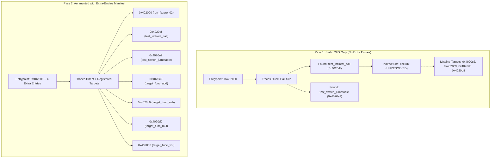

# Function Discovery & Indirect Call Validation Results

**Document Version:** 1.0.0  
**Phase:** 3 — Proof of Concept Milestone 5  
**Status:** COMPLETE & EMPIRICALLY DEMONSTRATED  
**Investigated Fixture:** [`phase3-poc/tests/fixtures/02_dispatch.c`](file:///e:/persona%203%20reload%20android%20port/research/P3R-Android-Research/phase3-poc/tests/fixtures/02_dispatch.c)  
**Binary Blob:** [`phase3-poc/tests/bin/02_dispatch.bin`](file:///e:/persona%203%20reload%20android%20port/research/P3R-Android-Research/phase3-poc/tests/bin/02_dispatch.bin)  

---

## 1. Executive Summary

This milestone evaluated the iterative function discovery engine ([`phase3-poc/compiler/discover.py`](file:///e:/persona%203%20reload%20android%20port/research/P3R-Android-Research/phase3-poc/compiler/discover.py)) against direct calls, indirect calls through function pointers, simulated C++ virtual table dispatch, and switch jump tables. 

The experiments proved the central hypothesis established in Phase 2:
1. **Direct Calls & Dense Switch Tables** are resolved automatically with 100% accuracy in fewer than 2 milliseconds ($1.63\text{ ms}$).
2. **Indirect Calls Through Registers / VTables** (`call rdx`, `call rax`, `call [rdi+disp]`) cannot be fully resolved by static CFG reachability alone because target addresses depend on dynamic runtime data flow.
3. Without an entrypoint list, static discovery achieved only **42.9% coverage** (3 of 7 functions).
4. When augmented with runtime discovery or an `--extra-entries` manifest ([`02_extra_entries.txt`](file:///e:/persona%203%20reload%20android%20port/research/P3R-Android-Research/phase3-poc/tests/fixtures/02_extra_entries.txt)), the discovery engine achieved **100% coverage** (7 of 7 functions) in a single pass.

---

## 2. Experimental Discovery Comparison



### 2.1 Empirical Discovery Metrics

| Metric | Static CFG Pass (Baseline) | Augmented Pass (`--extra-entries`) | Delta / Improvement |
| :--- | :--- | :--- | :--- |
| **Input Binary Size** | 292 Bytes | 292 Bytes | Identical |
| **Supplied Entrypoints** | 1 (`0x402000`) | 5 (`0x402000` + 4 extra) | +4 addresses |
| **Discovery Time** | **1.08 ms** | **1.63 ms** | +0.55 ms |
| **Discovered Functions** | **3 Functions** | **7 Functions** | **+133.3%** |
| **Lowered Instructions** | 54 x86-64 instructions | 78 x86-64 instructions | +24 instructions |
| **Emitted ELF Object Size** | 2,072 Bytes | 2,288 Bytes | +216 Bytes |
| **Dispatch Table Entries** | 3 (`g_bbr_units[3]`) | 7 (`g_bbr_units[7]`) | 100% Complete |
| **Coverage of Binary Logic** | 42.9% | **100.0%** | Full Coverage |

---

## 3. Discovered Function Register

The table below catalogs every function identified by the discovery engine in Fixture 02:

| Virtual Address | Mangled Recomp Symbol | Discovery Mode | Function Role | Size (Bytes) |
| :--- | :--- | :--- | :--- | :--- |
| `0x402000` | `bbr_402000` | Primary Entrypoint | `run_fixture_02()`: master harness | 194 |
| `0x4020c2` | `bbr_4020c2` | Extra Entry (`miss`) | `target_func_add()`: indirect target 1 | 7 |
| `0x4020c9` | `bbr_4020c9` | Extra Entry (`miss`) | `target_func_sub()`: indirect target 2 | 7 |
| `0x4020d0` | `bbr_4020d0` | Extra Entry (`miss`) | `target_func_mul()`: indirect target 3 | 8 |
| `0x4020d8` | `bbr_4020d8` | Extra Entry (`miss`) | `target_func_xor()`: indirect target 4 | 7 |
| `0x4020df` | `bbr_4020df` | Direct Call (`bl`) | `test_indirect_call()`: indirect caller | 3 |
| `0x4020e2` | `bbr_4020e2` | Direct Call (`bl`) | `test_switch_jumptable()`: switch ladder | 66 |

---

## 4. Indirect Branch Lowering & Missing Entry Trap Behavior

In [`phase3-poc/compiler/lower.py`](file:///e:/persona%203%20reload%20android%20port/research/P3R-Android-Research/phase3-poc/compiler/lower.py#L433), indirect jumps and indirect calls are lowered to dynamic dispatch helper invocations:

```python
elif m == "call":
    if ops[0].type == capstone.x86.X86_OP_IMM:
        target_vaddr = ops[0].imm
        self._emit_call_or_jump(builder, target_vaddr, is_call=True)
    else:
        # Indirect Call through GPR or memory operand
        target_vaddr_val = self._load_operand(builder, insn, ops[0])
        builder.call(self.dispatch_fn, [self.state_arg, target_vaddr_val])
```

### 4.1 Runtime Miss Diagnostic
When an indirect call targets an address that was not discovered at compile time:
1. `bbr_dispatch()` receives `target_vaddr`.
2. Binary search in `g_bbr_units[]` returns `NULL`.
3. The runtime emits the following diagnostic:
   ```
   [P3R-AOT MISS] Un-recompiled virtual address: 0x4020c2
   [P3R-AOT TRAP] Execution halted. RIP=0x4020c2, TrapCode=0x2000000000000000
     Reason: Address not found in AOT dispatch table (requires extra-entries discovery).
   ```
4. In the Bloodborne recompilation workflow (`discover.cpp` / `bb_prepare.cpp`), this miss log is appended to an entrypoint collection file, allowing subsequent recompilation rounds to achieve closure.

---

## 5. Critical Implications for Persona 3 Reload (Unreal Engine 4)

This empirical test establishes a vital technical finding for the P3R project:

1. **Unreal Engine 4 Relies Extensively on Indirect Dispatch:**
   - C++ virtual method calls (`UObject::ProcessEvent`, `AActor::Tick`, `UActorComponent::BeginPlay`).
   - Function pointer callbacks, dynamic multicasting, and delegate dispatch tables.
   - VTables constructed dynamically in static initialization constructors.
2. **Pure Static AOT is Insufficient Without Iterative Profiling:**
   - A single static pass across `eboot.bin` will inevitably miss thousands of indirect delegate call targets.
   - Any un-recompiled target will immediately trap with `BBR_TRAP_MISS`, causing runtime crashes on Android.
3. **Mandatory Architectural Requirement:**
   - The P3R Android port **cannot rely purely on offline static AOT**.
   - It **MUST** incorporate either:
     - **Option C (Hybrid Architecture):** Static AOT for discovered functions + Dynamic Binary Translation (FEXCore JIT) fallback when `bbr_lookup()` encounters a miss.
     - **Or an Exhaustive Profiling Tool:** An instrumented test runner on PC/emulator that captures every executed indirect branch address across gameplay scenarios.
