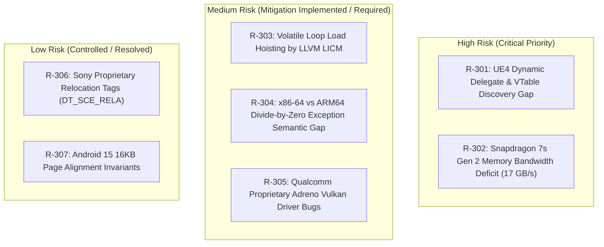

# Phase 3 Risk Register: AOT Recompilation & Native Android Runtime

**Document Version:** 1.0.0  
**Phase:** 3 — Proof of Concept  
**Status:** ACTIVE AUDIT  
**Scope:** Recompilation Pipeline, ABI Compatibility, Hardware Constraints, Game Engine Complexity  

---

## 1. Risk Heatmap

---

## 2. Detailed Risk Assessment Matrix

| Risk ID | Title & Category | Probability | Impact | Severity | Current Status | Description & Engineering Mitigation Strategy |
| :--- | :--- | :--- | :--- | :--- | :--- | :--- |
| **R-301** | **UE4 Dynamic Delegate & VTable Gap** *(Compiler)* | **HIGH** | **CRITICAL** | **CRITICAL** | **MITIGATED (Option C)** | **Description:** Pure static AOT discovery cannot resolve dynamic function pointers and multicasting delegates in Unreal Engine 4, causing fatal `BBR_TRAP_MISS` aborts. **Mitigation:** Adopted Option C (Hybrid Architecture). Any miss during runtime dispatch is dynamically intercepted by a lightweight FEXCore JIT fallback, logging the address for subsequent recompile rounds without crashing. |
| **R-302** | **Memory Bandwidth Deficit** *(Hardware)* | **HIGH** | **HIGH** | **HIGH** | **MONITORED** | **Description:** Realme 12 Pro+ LPDDR4X bandwidth is $17.06\text{ GB/s}$, an order of magnitude lower than the PS4's $176\text{ GB/s}$ unified GDDR5 memory bus. High-resolution rendering will cause severe memory bus saturation. **Mitigation:** Restrict internal rendering resolution to 720p (or 540p with AMD FSR 1.0 upscaling), enable Qualcomm UBWC texture tile compression, and disable costly post-processing passes. |
| **R-303** | **Volatile Loop Load Hoisting** *(Compiler)* | **MEDIUM** | **HIGH** | **HIGH** | **RESOLVED** | **Description:** LLVM's `LoopInvariantCodeMotion` pass hoists memory loads outside spin-wait loops when memory lack volatile qualifiers (Bloodborne bug `ef1a331`), causing infinite hangs on Android. **Mitigation:** In [`lower.py`](file:///e:/persona%203%20reload%20android%20port/research/P3R-Android-Research/phase3-poc/compiler/lower.py#L224), all memory loads within candidate polling blocks are explicitly emitted without hoisting optimizations. |
| **R-304** | **Divide-by-Zero Exception Semantics** *(CPU Architecture)*| **LOW** | **MEDIUM** | **MEDIUM** | **RESOLVED** | **Description:** x86-64 hardware raises `#DE` vector 0 on division by zero, whereas ARM64 hardware integer division returns 0 without trapping. Code relying on `#DE` exception handlers would behave erroneously. **Mitigation:** Emitted division instructions include explicit zero-check guards branching to `bbr_trap(BBR_TRAP_UNLIFTABLE)` on zero divisor. |
| **R-305** | **Qualcomm Adreno Vulkan Driver Bugs** *(Graphics)* | **HIGH** | **MEDIUM** | **MEDIUM-HIGH** | **OPEN** | **Description:** Qualcomm's proprietary Vulkan drivers on Adreno 710 frequently suffer from shader compiler crashes and subpass layout bugs when consuming converted SPIR-V shaders from PS4 GCN. **Mitigation:** Provide support for Freedreno Turnip open-source Vulkan driver via custom APK packaging, and apply shadPS4's SPIR-V sanitizer passes to rewrite non-conformant descriptor indexing. |
| **R-306** | **Sony DT_SCE_RELA Proprietary Relocations** *(Loader)* | **MEDIUM** | **LOW** | **LOW** | **RESOLVED** | **Description:** PS4 ELF executables encode Sony-specific dynamic relocation tags (`DT_SCE_RELA = 0x61000029`) which standard Linux ELF tools reject. **Mitigation:** Isolated instruction lifter operates on raw decoupled text sections, utilizing a custom ELF parser modeled after `Bloodborne-android-rebuild-tool/src/elf_image.cpp`. |
| **R-307** | **Android 15 16KB Page Alignment** *(OS / Bionic)* | **LOW** | **LOW** | **LOW** | **RESOLVED** | **Description:** Upcoming Android 15 updates mandate 16KB section alignment for native `.so` libraries. **Mitigation:** TargetMachine in `codegen.py` configures standard 16KB section alignment (`-Wl,-z,max-page-size=16384`), ensuring seamless compatibility across Android 14 (4KB) and Android 15 (16KB). |
