# Milestone 2: Synthetic Test Suite Specification & Executable Architecture

**Document ID:** `P3R-DOC-P3-002`  
**Research Phase:** Phase 3: AOT Recompilation Proof of Concept  
**Test Suite Directory:** `phase3-poc/tests/fixtures/`  
**Expected Manifest:** `phase3-poc/tests/expected/manifest.json`  
**Target Microarchitectures:** Guest x86-64 (AMD Jaguar Profile) $\to$ Host ARM64 (Cortex-A78)

---

## 1. Executive Summary & Purpose

Milestone 2 establishes a dedicated, reproducible, and legally unencumbered **synthetic test suite** designed specifically to stress-test the x86-64 to ARM64 AOT recompilation pipeline.

Per the strict scope limitations of Phase 3:
- **Zero commercial game code is used.** Persona 3 Reload and other commercial PS4 titles are completely excluded.
- The test suite is composed of five modular, deterministic C test fixtures written from scratch to isolate specific compiler and microarchitectural mechanisms: arithmetic, polymorphic dispatch, memory layout and relocations, SIMD vectorization, and concurrency/control flow.
- All expected outputs are mathematically modeled and committed to `phase3-poc/tests/expected/manifest.json` prior to compilation.

---

## 2. Test Fixture Inventory & Behavioral Coverage

The synthetic test suite consists of five specialized test programs located in `phase3-poc/tests/fixtures/`:

| Fixture ID | Source File | Core Architectural Capabilities Tested | Target Instructions / Mechanisms |
|---|---|---|---|
| **`01_arithmetic`** | `01_arithmetic.c` | • Integer 64-bit addition, subtraction, multiplication. • Signed/Unsigned division with div-by-zero guards. • Bitwise shifts, rotates, and bitwise logic. • Scalar single/double precision float arithmetic. • Deep recursion (Factorial of 10, Fibonacci of 12). | `ADD`, `SUB`, `IMUL`, `IDIV`, `DIV`, `SHL`, `SHR`, `XOR`, `AND`, `OR`, `CALL`, `RET`, SSE scalar float (`ADDSS`, `MULSS`, `DIVSS`, `CVTSS2SD`). |
| **`02_dispatch`** | `02_dispatch.c` | • Direct function calls and returns. • Indirect function pointer calls (`call *rax`). • Simulated C++ Virtual Table (vtable) object dispatch. • Dense jump tables (8-way switch statement lowering to `.rodata` address tables). • Callee-saved register preservation across calls. | `CALL reg`, `JMP [rip + reg*8 + disp]`, `LEA`, SysV callee-saved preservation (`rbx, rbp, r12-r15`). |
| **`03_memory_reloc`** | `03_memory_reloc.c` | • Global variables in `.rodata` and `.data`/`.bss`. • Nested structure pointer traversal (linked list). • RIP-relative data addressing and dynamic relocations. • Stack frame allocation and 16-byte stack alignment. | `MOV [rip+disp]`, `MOV [reg+disp]`, SIB addressing, stack pointer adjustments (`sub rsp, imm`). |
| **`04_vector_simd`** | `04_vector_simd.c` | • 128-bit packed single-precision float math (`v4sf`). • 128-bit packed integer arithmetic and bitwise (`v4si`). • 128-bit packed double-precision float math (`v2df`). • SIMD register loading, memory spilling, and conversions. | `ADDPS`, `MULPS`, `PADDD`, `PSUBD`, `PXOR`, `PAND`, `ADDPD`, `MULPD`, `MOVAPS`, `MOVUPS`. |
| **`05_control_concurrency`**| `05_control_concurrency.c`| • Spin-wait polling loops with memory loads. • Memory load preservation (verifying volatile load semantics). • Hardware atomic operations (`lock xadd`, `lock cmpxchg`). • Complex loop branching (`continue`, `break`, error status codes). | `LOCK XADD`, `LOCK CMPXCHG`, `PAUSE`, conditional jumps (`JNE`, `JE`, `JGE`, `JLE`). |

---

## 3. ELF Loader vs. Isolated Lifting Harness vs. Synthetic Executable Format

In analyzing how synthetic test programs interface with `bb-recomp`, we evaluate three distinct operational paradigms:

```mermaid
flowchart TD
    subgraph Option_1 ["Approach 1: Full PS4 ELF Loader (bb-prepare pipeline)"]
        A1["Standard Linux x86-64 ELF"] --> B1["❌ Fails: Missing Sony Magic (1S-ORBIS)"]
        B1 --> C1["❌ Fails: Missing DT_SCE_RELA (0x61000029)"]
        C1 --> D1["❌ Fails: Game Problem SHA-256 Check (bb_prepare.cpp L63)"]
    end

    subgraph Option_2 ["Approach 2: Modified PS4 ELF Packaging"]
        A2["Synthetic ELF"] --> B2["Inject Fake SELF Headers (0x4f153d1d)"]
        B2 --> C2["Rewrite Dynamic Tags to DT_SCE_*"]
        C2 --> D2["Fragile; requires maintaining fake console metadata"]
    end

    subgraph Option_3 ["Approach 3: Isolated Instruction-Lifting Test Harness (RECOMMENDED)"]
        A3["Compiled Synthetic C Fixtures"] --> B3["Standard x86-64 Object / ELF Extractor"]
        B3 --> C3["Clean-Room Lifter & LLVM Lowerer (FEX/LLVM Pipeline)"]
        C3 --> D3["Direct AArch64 Machine Codegen & Execution Harness"]
        D3 --> E3["✔ Deterministic, Clean, Zero Fake Headers, 100% Legal"]
    end
```

### Comparative Architectural Analysis:
1. **Approach 1 (Full PS4 Pipeline with `bb-prepare`):**
   - As audited in Milestone 1 (`REFERENCE_SOURCE_AUDIT.md`), `bb-prepare` strictly enforces Sony Orbis SELF headers (`0x4f153d1d`), rejects binaries whose SHA-256 does not match Bloodborne v1.09 (`bb_prepare.cpp` line 63), and expects Sony-specific relocation tags (`0x61000029`). Feeding a standard Linux test binary directly into `bb-prepare` fails immediately.
2. **Approach 2 (Synthetic PS4 Packaging):**
   - Involves writing a synthetic wrapper tool to fake Sony SELF headers, synthetic PRX tables, and custom NID hashes. While possible, this adds unnecessary engineering overhead without testing any additional compiler capabilities.
3. **Approach 3 (Isolated Instruction-Lifting Test Harness — Chosen):**
   - The test fixture source code is compiled into standard x86-64 machine code.
   - Our clean-room POC compiler (`phase3-poc/compiler/`) directly ingests the x86-64 machine instructions, parses function entries, performs iterative control-flow discovery, lowers the instructions to LLVM IR matching the Recomp ABI v2 `void bbr_<vaddr>(GuestState* s)` model, and compiles them to native AArch64 ELF objects via LLVM.
   - **Advantage:** Completely decouples compiler validation from proprietary console packaging, providing an auditable, reproducible testbench.

---

## 4. Expected Outputs & Verification Oracle

All expected return values have been mathematically calculated and committed to `phase3-poc/tests/expected/manifest.json`:

| Fixture ID | Entrypoint Function | Expected Output (Hexadecimal) | Expected Output (Decimal) | Verification Status |
|---|---|---|---|---|
| `01_arithmetic` | `run_fixture_01` | `0xd6e40c115e4f48b5` | `15484558237300742325` | **ORACLE DEFINED** |
| `02_dispatch` | `run_fixture_02` | `0x1b3f` | `6975` | **ORACLE DEFINED** |
| `03_memory_reloc` | `run_fixture_03` | `0x29f9f9e047` | `180287397959` | **ORACLE DEFINED** |
| `04_vector_simd` | `run_fixture_04` | `0x2e0bf311b` | `12360397083` | **ORACLE DEFINED** |
| `05_control_concurrency`| `run_fixture_05` | `0xfffffffffffffc8e` | `-882` (Two's Compl.) | **ORACLE DEFINED** |

---

## 5. Conclusion

The synthetic test suite established in Milestone 2 provides complete, isolated test coverage across all major CPU subsystems required by Persona 3 Reload's execution model. Proceeding to Milestone 3, we build the clean-room AOT compiler pipeline to lift and translate these fixtures into native ARM64 code.
