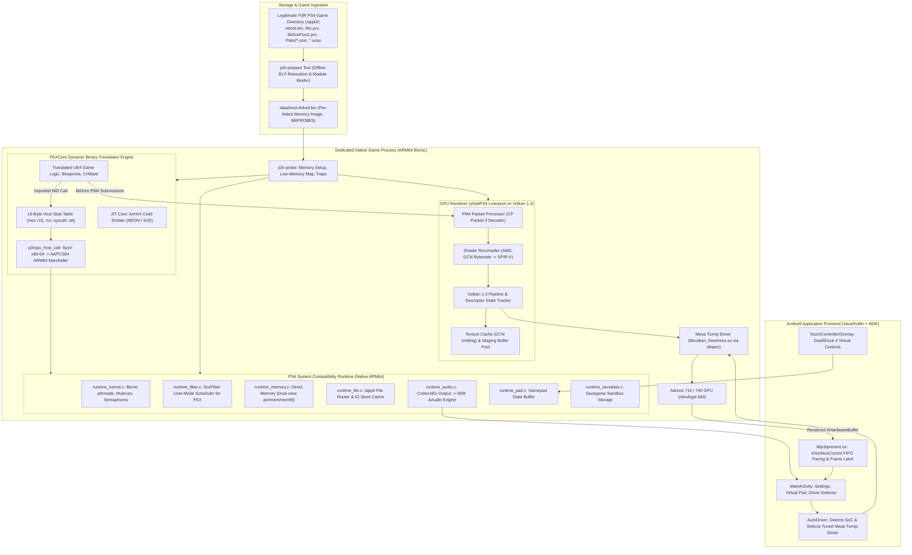

# Proposed Persona 3 Reload Android Architecture

**Document:** `documentation/PROPOSED_P3R_ANDROID_ARCHITECTURE.md`  
**Target Application:** Persona 3 Reload (PS4 ARM64 Android Port)  
**Investigation Date:** 2026-11-02  
**Status:** Architecture Proposal & Technical Evaluation  

---

## 1. Conceptual Execution Flow Evaluation

The proposed conceptual execution flow from the research brief is evaluated below:

```
PS4 P3R Executable (eboot.bin)
        |
        v
Executable and Module Loader (p3r-prepare / p3r-probe)
        |
        v
PS4 Compatibility Runtime (libkernel, libScePad, libSceFios2)
        |
        +--------------------+
        |                    |
        v                    v
FEXCore CPU Translation    Native System Replacements
(x86-64 -> ARM64 JIT)     (Bionic pthreads, ashmem, AAudio)
        |                    |
        +--------------------+
                 |
                 v
       Game Engine Execution (UE4.27 TaskGraph, Gameplay, Actors)
                 |
                 v
       Graphics Commands (libGnm PM4 Packets)
                 |
                 v
       PS4 Graphics Translation (shadPS4 Liverpool Video Core)
                 |
                 v
             Vulkan 1.3 (Pipelines, Render Passes, Descriptors)
                 |
                 v
        Android GPU Driver (Mesa Turnip / Adreno KGSL)
```

### Technical Evaluation: Is This Flow Technically Sound?
**VERDICT: YES, HIGHLY SOUND.**  
This architecture is not merely theoretical; it is the exact fundamental execution model proven in production by **Bloodborne Android v0.9.3**. 

However, adapting this model to **Persona 3 Reload** requires addressing three critical architectural divergences from Bloodborne:
1. **Unreal Engine 4 Concurrency & Fibers:** P3R runs Unreal Engine 4.27, which relies heavily on worker threads and `libSceFiber` (cooperative user-space fiber scheduling). The runtime must incorporate `runtime_fiber.c` (from Shadow of the Colossus PC) and adapt it to operate safely within FEXCore's simulated guest CPU context.
2. **Modern Deferred Rendering & Compute Shaders:** P3R's cel-shaded deferred renderer emits complex GCN compute shaders for lighting, outlines, Niagara particles, and post-processing. The vendored shadPS4 video core must be updated to include recent upstream control-flow and descriptor indexing fixes.
3. **Memory Pool Scale:** UE4's asset streaming and memory allocators require expanding direct physical memory mapping (`runtime_memory.c`) from 5 GiB to 6–8 GiB, while maintaining addresses below the 1 TiB boundary for 40-bit pointer packing.

---

## 2. End-to-End System Architecture



---

## 3. Subsystem Implementation Strategy

### 3.1. Component Reuse, Adaptation, and New Development

| Component | Source of Origin | Strategy | Required Modifications |
|---|---|---|---|
| **Android Launcher & UI** | Persona 5 Royal Android & Bloodborne Android | **REUSE (90%)** | Adopt P5R's clean UI, language selectors, settings, and touch editor; adapt paths for P3R. |
| **Presentation Pipeline** | Bloodborne Android (`libbbpresent.so`) | **REUSE (100%)** | Direct drop-in. Zero-copy `AHardwareBuffer` + `ASurfaceControl` over UNIX domain sockets. |
| **Game Preparation Tool** | Bloodborne Android (`tools/android/prepare/`) | **ADAPT (80%)** | Rename to `p3r-prepare`. Update `ps4.cpp` and `link.cpp` to parse UE4's `eboot.bin`, `libc.prx`, and `libSceFios2.prx`. |
| **CPU Translation Core** | FEXCore (`FEX-Emu/FEX`) | **REUSE (95%)** | Build FEXCore as a static library for ARM64 Bionic. |
| **CPU ABI Bridge** | Bloodborne Android (`guest_cpu_fex.cpp`, `host_call_arm64.S`) | **ADAPT (85%)** | Enlarge `stub_functions` capacity to accommodate UE4's larger import footprint; add fiber context hooks. |
| **`libSceFiber` Emulation** | Shadow of the Colossus PC (`runtime_fiber.c`) | **ADAPT (70%)** | Adapt x86-64 context switching so that fiber register swaps update FEXCore's `CPUStateFrame` rather than native host registers. |
| **PS4 System Runtime** | Bloodborne Android (`src/runtime_*.c`) | **ADAPT (80%)** | Expand direct memory pools in `runtime_memory.c`; add missing NIDs identified in shadPS4 compatibility logs. |
| **Audio Subsystem** | P5R Android (`AAudio`) & BB Android (`runtime_audio.c`) | **MERGE (85%)** | Route CriAtomEx PCM streams directly to Android NDK AAudio for minimal audio latency. |
| **GPU Video Core** | shadPS4 (`src/video_core/`) | **UPDATE / ADAPT (60%)** | Vendor modern shadPS4 main video core; incorporate latest compute shader control-flow fixes (`AF:structured_control_flow`) and vertex fetch fixes. |
| **Vulkan Driver** | Mesa Turnip (`mesa/mesa`) | **REUSE (100%)** | Pre-compile tuned Turnip builds with direct KGSL backend. |

---

## 4. Key Engineering Challenges & Mitigations

### Challenge 1: `libSceFiber` Context Switching inside FEXCore
- **Problem:** Unreal Engine 4 on PS4 schedules background tasks on fibers. SotC PC implements fibers using native x86-64 assembly (`movq %rsp, ...`). On Android, the code runs inside FEXCore's JIT. If a fiber switches guest stacks, FEXCore's internal call-return tracking stack (`callret_sp`) must remain consistent.
- **Mitigation:** Implement a guest-aware fiber helper in `guest_cpu_fex.cpp`. When `sceFiberSwitch` is invoked, update `frame->State.gregs[REG_RSP]` and rebind the thread's `callret_sp` to the new fiber stack before resuming JIT execution.

### Challenge 2: Unreal Engine 4 Compute Shaders & Structured Control Flow
- **Problem:** shadPS4 historically crashes on UE4 titles with `AF:structured_control_flow` assertions when compiling Niagara and lighting compute shaders.
- **Mitigation:** Pull the latest recompiler improvements from shadPS4 upstream (commits post-2026-10), which introduced improved dominator-tree control-flow reconstruction for GCN branch instructions.

### Challenge 3: Memory Budget on Mobile Devices
- **Problem:** Unreal Engine 4 + FEXCore JIT code cache + Vulkan pipeline caches + Mesa Turnip driver allocations can consume 5 to 7 GB of RAM. On devices with 8 GB of physical RAM, the Android Low Memory Killer (LMK) will terminate the process.
- **Mitigation:**
  - Implement texture downscaling in the texture cache (e.g. 1/2 resolution for 4K textures).
  - Clamp shadow map atlas resolution to 1024x1024.
  - Aggressively trim FEXCore JIT code cache for unvisited blocks.
  - Require a minimum of 8 GB RAM, with 12 GB+ recommended.

