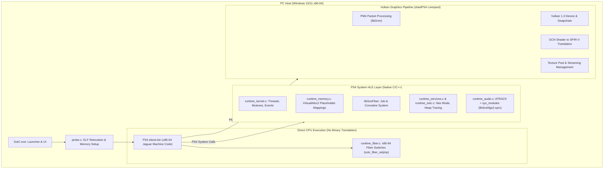

# Shadow of the Colossus PC Port Architecture & Technical Analysis

**Document:** `documentation/SHADOW_OF_THE_COLOSSUS_ANALYSIS.md`  
**Reference Repository:** `references/shadow-of-the-colossus-pc`  
**Source URL:** `https://github.com/AjncSystem/ShadowOfTheColossus-PC`  
**Commit Hash:** `cfbbfab9c94cf18f6b1ee34d64f005a305282931`  
**Branch:** `main`  
**License:** GNU General Public License v2.0 (`GPL-2.0`)  
**Investigation Date:** 2026-11-02  

---

## 1. Executive Summary & Architectural Scope

*Shadow of the Colossus PC* (Bluepoint Games, 2018; CUSA08809 / CUSA08034) is a native PC compatibility loader that adapts the PS4 x86-64 executable to run on 64-bit Windows systems. 

Unlike a full emulator, it operates as a **static-linked game loader and compatibility layer**:
1. The game's original `eboot.bin` x86-64 code runs **directly on the PC's x86-64 CPU**.
2. Imported PS4 system functions are hooked and resolved to native Win32/POSIX C routines.
3. The PS4's AMD GCN GPU commands (`libGnm` / PM4) are intercepted and translated to **Vulkan 1.3** using an adapted fork of shadPS4's Liverpool video core.



---

## 2. Fundamental Architectural Distinction: PC vs. Android

> [!CRITICAL]
> **Shadow of the Colossus PC DOES NOT solve the CPU ISA translation problem.**
> - Both the PS4 (AMD Jaguar) and modern PCs (Intel Core / AMD Ryzen) share the **x86-64** Instruction Set Architecture.
> - SotC PC simply `VirtualAlloc`s memory, maps the ELF segments, rebases addresses, and jumps directly to `entry` via a function pointer call `((Entry)(image + entry))(&params, guest_exit);`.
> - **This design CANNOT run on an Android ARM64 device** without inserting a dynamic binary translation (DBT) layer such as FEXCore.
> - However, SotC PC provides invaluable reference implementations for:
>   1. **`libSceFiber`**: Coroutine and job system emulation.
>   2. **Complex PS4 Virtual Memory Management**: Dual-view physical memory allocation, flexible memory, and page-fault tracking.
>   3. **Streaming & Texture Cache Management**: Resolving memory exhaustion when games stream gigabytes of open-world assets.
>   4. **Advanced Graphics Patches**: Barrier synchronizations, compute shader workarounds, and ultrawide render target rebinding.

---

## 3. Subsystem Breakdown

### 3.1. Executable Handling & Relocations

**Key Files:**
- `src/probe.c` (93,841 bytes)
- `src/import_names.inc` (41,232 bytes)
- `src/compat_win.c` & `src/compat_win.h`

#### Loading & Relocation Pipeline:
1. **SELF/ELF Parsing:** Similar to Bloodborne, the game's executable is an encrypted/signed PS4 ELF (`eboot.bin`). The toolchain requires a legitimately decrypted ELF.
2. **Segment Mapping (`src/runtime_memory.c#L368-L380`):**
   - Windows 10/11 supports `VirtualAlloc2` with `MEM_RESERVE_PLACEHOLDER`.
   - SotC PC reserves a contiguous 4 TiB virtual address space representing the PS4 user address space (`USER_MIN` to `USER_MAX`).
   - Replaces placeholder regions with mapped sections using `MapViewOfFile3`.
3. **Relocation Processing (`src/probe.c`):**
   - Resolves `R_X86_64_RELATIVE` (base rebase).
   - Resolves `R_X86_64_GLOB_DAT` and `R_X86_64_JUMP_SLOT`.
   - Imported NIDs that map to known host functions are wired to host stubs.
4. **Execution Bootstrap:**
   - Because the host is x86-64, calling guest code is trivial:
     ```c
     typedef void (ABI *Entry)(void *, void (ABI *)(void));
     ((Entry)(image + entry))(&params, guest_exit);
     ```

---

### 3.2. User-Mode Scheduling: `libSceFiber`

**Key Files:**
- `src/runtime_fiber.c` (404 lines)

*Shadow of the Colossus* relies heavily on Sony's fiber library (`libSceFiber`) to implement cooperative multitasking for background asset streaming, physics, and animation updates.

#### How `runtime_fiber.c` Implements Fibers:
- Uses a lightweight user-space context switch that saves only callee-saved registers (`RBX`, `RBP`, `RSP`, `R12`, `R13`, `R14`, `R15`, `FPU CW`, and `MXCSR`).
- `sotc_fiber_setjmp` and `sotc_fiber_longjmp` are implemented in handwritten x86-64 assembly (`src/runtime_fiber.c#L87-L150`):
  ```assembly
  sotc_fiber_setjmp:
      movq %rax, 0x00(%rdi)
      movq (%rsp), %rdx        /* return address, restored by longjmp */
      movq %rdx, 0x10(%rdi)
      movq %rbx, 0x18(%rdi)
      movq %rsp, 0x20(%rdi)
      movq %rbp, 0x28(%rdi)
      movq %r12, 0x50(%rdi)
      ...
      ret
  ```
- **Porting Challenge for Android ARM64:** On Android running under FEXCore, fiber contexts represent guest x86-64 execution state. If a guest program switches fibers, it expects guest registers and guest stacks to switch. FEXCore must properly handle stack switches and register restoration without corrupting host ARM64 call frames.

---

### 3.3. Memory Management & Streaming Stalls

**Key Files:**
- `src/runtime_memory.c` (78,840 bytes)
- `src/runtime_sotc.c` (23,713 bytes)

#### Solving the 5056 MiB Direct Memory Limit
On a retail PS4, `sceKernelGetDirectMemorySize` reports **5056 MiB**. In *Shadow of the Colossus*, streaming high-resolution assets and running in PS4 Pro mode quickly exhausted this memory, causing crashes in the game's allocator (`0x49800`).
- SotC PC allows expanding the direct memory pool via environment variable `BB_DMEM_MB`.
- Implements two views of direct memory:
  1. **Guest View:** Subject to GPU page-tracking write protections (`PROT_READ` / `PAGE_READONLY`) to detect CPU-side buffer modifications.
  2. **Backing Base View (`backing_base`):** Unprotected secondary view allowing host runtime I/O (e.g. streaming file reads) to write directly into guest memory without triggering spurious GPU dirty-page faults.

#### Fix for Area Transition Hitches & Speculative Readbacks
- In open-world games, streaming new chunks causes massive GPU/CPU memory thrashing.
- Version 0.60.6 resolved a major bug where speculative GPU readbacks wrote over memory that the game's allocator had already freed and reassigned, creating "rainbow texture garbage" and null-pointer crashes.
- SotC PC introduced texture cache flushing on save/load and read-ahead disk streaming queues.

---

### 3.4. PS4 Audio & System Modules

**Key Files:**
- `src/runtime_audio.c`
- `src/runtime_sotc.c`

#### Dual Audio Engine Approach:
1. **Standard Audio:** ATRAC9 decoding via HLE software decoders.
2. **Sony Sound Synthesis Modules:** For advanced audio graphs (`libSceNgs2.sprx` and `libSceUlt.sprx`), SotC PC allows copying the decrypted system modules from a PS4 console (`user/sys_modules`) and links them into the runtime, bridging NGS2 calls directly to the module.

---

## 4. Reusability Analysis for Persona 3 Reload on Android

| SotC PC Component | Technical Purpose | Reusable for P3R on Android? | Implementation Notes / Adaptations |
|---|---|---|---|
| **`libSceFiber` Implementation** | Cooperative fibers/jobs | **YES (with DBT translation)** | P3R and Unreal Engine 4 use task graphs and worker fibers. The logic in `runtime_fiber.c` is directly applicable, but context saving must operate on FEXCore's simulated `CPUStateFrame` instead of native host assembly. |
| **VirtualAlloc2 4 TiB Memory Map** | PS4 Address Space Reservation | **NO (Windows specific)** | Must use Linux/Android `mmap(..., MAP_NORESERVE)` below 1 TiB (as in Bloodborne Android's `runtime_low_map`). |
| **Direct Memory Dual-View** | Host I/O bypassing GPU page faults | **VERY HIGH** | Essential for Unreal Engine 4 file streaming (Pak / IO Store streaming into GPU-shared buffers). |
| **`sceKernelIsNeoMode` Handling** | PS4 Pro 60 FPS / 1440p toggle | **HIGH** | P3R has PS4 Pro enhancements; reporting Neo mode allows higher resolution/framerate profiles if desired. |
| **Direct x86-64 CPU Execution** | Host execution | **NO** | Android requires ARM64 translation via FEXCore. |
| **NGS2 Audio Module Loading** | Sony audio synthesis | **LOW** | P3R uses **CRI Middleware (CriAtomEx / ADX2)**, not Sony NGS2. |

